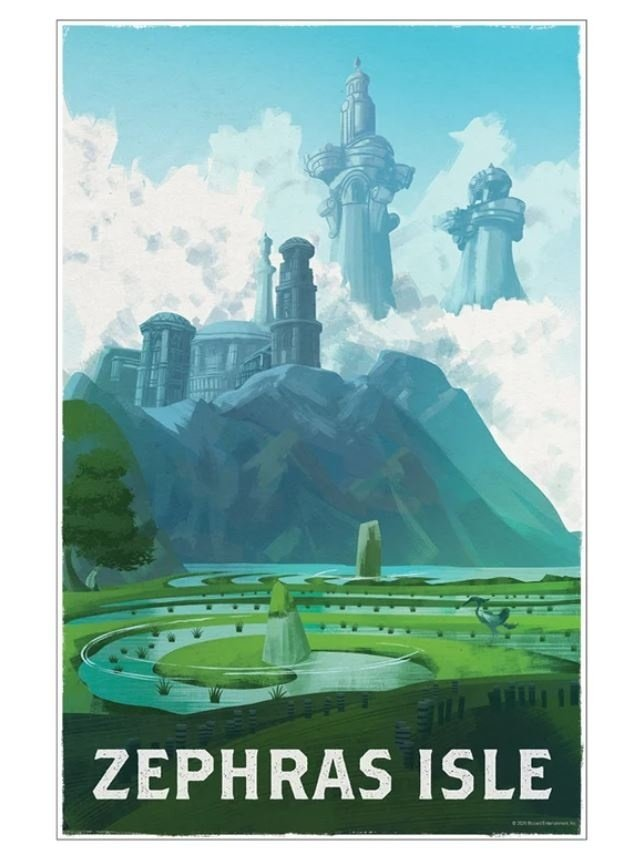
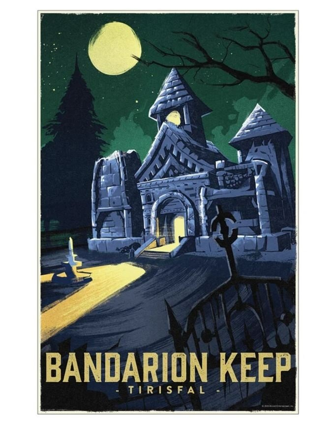
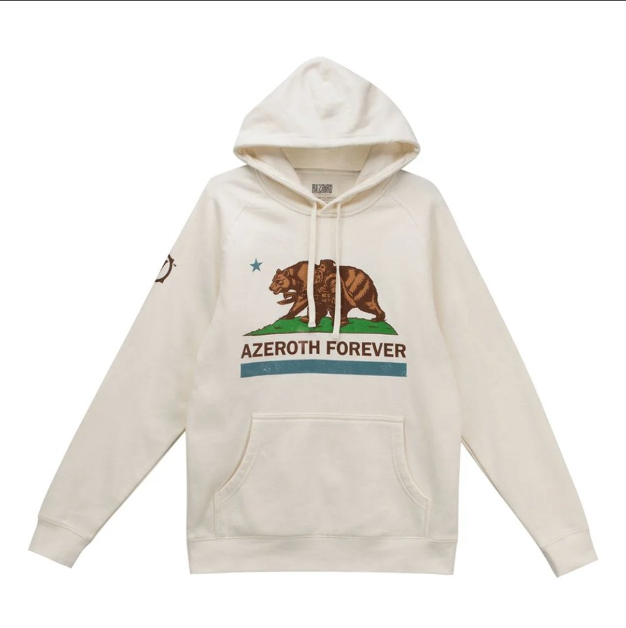

Der Blizzard Gear Store hat einen Black-Friday-Sale mit bis zu 60% Rabatt. Für World of Warcraft: Forever gibt es zwei Shirts mit Reisepostern vom Launch und ein Set mit vier dieser Poster. Bis zum 1. Dezember gibt eine Bestellung über 50 $ zudem drei Codes fürs Spiel.

## Forever im Sale

Das **Zephras Isle T-Shirt** und das **Dalaran T-Shirt** tragen die Reiseposter, mit denen Forever startete. Das **Travel Posters Gift Set** enthält die Drucke selbst: Zephras Isle, Dalaran, Mount Hyjal und Bandarion Keep in Tirisfal.

## Der Rest des Sales

Weitere WoW-Artikel im Sale sind der What Sword Hoodie von der Enthüllung der Worldsoul Saga, ein Alliance Quarter-Zip, eine Jacke mit Waffenmuster, ein Xal'atath T-Shirt, die Arcantina Heat Changing Mug, eine Replik der Rüstung von Darion Mograine und eine Arthas-Statue.

## Drei Codes ab 50 $

| | |
|---|---|
| Bis | 1. Dezember |
| Bedingung | Eine Bestellung über 50 $ an berechtigten Artikeln |
| Diablo IV | Refined Mind Trophy |
| WoW Midnight | Deep Winter Toque, ein Transmog |
| Overwatch | Legendary Cyberhog Skin |

Der Transmog ist für das moderne WoW, nicht für Forever. Nicht jeder berechtigte Artikel ist im Black-Friday-Sale. Der **Azeroth Forever Hoodie** zählt für die Codes, hat aber keinen Rabatt. Wie lange die Black-Friday-Preise gelten, sagt der Shop nicht. Preise in Euro und anderen Währungen können abweichen: schau im [Gear Store](https://gear.blizzard.com/) für deine Region nach.

