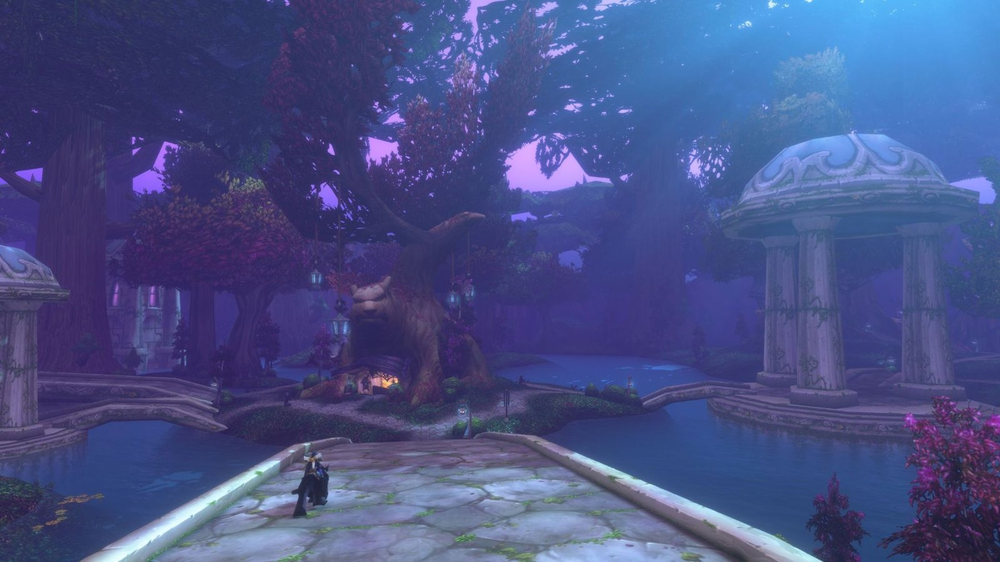
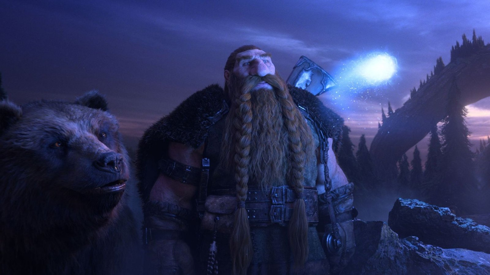

World of Warcraft: Forever bekommt keine Summoning Stones und keine Völker aus späteren Erweiterungen, sagt Blizzard in einem Interview. Teleports würden die Welt schrumpfen lassen. Die Klassen bleiben nah am Original, mit ein paar Mechaniken mehr, wo sie zu einfach waren.

Das Team prüft jede Änderung an vier Designsäulen: Nurture and Protect Social Experiences, Approachable and Familiar, World as the Main Character und Journey before destination. Zusammen sollen sie Design, Tempo und Ton des Originalspiels bewahren, sagt Blizzard.

## Keine Summoning Stones

Meeting Stones, die Spieler zu einem Dungeon oder Raid beschwören, kamen nach dem Originalspiel. Forever bekommt sie nicht. Komfortänderungen können eine oder mehrere Säulen leicht aushöhlen, sagt Blizzard, und Summoning Stones gehören dazu.

> Easy, quick access to teleports shrink the world, and marginalize part of the identity of a class like Warlock. Thus, it fails muster against 'Nurture and Protect Social Experiences' and 'World as the Main Character'.

Blizzard hat 22 Jahre an Daten darüber, wie Komfortänderungen das soziale Gefüge des Spiels beeinflusst haben. Forever geht einen anderen Weg, sagt das Team, und jedes Update wird an den Säulen gemessen.

## Einfachere Klassen, mit Tiefe

Die Klassen werden nicht modernisiert. Blizzard will "einfachere Klassen, aber mit fesselnder Tiefe". Manche Klassen in Classic waren zu einfach und haben ein paar Mechaniken dazubekommen. Die Komplexität der Klassen in der Beta zeigt, wohin das Team will.

Manche Klassen und Specs hatten starke Schwankungen in der Stärke oder langweiliges Gameplay, sagt Blizzard. Das Team will das verbessern, ohne den Kampf zu beschleunigen oder das Spiel schwer erlernbar zu machen. Die [Class Highlights](/de/news/warlocks-keep-their-sacrifice-and-their-demon/) zeigen viele dieser Änderungen.

## Dual Spec und Respecs

[Dual Spec](/de/news/dual-spec-may-unlock-before-level-40/) lernt man auf Level 40 gegen eine Gebühr, und mehr als zwei Specs sind nicht geplant. Respecs werden nicht billig. In der Beta ist der erste Respec jeder Stunde vorübergehend günstig. Zum Launch steigt der Preis schnell und sinkt nur einmal pro Woche.

Die Talententscheidungen der Spieler sollen Gewicht haben, sagt Blizzard. Weitere Respec-Möglichkeiten könnten später bei den Legacy-Talenten kommen.

## Anfangs jede Woche Balance

Klassenänderungen während der Beta kommen gebündelt, alle auf einmal. In den ersten sechs Monaten nach dem Launch erwartet Blizzard häufige Balanceänderungen, anfangs einmal pro Woche. Designänderungen nach dem Launch am 4. November sollen selten bleiben.

## Keine Goblins oder Vulpera

"Wir haben derzeit keine Pläne, Völker aus den Erweiterungen von WoW hinzuzufügen", sagt Blizzard. Vulpera, Goblins und Haranir kommen nicht. Das neue Volk von Forever sind die [Skyborne](/de/news/the-skyborne-choose-their-side/), gemacht für dieses Spiel.

Forever hat eine eigene Kontinuität und baut auf der Lore der Strategiespiele von Warcraft auf, ab dem Ende der neuen Kampagne Forsaken Kingdom von Warcraft 3. Die Geschichten bleiben bodenständig, sagt Blizzard. Spieler nehmen an großen Ereignissen auf subtilere Weise teil, wie im Originalspiel.

> You aren't THE hero in WoW: Forever, you are just A hero.

Forever könnte noch Orte aus späteren Erweiterungen besuchen, sagt Blizzard, aber dann in einer eigenen Version dieser Orte.
