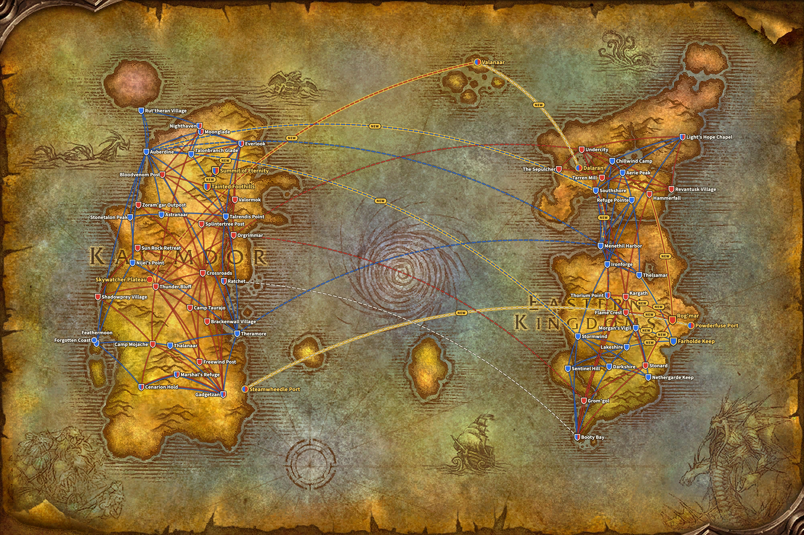
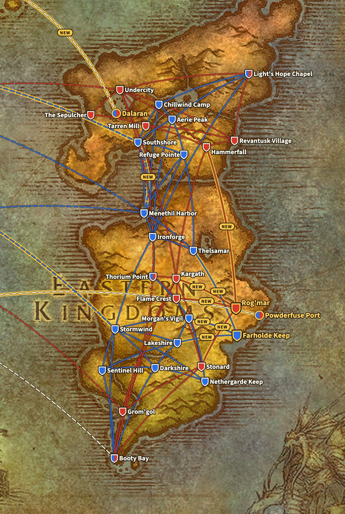
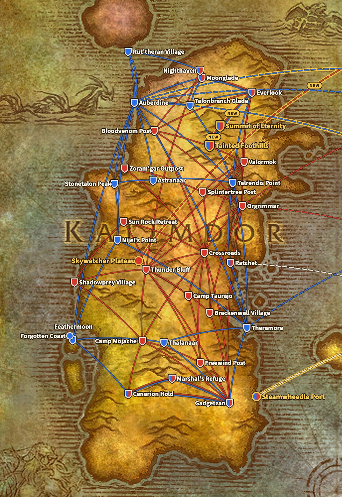
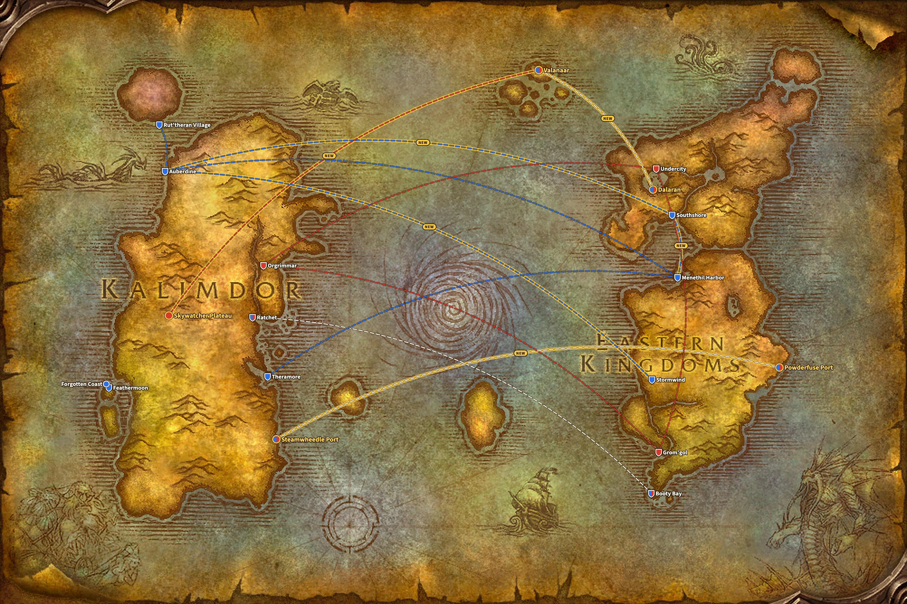

WoW Forever bekommt vier neue Flugpunkte: Farholde Keep und Rog'mar in The Riverglades sowie Tainted Foothills und Summit of Eternity auf Mount Hyjal. Zusammen bringen sie zehn neue Routen. Keine bestehende Route fällt weg, zeigen die Dateien des Live-Spiels.

*Aktualisiert am 9. November: In der Beta war Powderfuse Port in The Riverglades ein fünfter neuer Flugpunkt, mit einer Route nach Farholde Keep. Im Live-Spiel ist diese Route weg, deshalb zählt dieser Beitrag jetzt vier Flugpunkte und zehn Routen.*

## Woher die Routen stammen

Blizzard hat keine Liste der Flugrouten für Forever veröffentlicht. Die Routen auf dieser Seite stammen aus den Dateien des Live-Spiels, Build 1.60.1.70862. Sie stehen neben denselben Dateien von Classic Era, Build 1.15.9.69722.

Die Karte zeichnet jede Route als Linie zwischen zwei Orten, nicht so, wie der Flug im Spiel tatsächlich verläuft. So bleibt sie lesbar. Die Grundlage ist die Weltkarte aus dem Client von Forever, auf der The Riverglades schon östlich von Redridge Mountains liegt. Die Schiffe und Zeppeline stammen von derselben Weltkarte.

Eine blaue Linie ist eine Route der Alliance, eine rote Linie eine Route der Horde. Eine gestrichelte Linie ist ein Schiff oder ein Zeppelin, eine weiße gestrichelte Linie steht beiden Fraktionen offen. Eine Linie mit goldenem Rand und dem Wort NEW ist neu in Forever. Ein Schild ist ein Flugmeister, ein runder Punkt ein Hafen oder Zeppelinturm ohne Flugmeister. Ein Schild in Blau und Rot dient beiden Fraktionen, ein goldener Rand steht für einen neuen Ort.

## Die vier neuen Flugpunkte

| Flugpunkt | Zone | Für | Flugmeister | Fliegt nach |
|---|---|---|---|---|
| Farholde Keep | The Riverglades | Alliance | [Gretchen Mayberry](https://www.wowhead.com/forever/npc=257087) | Lakeshire, Thelsamar, Morgan's Vigil |
| Rog'mar | The Riverglades | Horde | [Grakna](https://www.wowhead.com/forever/npc=255993) | Stonard, Hammerfall, Kargath, Flame Crest |
| Tainted Foothills | Mount Hyjal | beide Fraktionen | [Bluebell](https://www.wowhead.com/forever/npc=260626) | Everlook, Summit of Eternity |
| Summit of Eternity | Mount Hyjal | beide Fraktionen | [Fayran Elthas](https://www.wowhead.com/forever/npc=41861) | Tainted Foothills |

[The Riverglades](/de/forever/) ist die neue Zone für Level 30 bis 45. Beide Fraktionen bekommen dort einen Flugpunkt, der die Zone mit ihren Nachbarn verbindet: Die Alliance fliegt nach Redridge Mountains, Loch Modan und Burning Steppes, die Horde nach Swamp of Sorrows, Arathi Highlands, Badlands und Burning Steppes.

Mount Hyjal ist das Finale des Levelns, mit einem Lager, in dem Horde und Alliance zusammen ausharren. Das zeigt sich auch in den Routen. Beide Flugpunkte auf dem Berg dienen beiden Fraktionen, und Tainted Foothills verbindet jede Seite mit Everlook in Winterspring.

## Alliance

Die Alliance erhält drei Flugpunkte und fünf Routen dazu. In den Eastern Kingdoms verbindet Farholde Keep mit Lakeshire, Thelsamar und Morgan's Vigil. In Kalimdor führt Everlook nach Tainted Foothills und von dort nach Summit of Eternity.

**Eastern Kingdoms, 17 Flugpunkte.** Bestehend: Aerie Peak, Booty Bay, Chillwind Camp, Darkshire, Ironforge, Lakeshire, Light's Hope Chapel, Menethil Harbor, Morgan's Vigil, Nethergarde Keep, Refuge Pointe, Sentinel Hill, Southshore, Stormwind, Thelsamar und Thorium Point. Neu: Farholde Keep.

**Kalimdor, 19 Flugpunkte.** Bestehend: Astranaar, Auberdine, Cenarion Hold, Everlook, Feathermoon, Gadgetzan, Marshal's Refuge, Moonglade, Nighthaven (für Druids, ab Rut'theran Village), Nijel's Point, Ratchet, Rut'theran Village, Stonetalon Peak, Talonbranch Glade, Talrendis Point, Thalanaar und Theramore. Neu: Tainted Foothills und Summit of Eternity.

## Horde

Die Horde erhält drei Flugpunkte und sechs Routen dazu. Rog'mar in The Riverglades hat vier Routen, nach Stonard, Hammerfall, Kargath und Flame Crest, genauso viele wie Farholde Keep. In Kalimdor bekommt die Horde dieselben zwei Punkte auf Mount Hyjal wie die Alliance.

**Eastern Kingdoms, 13 Flugpunkte.** Bestehend: Booty Bay, Flame Crest, Grom'gol, Hammerfall, Kargath, Light's Hope Chapel, Revantusk Village, Stonard, Tarren Mill, The Sepulcher, Thorium Point und Undercity. Neu: Rog'mar.

**Kalimdor, 22 Flugpunkte.** Bestehend: Bloodvenom Post, Brackenwall Village, Camp Mojache, Camp Taurajo, Cenarion Hold, Crossroads, Everlook, Freewind Post, Gadgetzan, Marshal's Refuge, Moonglade, Nighthaven (für Druids, ab Thunder Bluff), Orgrimmar, Ratchet, Shadowprey Village, Splintertree Post, Sun Rock Retreat, Thunder Bluff, Valormok und Zoram'gar Outpost. Neu: Tainted Foothills und Summit of Eternity.

## Classic Era und Forever im Vergleich

Eine Route ist hier ein direkter Flug zwischen zwei Flugpunkten. Ein Ort mit einem Flugmeister für jede Fraktion, etwa Everlook, zählt einmal pro Fraktion.

| | Classic Era | WoW Forever |
|---|---|---|
| Alliance, Eastern Kingdoms | 16 Punkte, 35 Routen | 17 Punkte, 38 Routen |
| Alliance, Kalimdor | 17 Punkte, 31 Routen | 19 Punkte, 33 Routen |
| Horde, Eastern Kingdoms | 12 Punkte, 22 Routen | 13 Punkte, 26 Routen |
| Horde, Kalimdor | 20 Punkte, 47 Routen | 22 Punkte, 49 Routen |

Jede Route aus Classic Era gibt es noch, mit demselben Start und Ziel. Forever fügt nur hinzu. Neben den Flugrouten kommen [drei neue Schiffsrouten](/de/news/wow-forever-three-new-ship-routes/), darunter ein Schiff von The Riverglades nach Steamwheedle Port in Tanaris. Mit dem Legacy-Perk Frequent Flier kostet ein Flug die Hälfte und ist 20 % schneller, siehe [die Übersicht zu Forever](/de/forever/).

Jeder Flugpunkt mit Flugmeister, Koordinaten und Routen steht im [Guide zu den Flugrouten](/de/guides/flight-paths/).

## Was nicht sicher ist

- **Powderfuse Port hat keine Flugroute.** In der Beta flog es nach Farholde Keep, im Live-Spiel ist diese Route weg. Der Hafen hat aber das Schiff nach Steamwheedle Port in Tanaris.
- **Ein weiterer Flugpunkt wartet**: Tidegear Coast in Dun Morogh steht in den Dateien, ohne eine einzige Route. Wofür er gedacht ist, ist nicht bekannt.
- **Die Routen können sich mit einem Hotfix oder Patch noch ändern.**
- **Zephras Isle hat keinen festen Platz** auf der Weltkarte in den Dateien. Die Karte setzt Valanaar, wo die neuen Zeppeline aus Dalaran und Skywatcher Plateau landen, auf die Inselgruppe nördlich des Maelstrom.
- **Wie lange ein Flug dauert**, steht nicht in diesen Dateien. Die Karte zeigt also, wo eine Route verläuft, nicht wie lange sie dauert.
