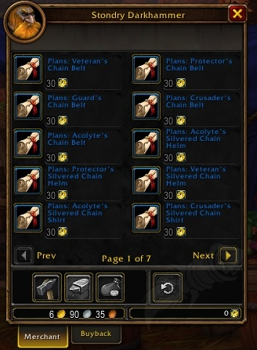

Paladine in World of Warcraft: Forever finden bis Stufe 30 keine Kettenrüstung mit Spell Power in Quests oder Dungeons. In der Beta geben nur grüne Items mit einem Suffix wie "of Magic" Spell Power. Der Ausweg ist Crafting.

## Zwei Questbelohnungen

Unter den Questbelohnungen der Beta tragen nur zwei Ketten-Items Spell Power, und beide sind eher für Heilung gedacht.

| Item | Stufe | Platz | Bonus |
|---|---|---|---|
| <a class="wf-wh wf-q2" href="https://www.wowhead.com/forever/item=270003">Garrison Cuffs</a> | 18 | Handgelenk | +2 Heilung, +1 Schaden |
| <a class="wf-wh wf-q2" href="https://www.wowhead.com/forever/item=270025">Silvered Gauntlets</a> | 27 | Hände | +9 Heilung, +3 Schaden |

Dungeons lassen nur Uncommon-Items mit einem zufälligen Suffix fallen, das Spell Power gibt, etwa "of Magic" oder "of the Knight". Das haben Tester bisher gefunden; ein Beweis, dass es nichts anderes gibt, ist es nicht.

## Nur der Paladin

Von Stufe 1 bis 30 trifft das eine Klasse. Der Paladin ist die einzige Klasse ohne Ausrüstung aus Quests oder Dungeons, die in diesen Stufen für ihn gemacht ist. Jede andere Klasse findet Teile für ihre Rolle.

## Stattdessen craften

Ein Paladin, der keine Upgrades im Auktionshaus kaufen will, muss sie herstellen. Die Pläne droppen in Dungeons oder werden für Merchant's Favor bei der [Azeroth Commerce Authority](/de/reputations/azeroth-commerce-authority/) und [Durotar Supply and Logistics](/de/reputations/durotar-supply-and-logistics/) verkauft. Alle Rezepte stehen unter [Blacksmithing für Forever](/de/tradeskills/forever/blacksmithing/).

Hergestellte Ausrüstung für niedrige Stufen ist neu in Forever. Ob Blizzard vor dem Launch noch Kettenrüstung mit Spell Power hinzufügt, ist nicht bekannt. Die Beta schließt am Freitag, 23. Oktober. Ein Talentbuild von 1 bis 60 steht im [Levelguide für den Paladin](/de/guides/paladin-leveling/).
