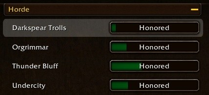

Skyborne-Spieler bekommen in World of Warcraft: Forever keinen Rabatt auf das Reittraining. Jedes andere Volk spart bei Honored mit der eigenen Fraktion 10 %, die Skyborne zahlen aber weiter die vollen 1.000 Gold für Journeyman Riding. Ihr Reitlehrer scheint die Ursache zu sein.

## Was der Rabatt wert ist

Reiten ist in Forever teuer. Du lernst es beim Reitlehrer deines eigenen Volkes; Lehrer anderer Völker bilden dich erst bei Exalted aus. Bei Honored mit deinem Volk gibt dir dein Lehrer 10 % Rabatt.

| Fertigkeit | Stufe | Tempo | Training | Reittier |
|---|---|---|---|---|
| <a class="wf-wh wf-spell" href="https://www.wowhead.com/forever/spell=33388">Apprentice Riding</a> | 40 | 60 % | 100 Gold | 20 Gold, das erste gratis |
| <a class="wf-wh wf-spell" href="https://www.wowhead.com/forever/spell=33391">Journeyman Riding</a> | 60 | 100 % | 1.000 Gold | 200 Gold |

## Warum die Skyborne leer ausgehen

Ein Spieler zeigte einen Screenshot mit Honored bei High Order, der Skyborne-Fraktion der Alliance, und Journeyman Riding weiter für 1.000 Gold.

<figure class="wf-embed wf-embed--reddit" data-wf-reddit="r/classicwow/comments/1xup8fk/dont_bother_getting_honored_with_the_skyborne">
  <button type="button" class="wf-embed__play">
    
    
      Don't bother getting Honored with the Skyborne
      Den Beitrag vom Subreddit classicwow laden.
    
  </button>
</figure>

Der Reitlehrer der Skyborne, <a class="wf-wh wf-plain" href="https://www.wowhead.com/forever/npc=265756">Genn Fairweather</a>, gehört zu keiner Fraktion, vielleicht weil dieser Lehrer beide Seiten bedient. Andere Reitlehrer wie <a class="wf-wh wf-plain" href="https://www.wowhead.com/forever/npc=7954">Binjy Featherwhistle</a> und <a class="wf-wh wf-plain" href="https://www.wowhead.com/forever/npc=4773">Velma Warnam</a> gehören dagegen zu einer Fraktion, und daher kommt höchstwahrscheinlich der Rabatt. Ob Blizzard das als Fehler sieht, ist nicht bekannt.

## Honored ist schwer zu erreichen

Nach Zephras Isle erhöhen keine Quests mehr deinen Ruf bei High Order oder bei den Windshapers, der Skyborne-Fraktion der Horde. Insgesamt geben etwa 70 bis 80 Quests Ruf bei ihnen, gegenüber mehr als 140 Quellen bei den Darkspear Trolls. Mitte vierzig sind die meisten Spieler bei den vier anderen Fraktionen ihrer Seite Honored.

Den Skyborne bleiben nur wiederholbare Abgabequests, etwa <a href="https://www.wowhead.com/forever/quest=99199">A Donation of Runecloth</a> bei <a class="wf-wh wf-plain" href="https://www.wowhead.com/forever/npc=276171">Oura Stormspinner</a>: 60 <a class="wf-wh wf-q1" href="https://www.wowhead.com/forever/item=14047">Runecloth</a> für 150 Ruf. Die Skyborne-Reittiere selbst stehen im [Reittier-Guide](/de/guides/mounts/).
