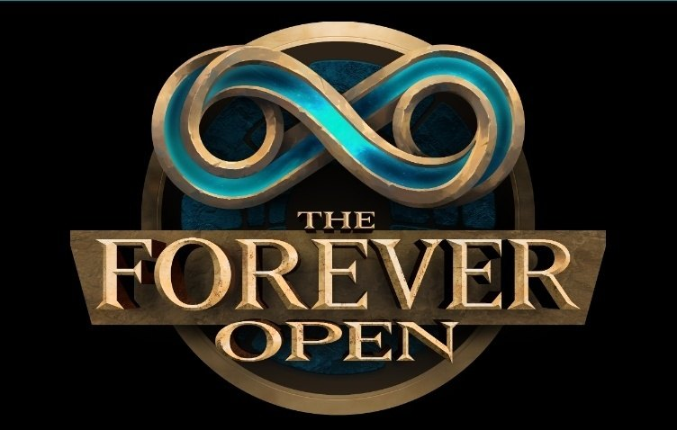

Warlocks gewannen im Finale der Forever Open, dem Duellturnier in der Beta, 79 % ihrer Duelle gegen andere Klassen. Am schlechtesten schnitten Mages ab, mit 25 %. Die Zahlen umfassen jedes Finalduell zwischen zwei verschiedenen Klassen.

## Siegquote pro Klasse

Ein Spieler zählte jedes Duell des Finales und teilte das Ergebnis auf Reddit. Duelle zwischen zwei Spielern derselben Klasse zählen nicht.

| Klasse | Siegquote | Siege-Niederlagen |
|---|---|---|
| **Warlock** | 79 % | 26-7 |
| **Shaman** | 63 % | 19-11 |
| **Paladin** | 55 % | 16-13 |
| **Druid** | 46 % | 12-14 |
| **Priest** | 43 % | 9-12 |
| **Hunter** | 39 % | 7-11 |
| **Rogue** | 31 % | 5-11 |
| **Warrior** | 27 % | 4-11 |
| **Mage** | 25 % | 4-12 |

Nur Warlocks, Shamans und Paladins gewannen mehr als die Hälfte ihrer Duelle. Das Turnier lief auf Level 30, auf Level 60 kann die Balance also ganz anders aussehen. Auch der Sieger war ein Warlock: [Warlockguy schlug Neepzen](/de/news/warlockguy-wins-the-50000-dollar-forever-open/), ebenfalls Warlock, im großen Finale.

<figure class="wf-embed wf-embed--reddit" data-wf-reddit="r/classicwow/comments/1x9ubp6/forever_duel_finals_win_rate_by_class">
  <button type="button" class="wf-embed__play">
    
    
      Forever Duel Finals: Win Rate by Class
      Den Beitrag vom Subreddit classicwow laden.
    
  </button>
</figure>

## Zwei Schmuckstücke

Zwei Schmuckstücke fielen im Finale auf: <a class="wf-wh wf-q2" href="https://www.wowhead.com/forever/item=276895">Transformative Cocoon</a> und <a class="wf-wh wf-q1" href="https://www.wowhead.com/forever/item=10577">Goblin Mortar</a>. Der Mörser half seinem Besitzer nicht immer. In einem Duell ging er gleich zweimal nach hinten los.

<figure class="wf-embed" data-wf-twitch="clip:CogentGiantCheetahOSfrog-TpfZ1PgavlaHoXbC">
  <button type="button" class="wf-embed__play">
    
    
      Doppelter Rohrkrepierer
      Den Clip auf Twitch abspielen.
    
  </button>
</figure>

## Ein Konzert und Azuregos

Blizzard gab den Finalisten einen eigenen Teil von Mount Hyjal, [Hyjal Crater](/de/news/blizzard-opens-hyjal-crater-for-the-forever-open/). Nach dem Turnier traten dort die Tauren Chieftains auf. Danach ließen Gamemaster Azuregos zwischen den Spielern erscheinen.

<figure class="wf-embed" data-wf-twitch="clip:TentativeIcyOilAMPEnergy-DQTmuRkXSV5dRNtf">
  <button type="button" class="wf-embed__play">
    
    
      GMs lassen Azuregos nach dem Turnier erscheinen
      Den Clip abspielen. EsfandTV auf Twitch.
    
  </button>
</figure>

TipsOut organisierte die Forever Open, mit [100.000 Dollar an Preisgeld](/de/news/the-beta-dueling-tournament-now-pays-100000-dollars/).
