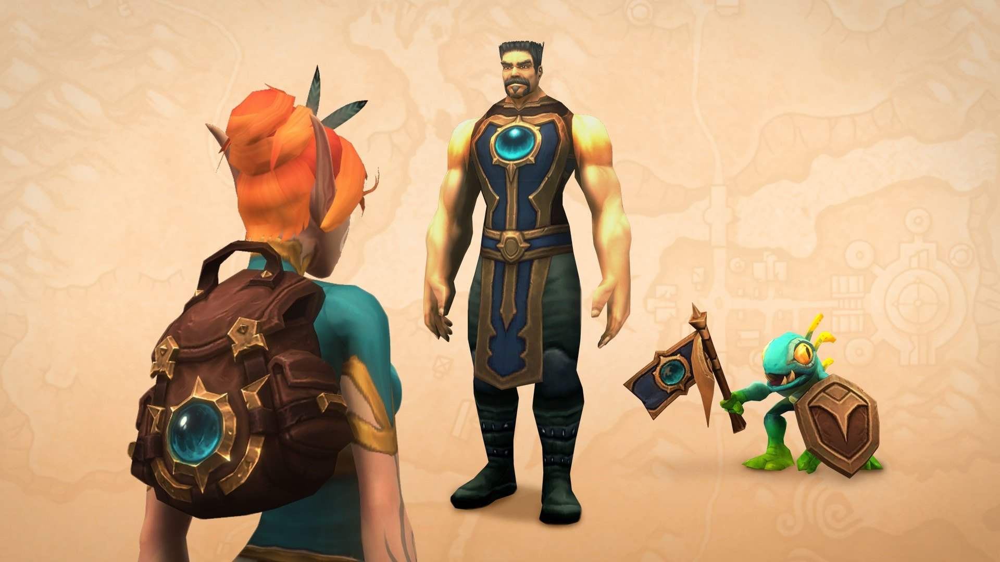
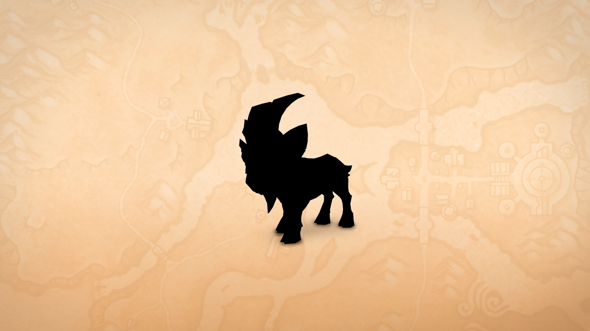

Spieler mit einem laufenden 12-Monats-Abo von World of Warcraft erhalten neue Belohnungen im Bereich Gifts der Battle.net-App. Für WoW Forever sind das ein Wappenrock, ein Rucksack und ein Murloc als Pet. Blizzard bestätigte das Angebot für Europa und Amerika am 15. Oktober.

## Was Forever-Spieler bekommen

Die Belohnungen für Forever sind der <a class="wf-wh wf-q4" href="https://www.wowhead.com/forever/item=285352">Tabard of Eternal Exploration</a>, der <a class="wf-wh wf-q3" href="https://www.wowhead.com/forever/item=285353">Eternal Explorer's Backpack</a>, ein Transmog für den Umhang, und das Haustier <a class="wf-wh wf-q4" href="https://www.wowhead.com/forever/item=285354">Azurky</a>, ein blauer Murloc mit einem Banner. Alle drei tragen dasselbe blau-goldene Emblem. WoW Forever selbst erscheint am 4. November.

Der Forever-Teil des Pakets zeigt außerdem ein geschwärztes Pet in Form einer Ziege. Was es ist und wann es kommt, sagt Blizzard nicht. 2027 ist im chinesischen Kalender das Jahr der Ziege. Blizzard nennt es den Sechsmonatsbonus zum Mondneujahr, der bis zum 31. Januar 2027 enthüllt und geliefert wird.

## Blizzard bestätigt das Angebot

Am 15. Oktober [kündigte Blizzard das Angebot an](https://worldofwarcraft.blizzard.com/en-gb/news/24310658/unlock-a-year-of-world-of-warcraft-and-get-bonus-treasures), auch für Europa und Amerika. Es gilt für ein 12-Monats-Abo oder 365 Tage Spielzeit sowie für die besonderen Abo-Angebote über 6 und 12 Monate. Die Boni kommen bis zum 31. Oktober 2026 und müssen bis zum 30. April 2027 eingelöst werden. Wappenrock und Rucksack sind Transmogs, und die drei Belohnungen funktionieren nur in Forever.

Wer schon für 12 Monate zahlt, lässt die automatische Verlängerung mit einem künftigen Datum eingeschaltet. Dann gibt es den 12- und den 6-Monats-Bonus ohne Aufpreis, über die Battle.net-App.

## Zuerst in China angekündigt

Anders als frühere Abo-Belohnungen wurde dieser zweite Teil der Jahresaktion in Nordamerika und Europa zunächst nicht angekündigt. Bekannt war das Paket, weil WoW China wenige Tage zuvor ein ähnliches angekündigt hatte. MrGM teilte die chinesische Ankündigung am 12. Oktober auf X:

<figure class="wf-embed wf-embed--x" data-wf-x="2109628613632938168">
  <button type="button" class="wf-embed__play">
    
    
      MrGM über das Paket für das Jahresabo in China
      Den Beitrag von X laden.
    
  </button>
</figure>

## Die anderen Spielversionen

Retail-Spieler bekommen zwei Reittiere, den Ashen Dreadglider und den Giant Grrloc, dazu eine geschwärzte Ziege als Reittier für später. In MoP Classic ist die Belohnung der Cerulean Drake, mit demselben geschwärzten Ziegen-Pet wie in Forever.

Das Reittier Sunflare Driftmoth und das Kampfhaustier Sunflutter Driftmoth gehören nicht zu dieser Runde. Sie waren die Belohnung für sechs Monate im Juli und wurden bereits verteilt.
