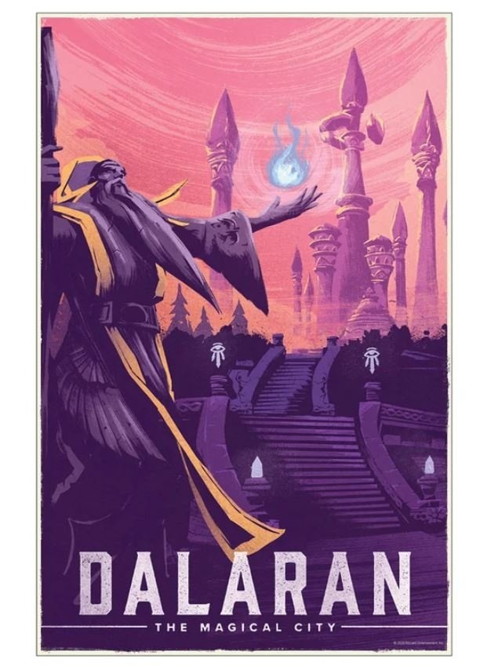
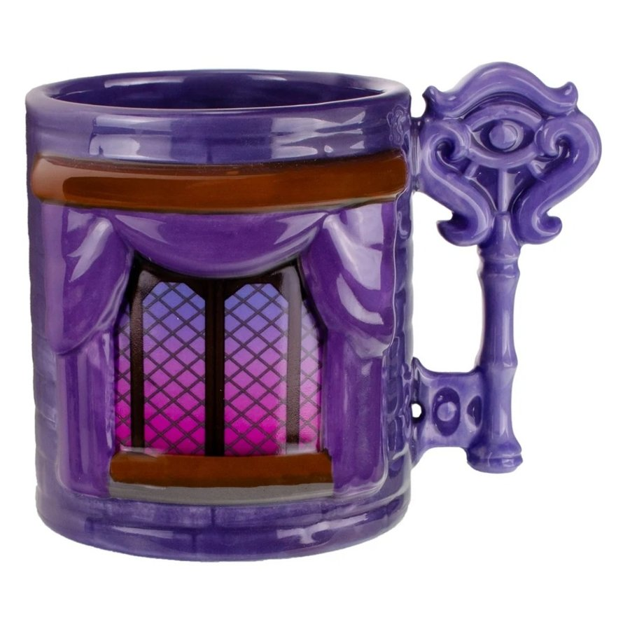

The Blizzard Gear Store has a Black Friday sale with up to 60% off. For World of Warcraft: Forever there are two shirts with travel posters from the launch and a set with four of those posters. Until 1 December, an order above $50 also gives three in-game codes.

## Forever in the sale

The **Zephras Isle T-Shirt** and the **Dalaran T-Shirt** carry the travel posters that Forever launched with. The **Travel Posters Gift Set** has the prints themselves: Zephras Isle, Dalaran, Mount Hyjal and Bandarion Keep in Tirisfal.

## The rest of the sale

Other WoW items in the sale are the What Sword Hoodie from the reveal of the Worldsoul Saga, an Alliance Quarter-Zip, a jacket with weapons, a Xal'atath T-Shirt, the Arcantina Heat Changing Mug, a replica of Darion Mograine's armor and an Arthas statue.

## Three codes above $50

| | |
|---|---|
| Until | 1 December |
| Condition | An order above $50 of eligible items |
| Diablo IV | Refined Mind Trophy |
| WoW Midnight | Deep Winter Toque, a transmog |
| Overwatch | Legendary Cyberhog Skin |

The transmog is for modern WoW, not for Forever. Not every eligible item is in the Black Friday sale. The **Azeroth Forever Hoodie** counts for the codes, but has no discount. How long the Black Friday prices last, the store does not say. Prices in euros and other currencies can differ: check the [Gear Store](https://gear.blizzard.com/) for your region.

