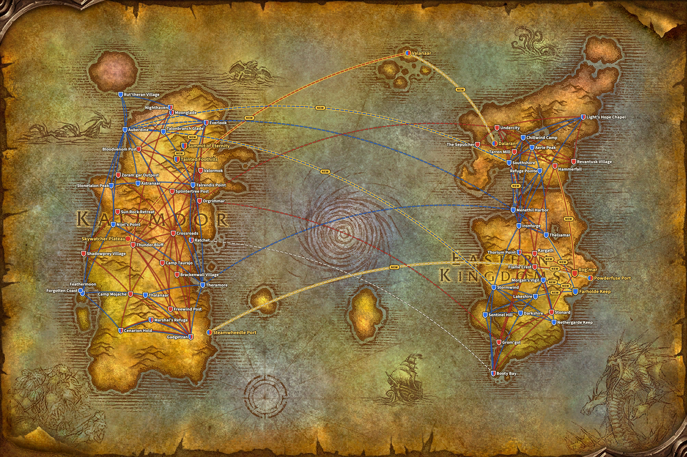
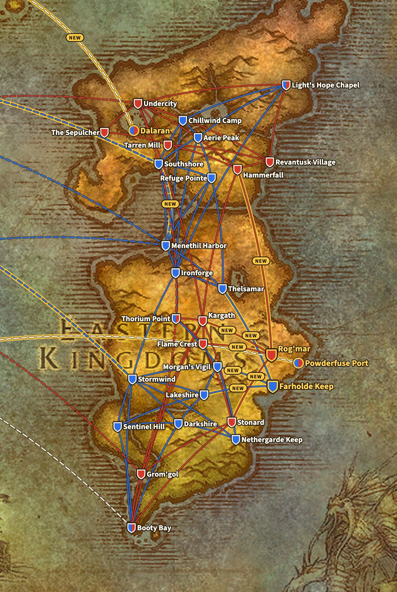
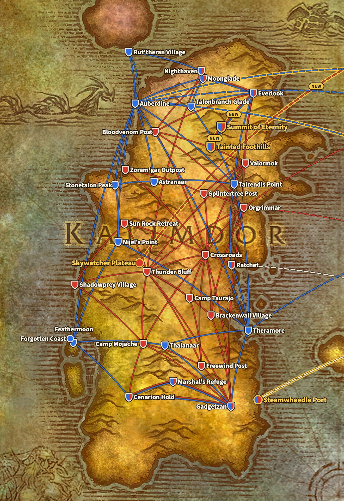
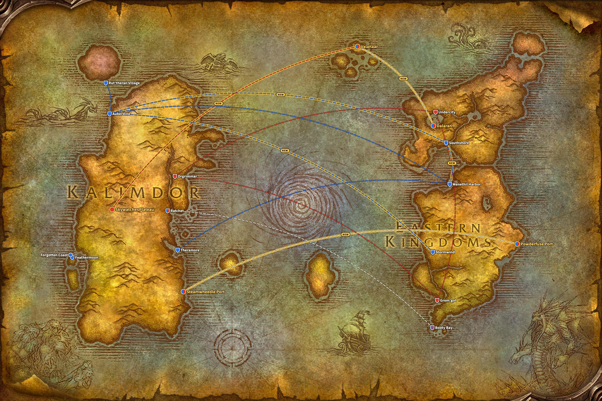

WoW Forever adds four flight points: Farholde Keep and Rog'mar in The Riverglades, and Tainted Foothills and Summit of Eternity on Mount Hyjal. Together they bring ten new routes. No existing route disappears, the files of the live game show.

*Updated on 9 November: in the beta, Powderfuse Port in The Riverglades was a fifth new flight point, with a route to Farholde Keep. That route is gone in the live game, so this post now counts four flight points and ten routes.*

## Where the routes come from

Blizzard has not published a list of flight paths for Forever. The routes on this page come from the files of the live game, build 1.60.1.70862. They are set against the same files of Classic Era, build 1.15.9.69722.

The map draws each route as a line between two places, not as the flight itself runs in the game. That keeps it readable. The base is the world map from the Forever client, which already shows The Riverglades east of Redridge Mountains. The boats and zeppelins come from the same world map.

A blue line is an Alliance route, a red line a Horde route. A dashed line is a boat or a zeppelin, and a white dashed line is open to both factions. A line with a gold border and the word NEW is new in Forever. A shield is a flight master, a round mark a dock or zeppelin tower without one. A shield in blue and red serves both factions, and a gold rim marks a new place.

## The four new flight points

| Flight point | Zone | For | Flight master | Flies to |
|---|---|---|---|---|
| Farholde Keep | The Riverglades | Alliance | [Gretchen Mayberry](https://www.wowhead.com/forever/npc=257087) | Lakeshire, Thelsamar, Morgan's Vigil |
| Rog'mar | The Riverglades | Horde | [Grakna](https://www.wowhead.com/forever/npc=255993) | Stonard, Hammerfall, Kargath, Flame Crest |
| Tainted Foothills | Mount Hyjal | both factions | [Bluebell](https://www.wowhead.com/forever/npc=260626) | Everlook, Summit of Eternity |
| Summit of Eternity | Mount Hyjal | both factions | [Fayran Elthas](https://www.wowhead.com/forever/npc=41861) | Tainted Foothills |

[The Riverglades](/forever/) is the new zone for levels 30 to 45. Both factions get a flight point there that ties it to the zones around it: the Alliance flies to Redridge Mountains, Loch Modan and Burning Steppes, the Horde to Swamp of Sorrows, Arathi Highlands, Badlands and Burning Steppes.

Mount Hyjal is the finale of levelling, with a camp where Horde and Alliance sit together. That shows in the routes. Both flight points on the mountain serve both factions, and Tainted Foothills links to Everlook in Winterspring for each side.

## Alliance

The Alliance gains three flight points and five routes. In the Eastern Kingdoms, Farholde Keep connects to Lakeshire, Thelsamar and Morgan's Vigil. In Kalimdor, Everlook leads to Tainted Foothills and from there to Summit of Eternity.

**Eastern Kingdoms, 17 flight points.** Existing: Aerie Peak, Booty Bay, Chillwind Camp, Darkshire, Ironforge, Lakeshire, Light's Hope Chapel, Menethil Harbor, Morgan's Vigil, Nethergarde Keep, Refuge Pointe, Sentinel Hill, Southshore, Stormwind, Thelsamar and Thorium Point. New: Farholde Keep.

**Kalimdor, 19 flight points.** Existing: Astranaar, Auberdine, Cenarion Hold, Everlook, Feathermoon, Gadgetzan, Marshal's Refuge, Moonglade, Nighthaven (for Druids, from Rut'theran Village), Nijel's Point, Ratchet, Rut'theran Village, Stonetalon Peak, Talonbranch Glade, Talrendis Point, Thalanaar and Theramore. New: Tainted Foothills and Summit of Eternity.

## Horde

The Horde gains three flight points and six routes. Rog'mar in The Riverglades has four routes, to Stonard, Hammerfall, Kargath and Flame Crest, as many as Farholde Keep. In Kalimdor the Horde gets the same two points on Mount Hyjal as the Alliance.

**Eastern Kingdoms, 13 flight points.** Existing: Booty Bay, Flame Crest, Grom'gol, Hammerfall, Kargath, Light's Hope Chapel, Revantusk Village, Stonard, Tarren Mill, The Sepulcher, Thorium Point and Undercity. New: Rog'mar.

**Kalimdor, 22 flight points.** Existing: Bloodvenom Post, Brackenwall Village, Camp Mojache, Camp Taurajo, Cenarion Hold, Crossroads, Everlook, Freewind Post, Gadgetzan, Marshal's Refuge, Moonglade, Nighthaven (for Druids, from Thunder Bluff), Orgrimmar, Ratchet, Shadowprey Village, Splintertree Post, Sun Rock Retreat, Thunder Bluff, Valormok and Zoram'gar Outpost. New: Tainted Foothills and Summit of Eternity.

## Classic Era and Forever side by side

A route here is a direct flight between two flight points. A town with a flight master for each faction, such as Everlook, counts once per faction.

| | Classic Era | WoW Forever |
|---|---|---|
| Alliance, Eastern Kingdoms | 16 points, 35 routes | 17 points, 38 routes |
| Alliance, Kalimdor | 17 points, 31 routes | 19 points, 33 routes |
| Horde, Eastern Kingdoms | 12 points, 22 routes | 13 points, 26 routes |
| Horde, Kalimdor | 20 points, 47 routes | 22 points, 49 routes |

Every route of Classic Era is still there, with the same start and end. Forever only adds. Next to the flight paths come [three new ship routes](/news/wow-forever-three-new-ship-routes/), among them a boat from The Riverglades to Steamwheedle Port in Tanaris. Players with the Legacy perk Frequent Flier pay half for a flight and fly 20% faster, see [the overview of Forever](/forever/).

Every flight point with its flight master, coordinates and routes is in the [flight paths guide](/guides/flight-paths/).

## What is not certain

- **Powderfuse Port has no flight route.** In the beta it flew to Farholde Keep, but that route is gone in the live game. The port does have the boat to Steamwheedle Port in Tanaris.
- **Another flight point waits**: Tidegear Coast in Dun Morogh stands in the files, without a single route. What it is for is not known.
- **The routes can still change** with a hotfix or a patch.
- **Zephras Isle has no fixed place** on the world map in the files. The map puts Valanaar, where the new zeppelins from Dalaran and Skywatcher Plateau land, on the group of islands north of the Maelstrom.
- **How long a flight takes** is not in these files, so the map shows where a route runs, not how long it lasts.
