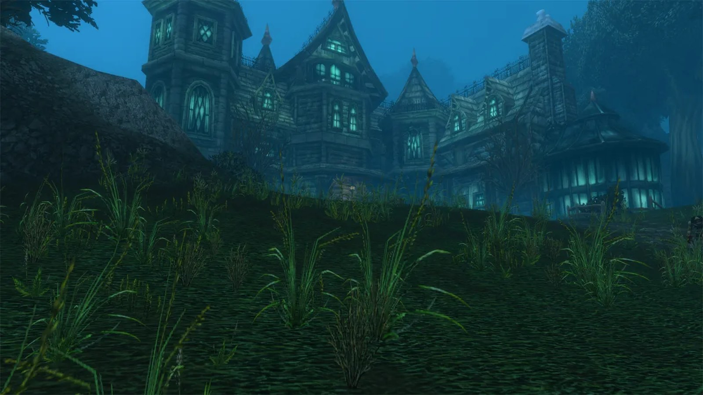
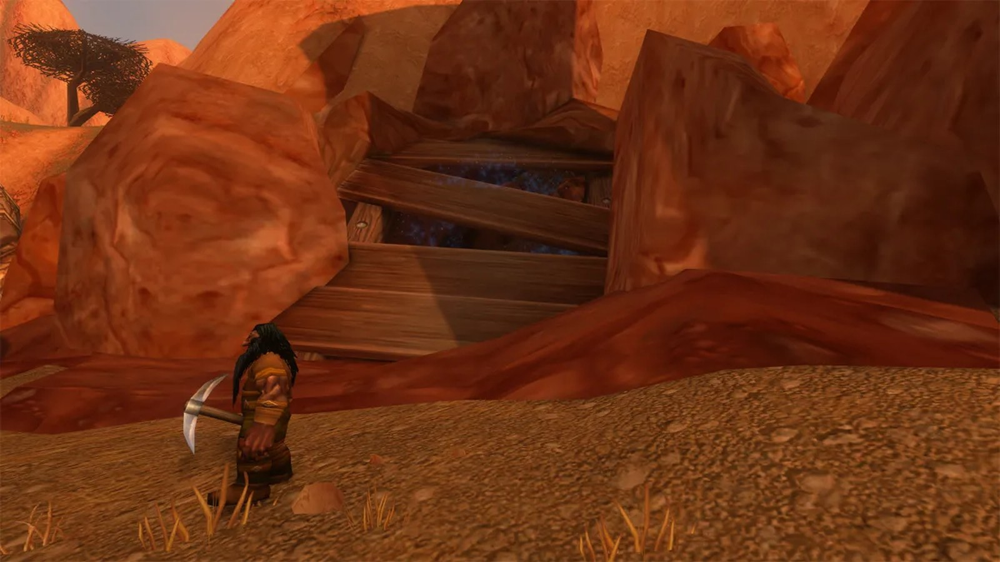
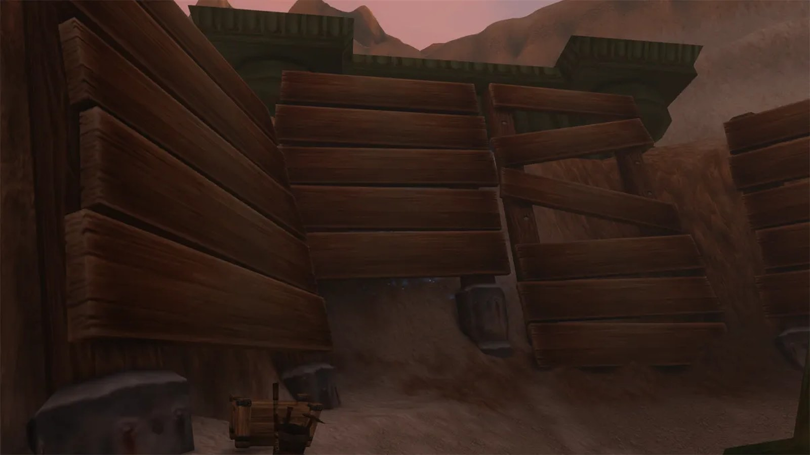
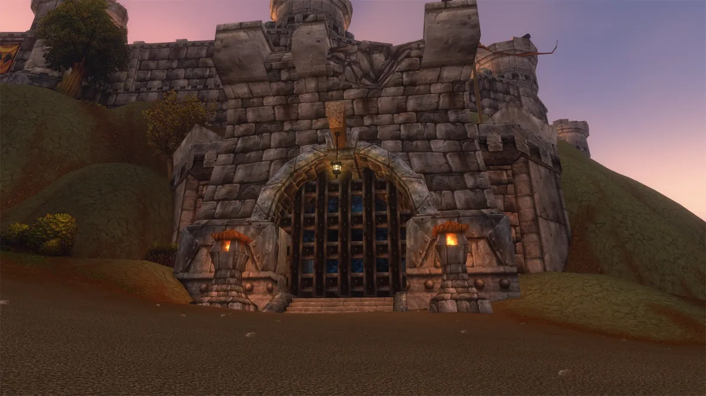
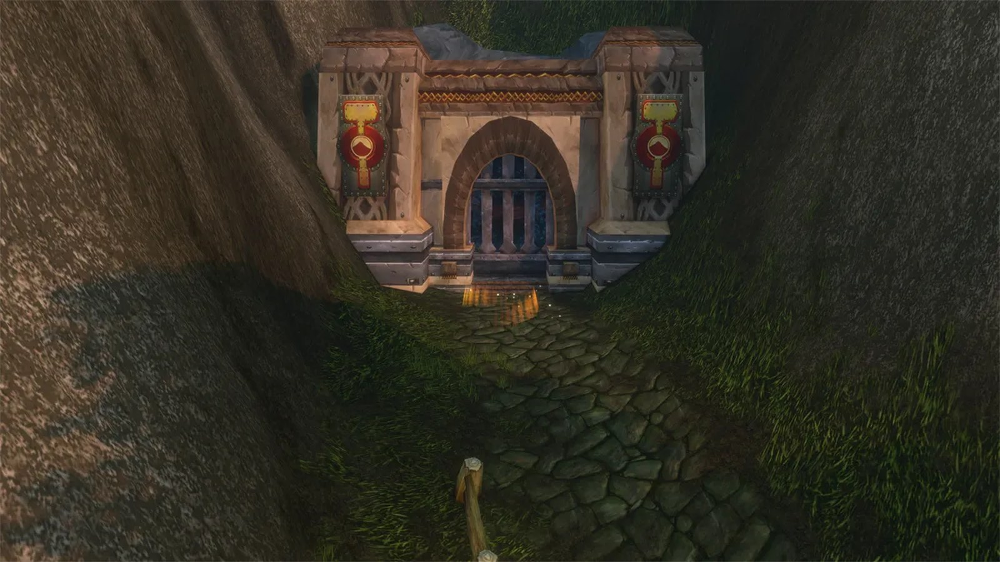
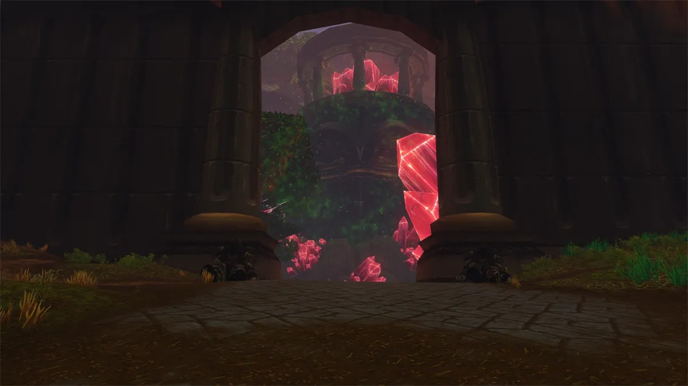
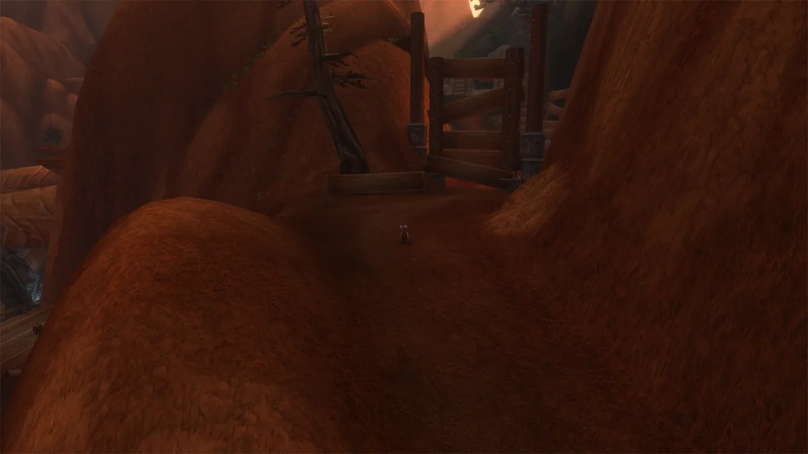
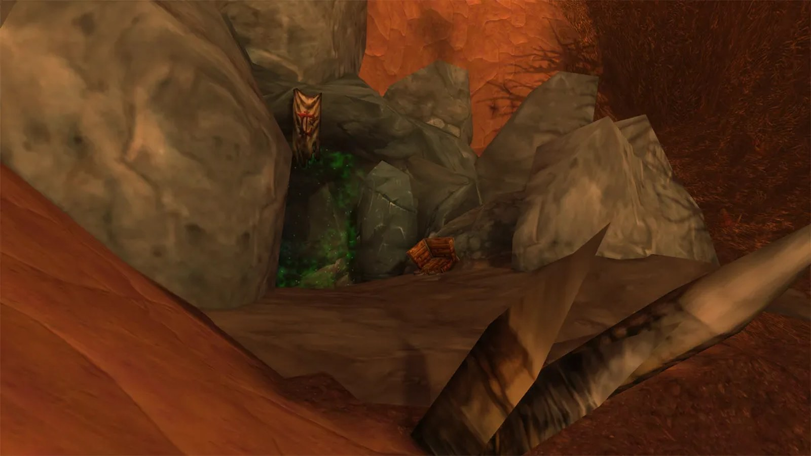
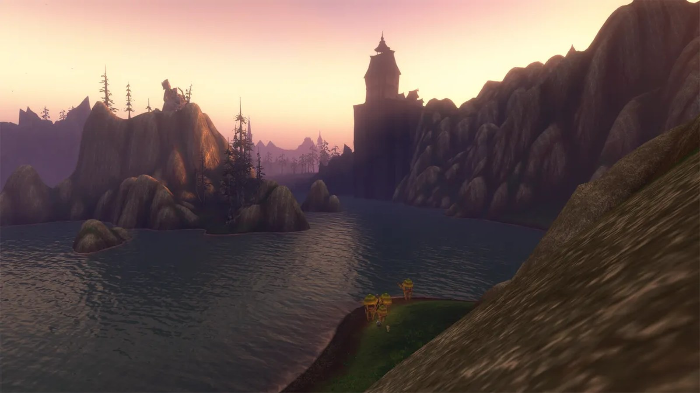

Blizzard is laying groundwork in WoW Forever for content that is not there yet. Clay Stone hinted at manors and instance portals in quiet corners of the world. Players went looking in the beta and found nine places, from Duskwood to Un'Goro Crater.

## What Blizzard said

Clay Stone said it near the end of [the fifth episode of the podcast](/news/podcast-episode-5-looks-back-on-the-beta/), at about 1 hour and 38 minutes.

> One of the things we're trying to do with Forever is to make sure we're laying the groundwork for the future. There might be some homes, some manors out there that folks have found, that might be something interesting in the future, you might have seen some other instance portals kind of hiding in inconspicuous spots. So, there are things coming in the future, and we're going to be really excited to share those as we get there!

He gave no names, dates or levels. Everything below was found in the beta, and none of it is confirmed as a dungeon or raid.

## Manor Mistmantle, Duskwood

Manor Mistmantle is the home of the Stalvan questline. In Forever it has a huge new manor. There is no portal in sight, but during the beta a level 60 Mistmantle Prowler roamed here and hunted Alliance players, [as Stitches did](/news/stitches-attacks-players-in-duskwood-again/).

## Bael Modan, The Barrens

The dwarven dig site in the Barrens hides a dungeon portal behind planks. Horde players already know the area from its quests, such as a dwarf who turned into a trogg after too long with an artifact. In the original timeline, after the Cataclysm, players were told to keep away from Bael Modan.

## Rustmaul Dig Site, Thousand Needles

This dig site was abandoned after a fight between Horde and Alliance woke a nest of silithid. Its portal sits behind a wall of planks and is easy to miss.

## Farholde Keep, The Riverglades

The Riverglades already have [Krol'dok Stronghold](/news/wow-forever-kroldok-stronghold-level-range/). A second dungeon portal stands by the shore at Farholde Keep, the Alliance hub of the zone.

## The dwarven farm, Wetlands

The farm on the mountain top in the Wetlands is now reachable on foot from the area of the [Excavation Site](/guides/dungeons/excavation-site-wetlands/). One of the entrances that used to lead under the terrain now holds a dungeon portal. It leads nowhere yet.

## A raid portal in Shaper's Terrace, Un'Goro Crater

[Shaper's Terrace](/news/blizzard-describes-all-nine-new-dungeons/) is the new dungeon for levels 58 to 60. Only the entrance was open in the beta, but with Eagle Eye players looked further inside and found what looks like a raid portal. A raid entrance inside a dungeon is nothing new: Molten Core starts in Blackrock Depths.

## Windshear Crag, Stonetalon Mountains

Windshear Crag has no portal, but a new path at the top leads to a closed mine entrance, just before the bridge to the Venture Co. leaders. That could become an outdoor dungeon area.

## New Avalon, Eastern Plaguelands

Pieces of the Scarlet Enclave, the last raid of Season of Discovery, are in Forever: the raid entrance and the open area of New Avalon. Anyone who tries to enter New Avalon is sent straight back to Light's Hope Chapel. These may be leftovers, but they keep alive the hope of more Season of Discovery content. Deadwind Pass changed too: [the hole beneath Karazhan is gone](/news/the-hole-beneath-karazhan-is-gone-from-the-beta/).

## Gilneas

Gilneas has been on the world map since 2004. In Forever its buildings are visible from the coasts of Hillsbrad Foothills and Silverpine Forest. Around it lies a new zone, the Shark-Infested Waters, with level 63 elite sharks that stun and kill anyone who swims in. Testers who got through anyway met level 63 worgen on the shore.

What opens first, Blizzard does not say. WoW Forever launches on 5 November at 00:00 Belgian time.
