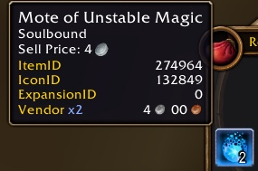

<a class="wf-wh wf-q1" href="https://www.wowhead.com/forever/item=274964">Mote of Unstable Magic</a> is soulbound in World of Warcraft: Forever since a hotfix on 19 November. Players can no longer buy or sell the Motes at the Auction House. Every Mote you need, you now farm yourself, and a spare one fetches 2 silver at a vendor.

## How the Motes work

From level 48 you can pick up <a href="https://www.wowhead.com/forever/quest=96603">Unstable Magic</a> in Dalaran or <a href="https://www.wowhead.com/forever/quest=98477">Unstable Magic</a> on the Skywatcher Plateau. The quest gives you an <a class="wf-wh wf-q2" href="https://www.wowhead.com/forever/item=281371">Elemental Attractor</a>, which grants the <a class="wf-wh wf-spell" href="https://www.wowhead.com/forever/spell=1297774">Magical Awareness</a> buff. With that buff, spellcasters and bosses sometimes drop a Mote. After the first quest, a repeatable quest such as <a href="https://www.wowhead.com/forever/quest=98476">More Unstable Magic</a> takes 10 Motes for reputation and 65 silver.

## Why it matters

The hotfix went live around noon Pacific time, 21.00 Belgian time. Before the hotfix, a Mote sold for about 13 silver. Players bought them at the Auction House for cheap reputation. The repeatable quest stops at Honored, but the Motes keep dropping, and many players sold theirs for gold. That income is gone now.

Why Blizzard made the change, is not known. The Blackmaw Devotees in Blackmaw Hold dropped a lot of Motes until an earlier hotfix, see [the post about that farm](/news/a-gold-farm-in-blackmaw-hold-is-hotfixed/).
