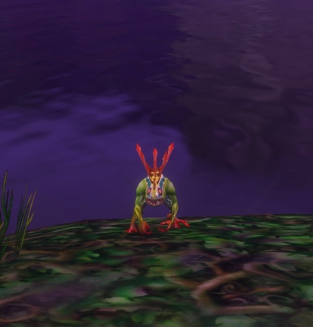

WoW Forever has a new Cooking recipe that transforms whoever eats it. Savory Whimsyfin Delight turns Body Type 1 into a Murloc and Body Type 2 into an Ogre, for 60 minutes. The recipe drops from mobs in Redridge Mountains. Since the beta build of 1 October, that is no longer so: Blizzard says the Murloc and Ogre were placeholders, and the dish now gives an orc version of the ninja and pirate costumes.

## How it works

<a class="wf-wh wf-q1" href="https://www.wowhead.com/forever/item=251525">Savory Whimsyfin Delight</a> is the Forever version of <a class="wf-wh wf-q1" href="https://www.wowhead.com/forever/item=6657">Savory Deviate Delight</a>, the Classic dish that turns you into a ninja or a pirate. The old one stays in the game, writes Wowhead, so both costumes are still there.

The new form depends on the Body Type chosen at character creation. Body Type 1 becomes a Murloc, Body Type 2 a large Ogre. The form lasts 60 minutes, or until the character dies.

## The recipe

<a class="wf-wh wf-q2" href="https://www.wowhead.com/forever/item=251526">Recipe: Savory Whimsyfin Delight</a> needs Cooking 85 and drops from random mobs, such as the <a class="wf-wh wf-plain" href="https://www.wowhead.com/forever/npc=547">Great Goretusk</a> in <a class="wf-wh wf-plain" href="https://www.wowhead.com/forever/zone=44">Redridge Mountains</a>. The dish itself takes a <a class="wf-wh wf-q1" href="https://www.wowhead.com/forever/item=251524">Whimsyfin</a> and <a class="wf-wh wf-q1" href="https://www.wowhead.com/forever/item=2678">Mild Spices</a>, according to the recipe in the beta.

Murlocs and Ogres were two of the races players asked for most before Forever, writes Wowhead. Neither is playable.

## What is not known

Where the Whimsyfin is caught, the beta does not show. Nor is it known how often the recipe drops, or whether the form works in a battleground.
