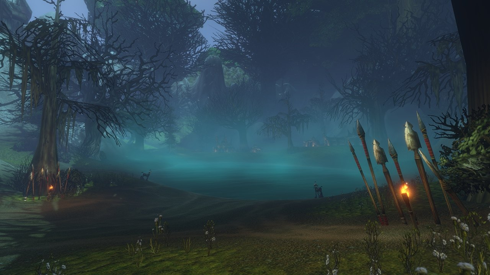

Blizzard has published a guide for players returning to Azeroth. It names the two Experience Presets that World of Warcraft: Forever offers at the first login, Classic and Enhanced, and lists what each one switches on or off by default.

## Classic or Enhanced

The choice appears once, at the first login, before you pick a ruleset. The [starter guide for new players](/news/new-players-get-an-official-starter-guide/) only said that Blizzard advises Enhanced. The new guide shows what both presets do.

| Setting | Classic | Enhanced |
|---|---|---|
| **Character models** | Standard Definition | High Definition |
| **Quest markers and objective areas** | Off | On |
| **One bag** | Off | On |
| **Transmog** | Off | On |
| **Keyboard turning** | Turns the camera | Strafes |
| **Screen layout** | Classic | Centered |

Classic stays close to the original game: simpler visuals, fewer modern interface features and less automatic guidance. Enhanced looks sharper and switches more help on. Both are only a starting point: everything can be changed later under Options, System, Preset. HD or SD models are also a choice per character, which you can change in the options or at a [barbershop](/news/barbershops-in-wow-forever/).

## Year 1 of the original game

Forever starts in the "Year 1" period of the original World of Warcraft, before Kazzak reopened the Dark Portal and long before the trips to Northrend. Everything is built on the world of level 1 to 60, with events, characters and places that existed in that era, or could have.

## The rest at a glance

- **The world**: more than 1,000 new quests and the new zones Mount Hyjal, Shen'dralas, the Riverglades and Zephras Isle.
- **Dungeons**: [nine new ones](/news/blizzard-describes-all-nine-new-dungeons/) for levels 13 to 60.
- **New combinations**: Human Hunter, Dwarf Shaman and Gnome Priest for the Alliance, Orc Mage, Troll Warlock and Undead Paladin for the Horde. The Skyborne need the Heroic Pack or a higher edition.
- **Legacy**: an account-wide system that rewards exploring rather than power. Alts help, but every advantage can be unlocked on one character. More on the [Legacy page](/talents/legacy/).
- **PvP**: Honor and Rank points from battlegrounds, PvP quests and weekly seasonal tasks, with extra during holiday weeks. The new battleground [Darkspear Islands](/news/darkspear-islands-pits-15-players-against-15/) is 15 against 15 for levels 30 to 60.
- **Names**: [two names per character](/news/every-character-gets-a-first-and-a-second-name/), unique in your region. The second name can be hidden above your character, but still shows in chat.
- **Rulesets**: Normal, PvP, Roleplay and Roleplay-PvP, with Hardcore later. Pick the same ruleset and faction as your friends; more in the [rulesets guide](/guides/rulesets/).

## Before launch

Blizzard advises updating your operating system and graphics drivers before installing. Players who cannot sign in can use the account recovery page, and contact a Game Master through Blizzard Support if that does not help. Forever launches on 4 November at 15:00 Pacific time, which is midnight in Belgium.
