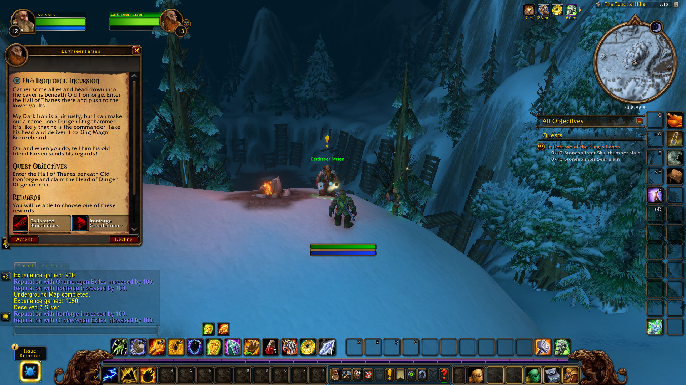
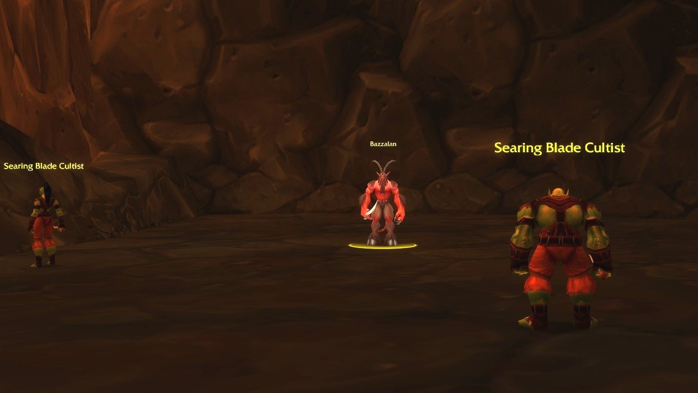

World of Warcraft: Forever tiene hacia el nivel 16 un arma a dos manos de misión para cada facción. La Alianza recibe el <a class="wf-wh wf-q3" href="https://www.wowhead.com/forever/item=279895">Ironforge Greathammer</a> en el Hall of Thanes, la Horda el <a class="wf-wh wf-q3" href="https://www.wowhead.com/forever/item=15424">Axe of Orgrimmar</a> en Ragefire Chasm. Ambas son de nivel de objeto 18 y se ligan al recogerlas.

## Las dos armas

| | Alianza | Horda |
|---|---|---|
| **Arma** | <a class="wf-wh wf-q3" href="https://www.wowhead.com/forever/item=279895">Ironforge Greathammer</a> | <a class="wf-wh wf-q3" href="https://www.wowhead.com/forever/item=15424">Axe of Orgrimmar</a> |
| **Tipo** | Two-Hand Mace | Two-Hand Axe |
| **Daño** | 39 a 60, velocidad 3.10 | 42 a 64, velocidad 3.30 |
| **DPS** | 15.97 | 16.06 |
| **Bonus** | Chance on hit: 42 de daño de Fire | +6 Stamina, +6 Spirit |
| **Misión** | <a href="https://www.wowhead.com/forever/quest=96393">Old Ironforge Incursion</a> | <a href="https://www.wowhead.com/forever/quest=5728">Hidden Enemies</a> |

## Ironforge Greathammer para la Alianza

1. **Busca el mapa.** Mata Dark Iron Spies en Ironband's Compound, en Dun Morogh, hacia `/way 77.5 60.4`, hasta que uno suelte el <a class="wf-wh wf-q1" href="https://www.wowhead.com/forever/item=274268">Dark Iron Map</a>. <a class="wf-wh wf-plain" href="https://www.wowhead.com/forever/npc=264936">Earthseer Farsen</a> también da <a href="https://www.wowhead.com/forever/quest=96390">Nip 'Em in the Bud</a> por diez de esos espías.
2. **Llévaselo a Farsen.** Usa el mapa desde tus bolsas. Inicia <a href="https://www.wowhead.com/forever/quest=96391">Underground Map</a>, que lleva a Earthseer Farsen en `/way 64.8 58.4`.
3. **Haz el Hall of Thanes.** Farsen da luego Old Ironforge Incursion. Mata a <a class="wf-wh wf-plain" href="https://www.wowhead.com/forever/npc=261319">Durgen Dirgehammer</a>, el jefe final de la mazmorra bajo Old Ironforge, y recoge su cabeza.
4. **Entrega la misión.** Lleva la cabeza a <a class="wf-wh wf-plain" href="https://www.wowhead.com/forever/npc=2784">King Magni Bronzebeard</a> en Ironforge. El Greathammer es una de las tres recompensas, junto al <a class="wf-wh wf-q3" href="https://www.wowhead.com/forever/item=279894">Calibrated Blunderbuss</a> y la varita <a class="wf-wh wf-q3" href="https://www.wowhead.com/forever/item=279896">Deepblaze</a>.

## Axe of Orgrimmar para la Horda

1. **Empieza con Thrall.** <a class="wf-wh wf-plain" href="https://www.wowhead.com/forever/npc=4949">Thrall</a>, en Orgrimmar en `/way 32.0 37.8`, da <a href="https://www.wowhead.com/forever/quest=5726">Hidden Enemies</a>. Mata Burning Blade Apprentices y Burning Blade Fanatics en Skull Rock, en Durotar, hacia `/way 53.6 9.4`, hasta que uno suelte la <a class="wf-wh wf-q1" href="https://www.wowhead.com/forever/item=14544">Lieutenant's Insignia</a>.
2. **Enséñasela a Neeru.** Lleva la insignia a Thrall. Te envía con ella a <a class="wf-wh wf-plain" href="https://www.wowhead.com/forever/npc=3216">Neeru Fireblade</a>, en la Cleft of Shadow, para ver cómo reacciona, y luego otra vez a Thrall.
3. **Haz Ragefire Chasm.** La última parte pide a <a class="wf-wh wf-plain" href="https://www.wowhead.com/forever/npc=11519">Bazzalan</a> y <a class="wf-wh wf-plain" href="https://www.wowhead.com/forever/npc=11518">Jergosh the Invoker</a>, dos jefes de la mazmorra bajo Orgrimmar.
4. **Entrega la misión.** Vuelve con Thrall y elige el Axe of Orgrimmar como recompensa. La misión da también 1150 de experiencia y 100 de reputación con Orgrimmar.

Cada misión de las dos mazmorras, con las coordenadas y las demás recompensas, está en las guías del [Hall of Thanes](/es/guides/dungeons/hall-of-thanes/) y de [Ragefire Chasm](/es/guides/dungeons/ragefire-chasm/).
