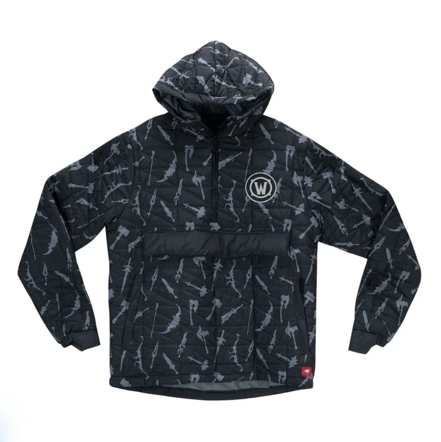
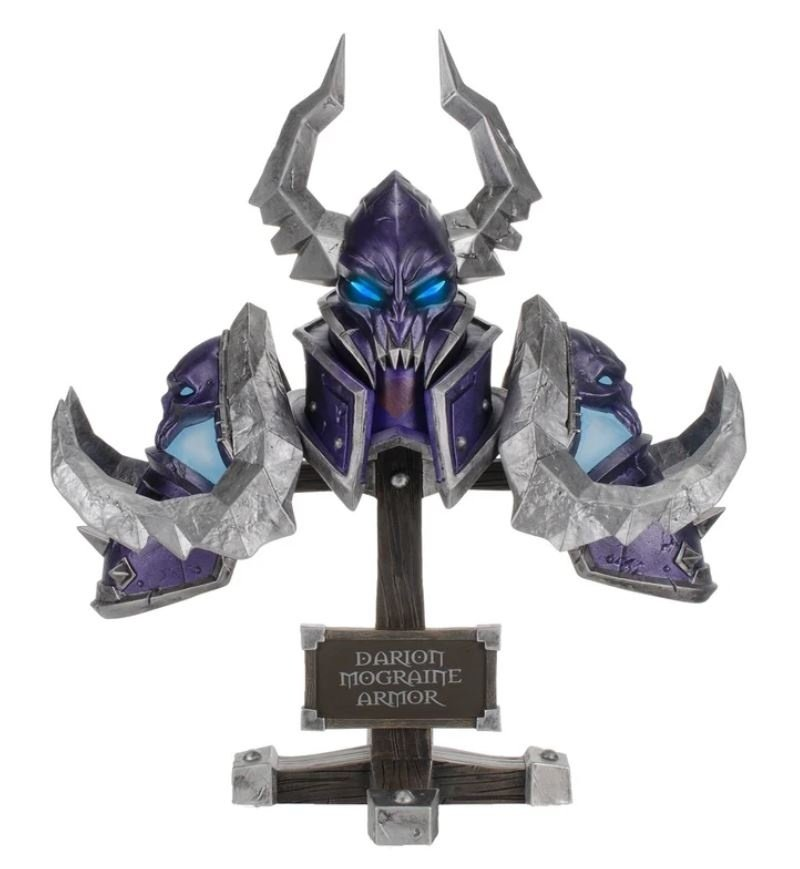
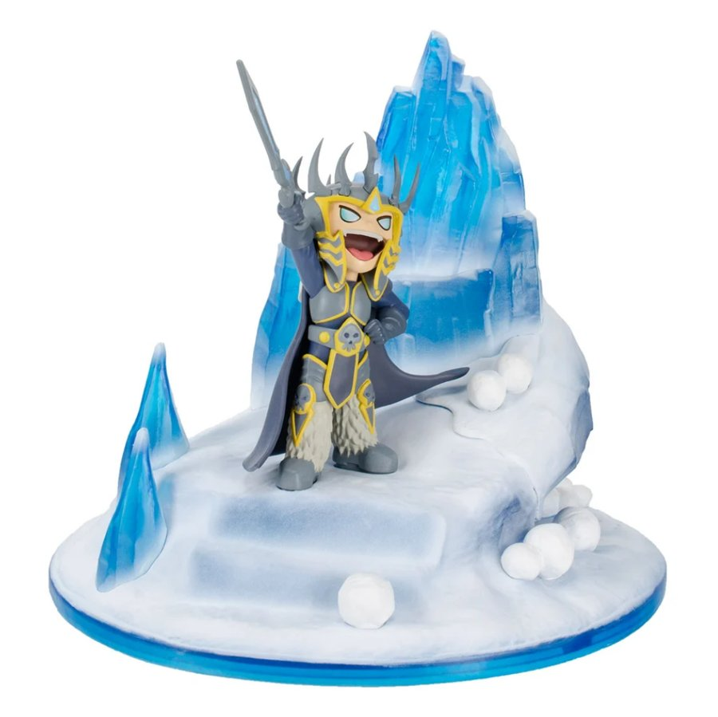

La Blizzard Gear Store tiene rebajas de Black Friday de hasta el 60%. Para World of Warcraft: Forever hay dos camisetas con pósteres de viaje del lanzamiento y un set con cuatro de esos pósteres. Hasta el 1 de diciembre, un pedido de más de 50 $ da además tres códigos para el juego.

## Forever en las rebajas

La **Zephras Isle T-Shirt** y la **Dalaran T-Shirt** llevan los pósteres de viaje con los que se lanzó Forever. El **Travel Posters Gift Set** trae las láminas: Zephras Isle, Dalaran, Mount Hyjal y Bandarion Keep en Tirisfal.

## El resto de las rebajas

Otros artículos de WoW rebajados son la What Sword Hoodie de la presentación de la Worldsoul Saga, un Alliance Quarter-Zip, una chaqueta con armas, una Xal'atath T-Shirt, la Arcantina Heat Changing Mug, una réplica de la armadura de Darion Mograine y una estatua de Arthas.

## Tres códigos por más de 50 $

| | |
|---|---|
| Hasta | 1 de diciembre |
| Condición | Un pedido de más de 50 $ en artículos válidos |
| Diablo IV | Refined Mind Trophy |
| WoW Midnight | Deep Winter Toque, una transfiguración |
| Overwatch | Legendary Cyberhog Skin |

La transfiguración es para el WoW moderno, no para Forever. No todos los artículos válidos están rebajados por el Black Friday. La **Azeroth Forever Hoodie** cuenta para los códigos, pero no tiene descuento. Cuánto duran los precios del Black Friday, la tienda no lo dice. Los precios en euros y otras monedas pueden variar: mira la [Gear Store](https://gear.blizzard.com/) de tu región.

