Jugadores en China recorrieron Dalaran de verdad. Una fiesta de World of Warcraft: Forever en Shanghái reconstruyó la ciudad a tamaño real desde el 16 de octubre. Los visitantes hicieron misiones, ganaron premios y jugaron a la beta en las alcantarillas.

## La ciudad

La fiesta duró dos días. Los visitantes pasaban por lugares reconstruidos como The Silver Enclave, Sunreaver's Sanctuary y el Antonidas Memorial en Runeweaver Square. Las Dalaran Sewers se convirtieron en la sala donde se podía probar la beta de Forever. La tienda de Mei Francis mostraba monturas.

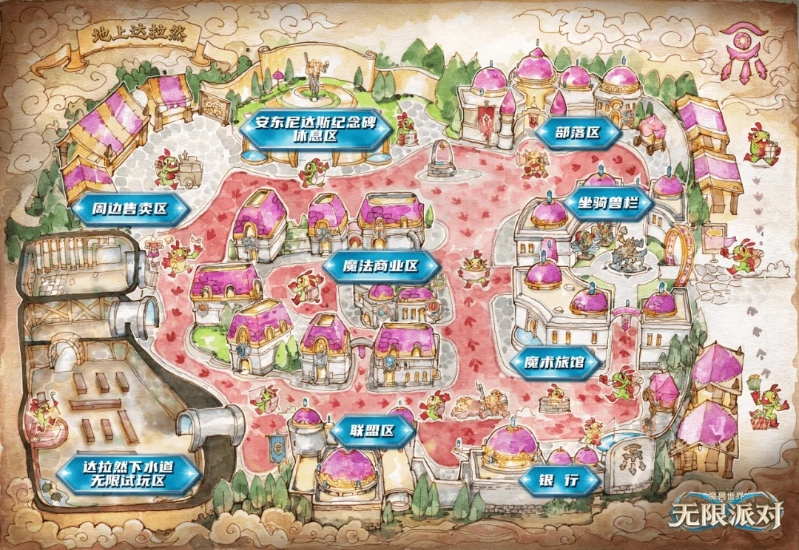

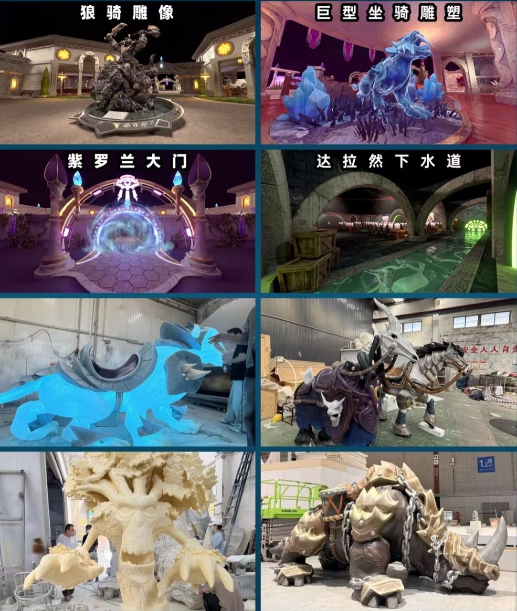

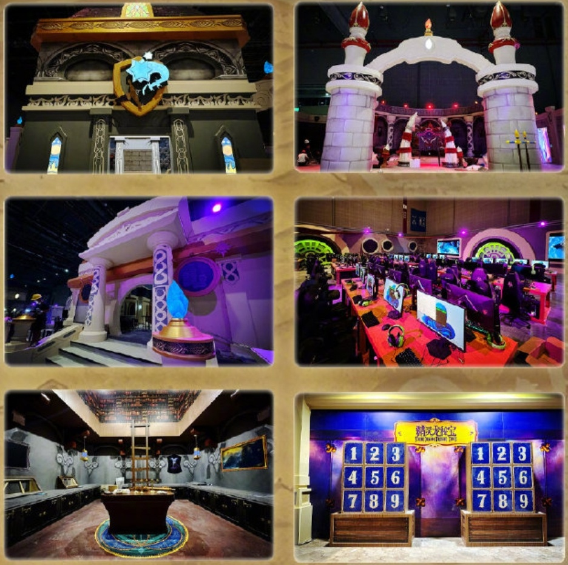

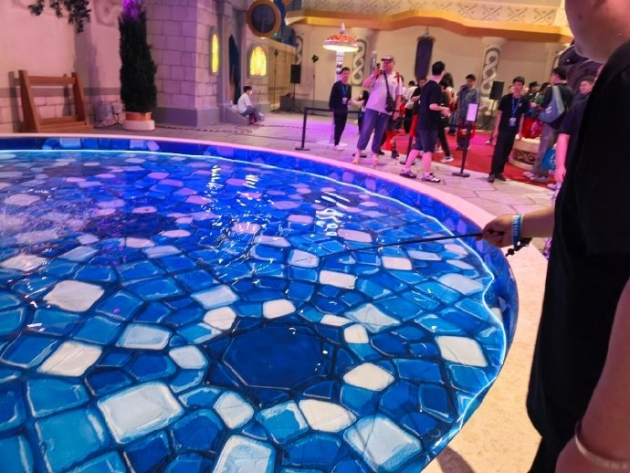

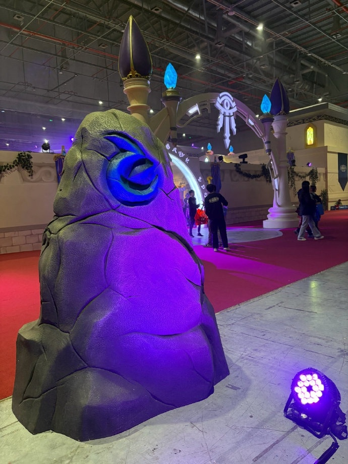

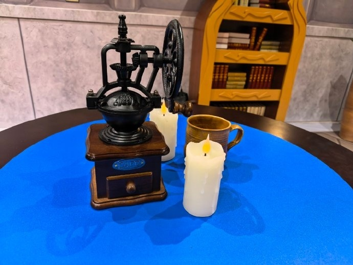

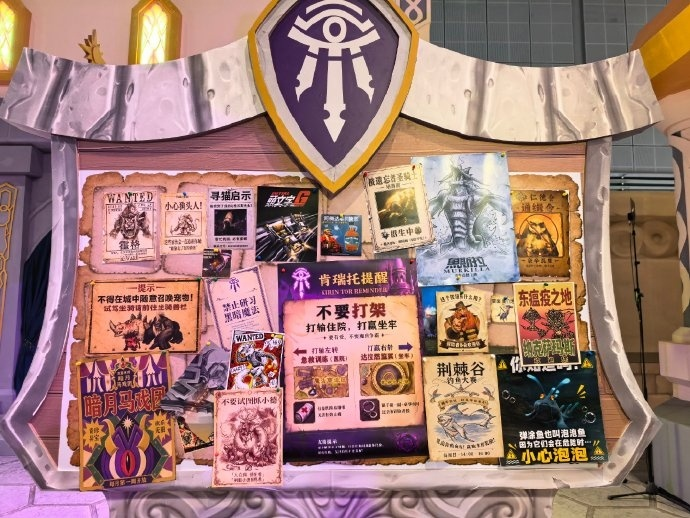

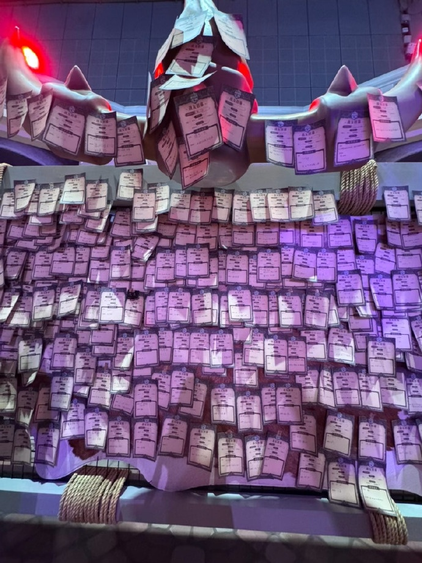

## Misiones por monedas de oro

Cada visitante recibía una pulsera para fichar en puestos repartidos por el pabellón. Las misiones en esos puestos daban Dalaran Gold Coins, que se canjeaban por un sorteo de un cofre. Entre los premios había gorros y juguetes de múrloc, sets de sellos de lacre, pegatinas y estatuas de colección. También se vendía más merchandising.

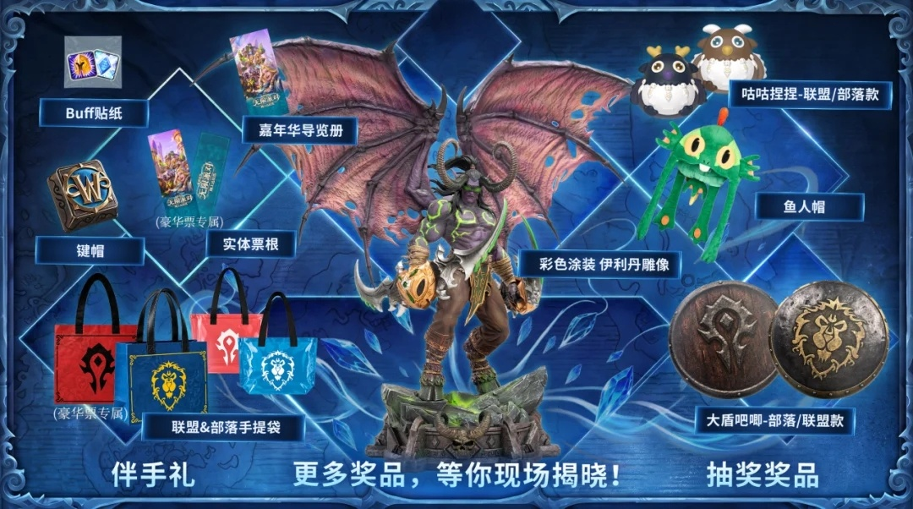

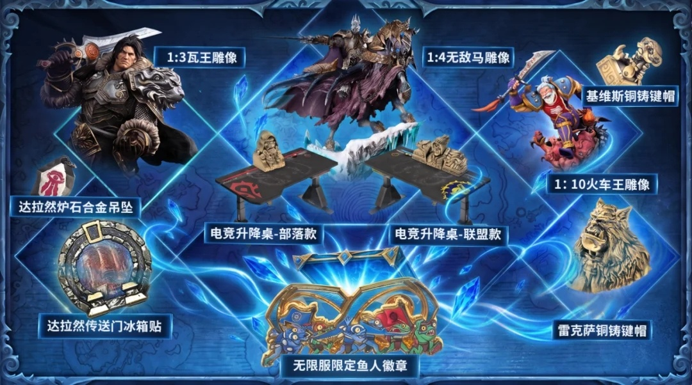

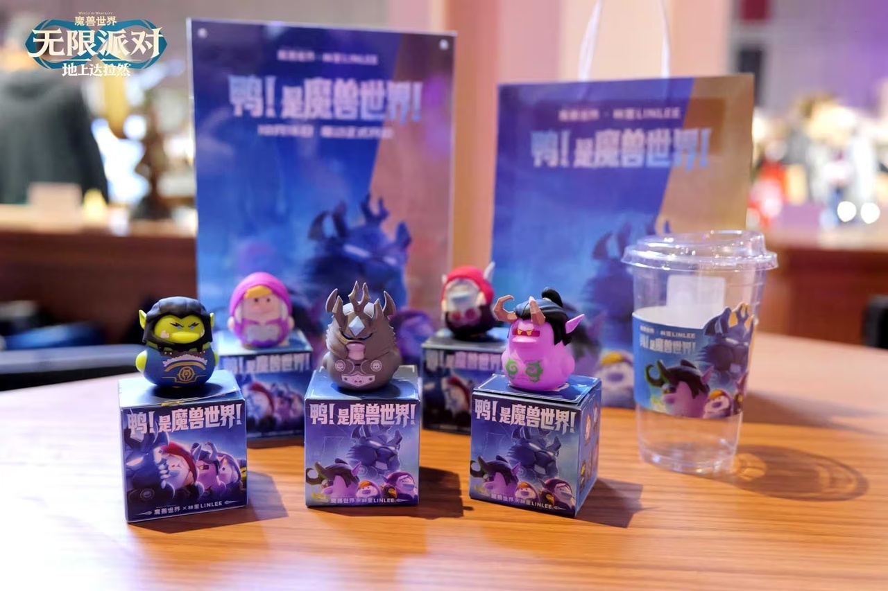

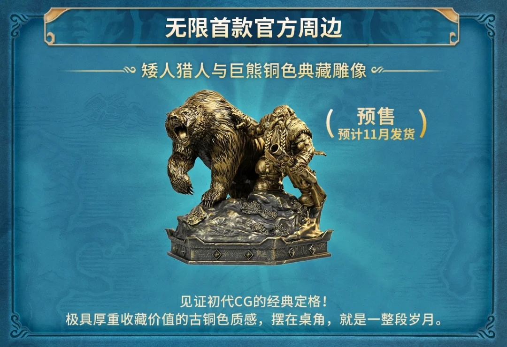

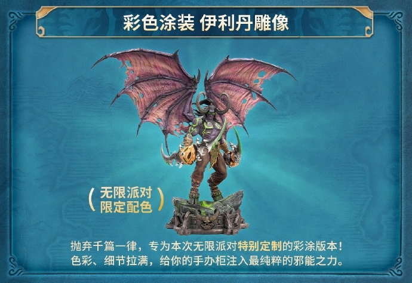

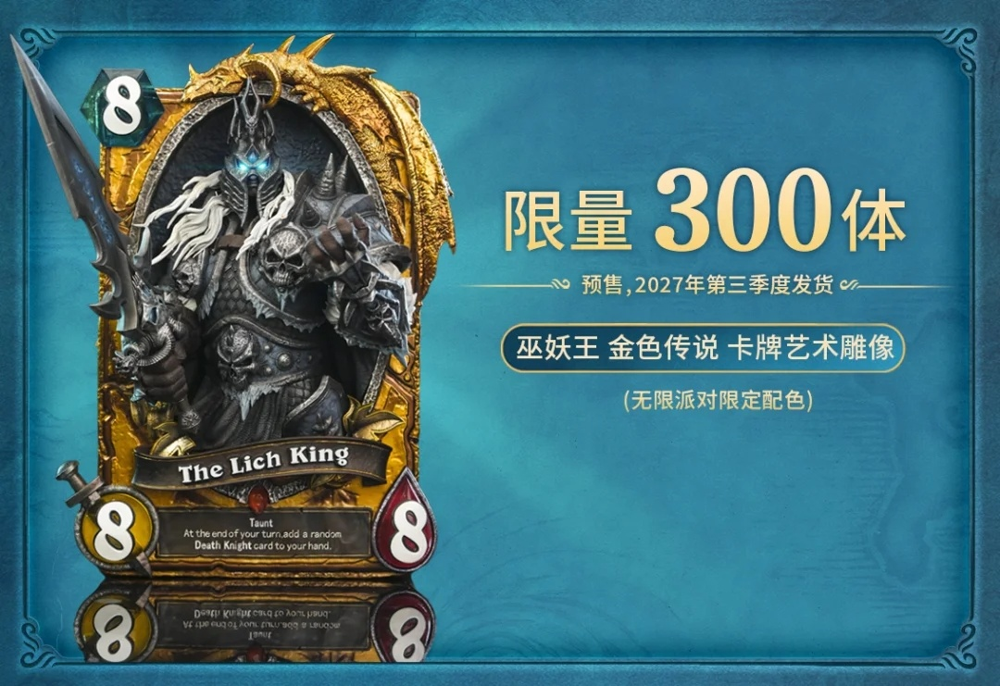

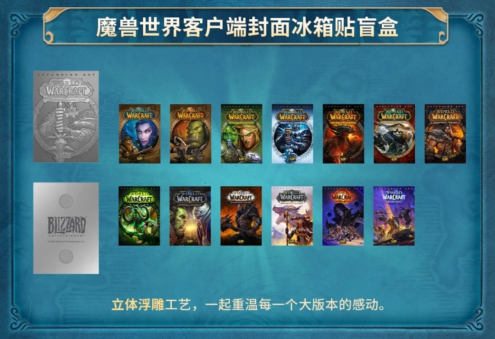

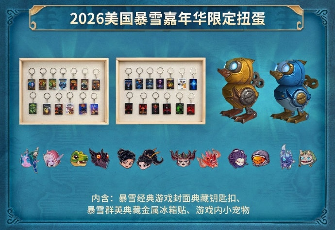

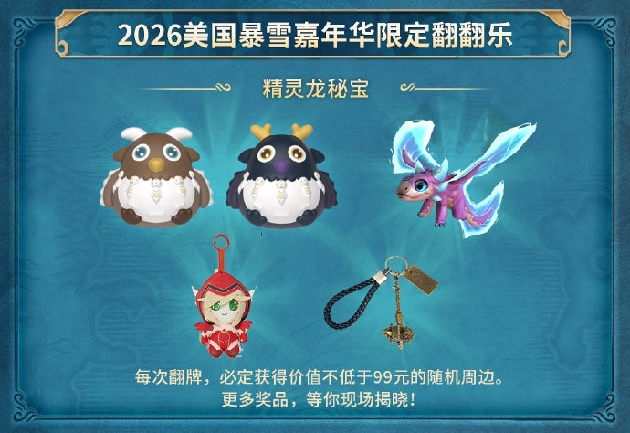

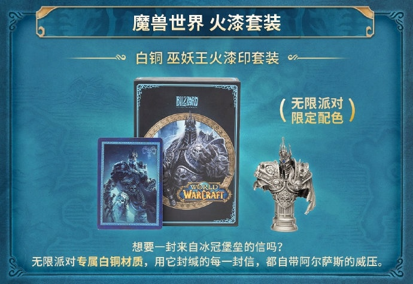

## Ion Hazzikostas como Medivh

El game director Ion Hazzikostas acudió a la fiesta disfrazado de Medivh y habló a los jugadores chinos.

<figure class="wf-embed wf-embed--x" data-wf-x="2112897624416436408">
  <button type="button" class="wf-embed__play">
    
    
      Ion Hazzikostas como Medivh en la Forever Party de China
      Cargar la publicación de X.
    
  </button>
</figure>

Forever sale el 5 de noviembre a las 00:00, hora belga.
