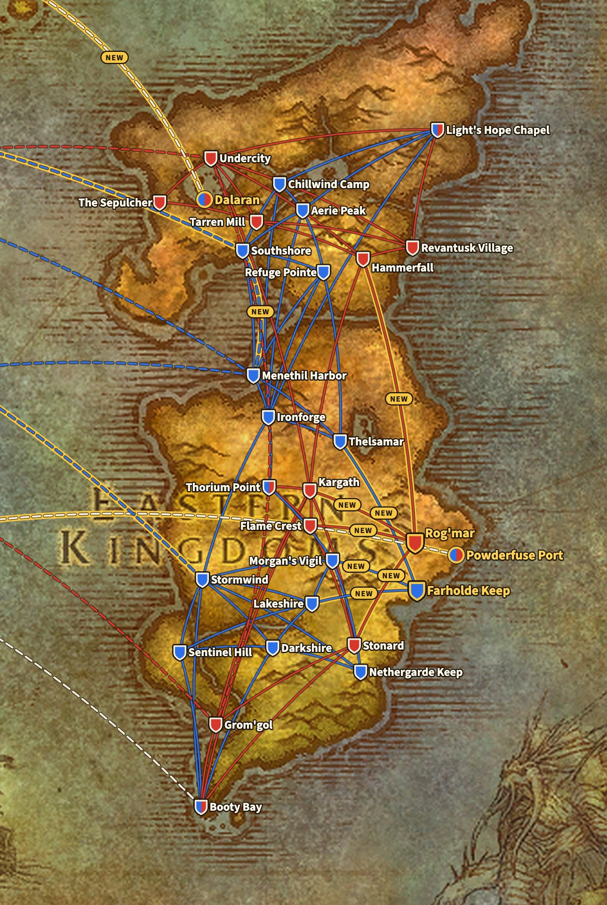
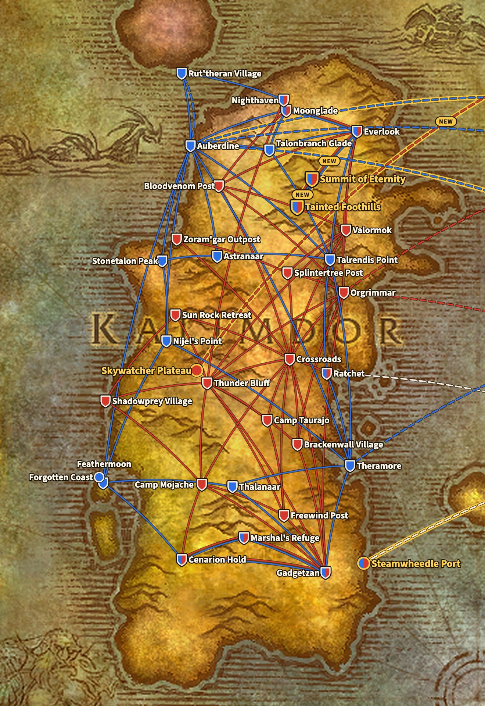
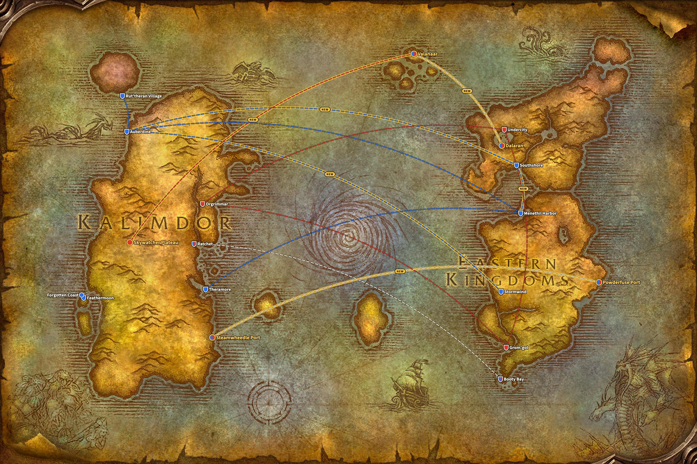

WoW Forever añade cuatro puntos de vuelo: Farholde Keep y Rog'mar en The Riverglades, y Tainted Foothills y Summit of Eternity en Mount Hyjal. Juntos traen diez rutas nuevas. Ninguna ruta existente desaparece, según los archivos del juego en vivo.

*Actualizado el 9 de noviembre: en la beta, Powderfuse Port, en The Riverglades, era un quinto punto de vuelo nuevo, con una ruta a Farholde Keep. Esa ruta ya no está en el juego en vivo, así que este artículo cuenta ahora cuatro puntos de vuelo y diez rutas.*

## De dónde salen las rutas

Blizzard no ha publicado una lista de rutas de vuelo para Forever. Las rutas de esta página salen de los archivos del juego en vivo, build 1.60.1.70862. Se comparan con los mismos archivos de Classic Era, build 1.15.9.69722.

El mapa dibuja cada ruta como una línea entre dos lugares, no como transcurre el vuelo en el juego. Así se lee mejor. La base es el mapa del mundo del cliente de Forever, que ya muestra The Riverglades al este de Redridge Mountains. Los barcos y zepelines vienen del mismo mapa del mundo.

Una línea azul es una ruta de la Alliance, una línea roja una ruta de la Horde. Una línea discontinua es un barco o un zepelín, y una línea blanca discontinua está abierta a ambas facciones. Una línea con borde dorado y la palabra NEW es nueva en Forever. Un escudo es un maestro de vuelo, una marca redonda un puerto o una torre de zepelín sin maestro de vuelo. Un escudo azul y rojo sirve a ambas facciones, y un borde dorado señala un lugar nuevo.

## Los cuatro puntos de vuelo nuevos

| Punto de vuelo | Zona | Para | Maestro de vuelo | Vuela a |
|---|---|---|---|---|
| Farholde Keep | The Riverglades | Alliance | [Gretchen Mayberry](https://www.wowhead.com/forever/npc=257087) | Lakeshire, Thelsamar, Morgan's Vigil |
| Rog'mar | The Riverglades | Horde | [Grakna](https://www.wowhead.com/forever/npc=255993) | Stonard, Hammerfall, Kargath, Flame Crest |
| Tainted Foothills | Mount Hyjal | ambas facciones | [Bluebell](https://www.wowhead.com/forever/npc=260626) | Everlook, Summit of Eternity |
| Summit of Eternity | Mount Hyjal | ambas facciones | [Fayran Elthas](https://www.wowhead.com/forever/npc=41861) | Tainted Foothills |

[The Riverglades](/es/forever/) es la nueva zona para los niveles 30 a 45. Cada facción recibe allí un punto de vuelo que la une a las zonas vecinas: la Alliance vuela a Redridge Mountains, Loch Modan y Burning Steppes, y la Horde a Swamp of Sorrows, Arathi Highlands, Badlands y Burning Steppes.

Mount Hyjal es el final de la subida de nivel, con un campamento donde la Horde y la Alliance conviven. Las rutas lo reflejan. Los dos puntos de vuelo de la montaña sirven a ambas facciones, y Tainted Foothills conecta a cada bando con Everlook, en Winterspring.

## Alliance

La Alliance gana tres puntos de vuelo y cinco rutas. En los Eastern Kingdoms, Farholde Keep conecta con Lakeshire, Thelsamar y Morgan's Vigil. En Kalimdor, Everlook lleva a Tainted Foothills y de allí a Summit of Eternity.

**Eastern Kingdoms, 17 puntos de vuelo.** Existentes: Aerie Peak, Booty Bay, Chillwind Camp, Darkshire, Ironforge, Lakeshire, Light's Hope Chapel, Menethil Harbor, Morgan's Vigil, Nethergarde Keep, Refuge Pointe, Sentinel Hill, Southshore, Stormwind, Thelsamar y Thorium Point. Nuevo: Farholde Keep.

**Kalimdor, 19 puntos de vuelo.** Existentes: Astranaar, Auberdine, Cenarion Hold, Everlook, Feathermoon, Gadgetzan, Marshal's Refuge, Moonglade, Nighthaven (para Druids, desde Rut'theran Village), Nijel's Point, Ratchet, Rut'theran Village, Stonetalon Peak, Talonbranch Glade, Talrendis Point, Thalanaar y Theramore. Nuevos: Tainted Foothills y Summit of Eternity.

## Horde

La Horde gana tres puntos de vuelo y seis rutas. Rog'mar, en The Riverglades, tiene cuatro rutas, a Stonard, Hammerfall, Kargath y Flame Crest, tantas como Farholde Keep. En Kalimdor, la Horde recibe los mismos dos puntos en Mount Hyjal que la Alliance.

**Eastern Kingdoms, 13 puntos de vuelo.** Existentes: Booty Bay, Flame Crest, Grom'gol, Hammerfall, Kargath, Light's Hope Chapel, Revantusk Village, Stonard, Tarren Mill, The Sepulcher, Thorium Point y Undercity. Nuevo: Rog'mar.

**Kalimdor, 22 puntos de vuelo.** Existentes: Bloodvenom Post, Brackenwall Village, Camp Mojache, Camp Taurajo, Cenarion Hold, Crossroads, Everlook, Freewind Post, Gadgetzan, Marshal's Refuge, Moonglade, Nighthaven (para Druids, desde Thunder Bluff), Orgrimmar, Ratchet, Shadowprey Village, Splintertree Post, Sun Rock Retreat, Thunder Bluff, Valormok y Zoram'gar Outpost. Nuevos: Tainted Foothills y Summit of Eternity.

## Classic Era y Forever frente a frente

Una ruta es aquí un vuelo directo entre dos puntos de vuelo. Una ciudad con un maestro de vuelo para cada facción, como Everlook, cuenta una vez por facción.

| | Classic Era | WoW Forever |
|---|---|---|
| Alliance, Eastern Kingdoms | 16 puntos, 35 rutas | 17 puntos, 38 rutas |
| Alliance, Kalimdor | 17 puntos, 31 rutas | 19 puntos, 33 rutas |
| Horde, Eastern Kingdoms | 12 puntos, 22 rutas | 13 puntos, 26 rutas |
| Horde, Kalimdor | 20 puntos, 47 rutas | 22 puntos, 49 rutas |

Todas las rutas de Classic Era siguen ahí, con el mismo inicio y el mismo final. Forever solo añade. Junto a las rutas de vuelo llegan [tres rutas marítimas nuevas](/es/news/wow-forever-three-new-ship-routes/), entre ellas un barco de The Riverglades a Steamwheedle Port, en Tanaris. Con la ventaja de Legacy Frequent Flier, un vuelo cuesta la mitad y va un 20 % más rápido, véase [la página de Forever](/es/forever/).

Cada punto de vuelo con su maestro de vuelo, sus coordenadas y sus rutas está en la [guía de rutas de vuelo](/es/guides/flight-paths/).

## Lo que no es seguro

- **Powderfuse Port no tiene ruta de vuelo.** En la beta volaba a Farholde Keep, pero esa ruta ya no está en el juego en vivo. El puerto sí tiene el barco a Steamwheedle Port, en Tanaris.
- **Otro punto de vuelo espera**: Tidegear Coast, en Dun Morogh, está en los archivos, sin una sola ruta. No se sabe para qué sirve.
- **Las rutas aún pueden cambiar** con un hotfix o un parche.
- **Zephras Isle no tiene un lugar fijo** en el mapa del mundo de los archivos. El mapa sitúa Valanaar, donde llegan los nuevos zepelines de Dalaran y Skywatcher Plateau, en el grupo de islas al norte del Maelstrom.
- **Cuánto dura un vuelo** no figura en estos archivos. El mapa muestra por dónde pasa una ruta, no cuánto tarda.
