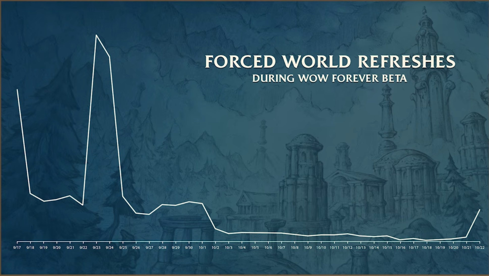

Unirse a un grupo en World of Warcraft: Forever ya no mueve a un jugador a otra layer al instante. Primero aparece un aviso con un plazo, dice Blizzard en el episodio 6 de su podcast. Los refresh forzados del mundo deberían ser raros en el lanzamiento.

El episodio 6 dura 69 minutos y salió el 29 de octubre en el canal de World of Warcraft. Los invitados son la Lead Software Engineer Ana Resendez, el Principal Software Engineer Frank Williams y el creador de contenido Shobek, junto a Josh «Aggrend» Greenfield de Blizzard.

<figure class="wf-embed" data-wf-video="BVyhnixdPQg">
  <button type="button" class="wf-embed__play">
    
    
      All About Tech, episodio 6 de The WoW: Forever Podcast
      Reproducir el vídeo. World of Warcraft en YouTube, 69 minutos.
    
  </button>
</figure>

## Menos refresh forzados

Forever no tiene reinos. Un nuevo sistema de layering coloca a cada jugador en la parte del mundo donde cree que está su comunidad: caras conocidas y hermandades aliadas o enemigas. El objetivo es encontrarse con la misma gente mientras subes de nivel, para que después llegue una mazmorra o una invitación de hermandad, explica Williams.

Al principio de la beta, esos algoritmos eran demasiado agresivos y movían a los jugadores con demasiada frecuencia. Tras dos semanas de ajustes, el número de refresh forzados bajó mucho, como muestra un gráfico del podcast.

## Un aviso en vez de un traslado

La beta ya [avisaba cinco minutos antes de un refresh forzado](/es/news/phasing-warning-before-a-zone-refresh/). En el lanzamiento, ese aviso también aparece cuando un jugador se une a un grupo, en lugar de un traslado inmediato. El jugador elige entonces el momento, dentro de un plazo. En la beta y en el juego moderno, [un grupo te mueve al instante](/es/news/leaving-a-group-moves-the-leader-to-a-new-layer/).

Williams lo relaciona con Hardcore, que llega después del lanzamiento: nadie quiere aparecer junto a un élite en una cueva. Cuánto dura el plazo, Blizzard no lo dice.

## Layers entre zonas

Las zonas vecinas pueden seguir en layers distintas. Blizzard puede ajustar qué zonas comparten layer, dice Aggrend. En el lanzamiento, Durotar estará a rebosar y Orgrimmar bastante vacía, así que siguen separadas. Un mes después puede ser al revés, y la agrupación de zonas puede ser muy distinta.

Según Williams, esos ajustes ya cambiaron en los últimos días de la beta y en la prueba de estrés, y vendrán más retoques. El layering en las fronteras de zona se queda, como consecuencia de cómo está hecho Forever.

## Grandes batallas en el mundo abierto

Shobek preguntó por los grandes combates de PvP en el mundo donde no todos acaban en la misma layer. Blizzard mira de cerca lo que los jugadores organizan con addons y lo que podría integrar en el juego, dice Aggrend. Según Williams, puede que la palabra «megaraid» esté en una pizarra del campus. Otra idea: servidores que detectan una gran batalla PvP y se amplían un poco para que siga.

> But I would say the state at the end of the beta is what you can expect for launch.
