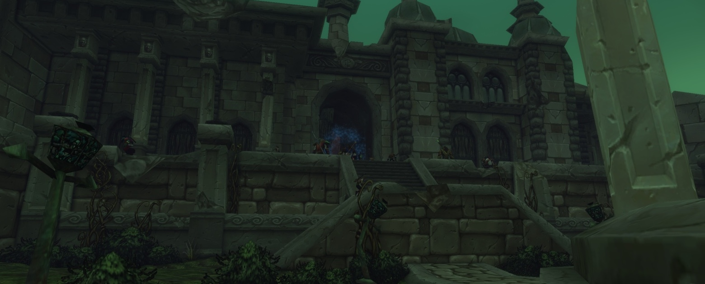
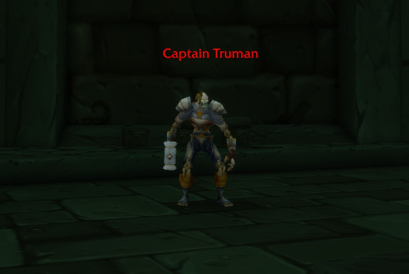

Ruins of Lordaeron es la mazmorra sobre la Undercity en World of Warcraft: Forever, para los niveles 15 a 20. Los seis jefes se pueden hacer en cualquier orden. La Horde encuentra allí seis misiones, la Alliance cuatro.

<figure class="wf-embed" data-wf-video="VbryA5eOUHI">
  <button type="button" class="wf-embed__play">
    
    
      Ruins of Lordaeron Dungeon Guide: All Quests, Bosses and Loot
      Reproduce el vídeo. Jurdi en YouTube, 28 minutos.
    
  </button>
</figure>

El recorrido es de Jurdi, que también escribió el de [Hall of Thanes](/es/news/the-hall-of-thanes-has-four-bosses-and-five-quests/). Hizo la mazmorra en la beta y la describe como no lineal, con secretos fáciles de pasar por alto. El jefe final es de nivel 20, sin decir cuál de los seis es.

## Dónde está

La entrada está en las ruinas abiertas de Lordaeron, la ciudad sobre la Undercity, justo a la izquierda después de la puerta. El Spirit Healer está justo fuera, así que un wipe cuesta poco tiempo.

Para la Horde es un paseo corto desde Brill. La Alliance tiene un viaje largo: el barco de Stormwind Harbor a Auberdine, luego el barco a Menethil Harbor y hasta Southshore, y desde allí hacia el norte pasando Dalaran y cruzando Silverpine Forest. Los Skyborne del lado de la Alliance se saltan casi todo con un portal de la Mage Tower de Stormwind a Dalaran.

## Seis misiones para la Horde, cuatro para la Alliance

Cuatro misiones de la Horde empiezan fuera de la mazmorra. The Wrath of Rath'mael viene de Deathguard Kristof, en la caravana entre Brill y la Undercity. A Frightened Request viene de Tabitha Heartweaver en The Sepulcher, en Silverpine Forest. The New Plague empieza en el Apothecarium y Light's Justice en el Royal Quarter de la Undercity.

Otras dos empiezan dentro. The Baron suelta la Abominable Head, que inicia Unending Torment, una cadena de cinco pasos en la Undercity. Un Crest of Lordaeron está en algún lugar de la mazmorra, en uno de varios puntos, e inicia una misión del mismo nombre para las dos facciones.

La Alliance lo encuentra todo dentro. Captain Truman, amistoso con la Alliance y hostil con la Horde, espera cerca de la entrada con Abominable Creatures. Los no muertos sueltan Bloodied Insignias, una Blood-Stained Letter junto a Rath'mael inicia Remember That I Love You, y el Crest va a Stormwind.

Cada misión da hasta 9.750 de experiencia. En el juego salen en rojo incluso a nivel 17, porque las misiones son de nivel 21 y 22, pero la mazmorra se puede completar a nivel 17.

| Recompensa | Tipo | Misión |
|---|---|---|
| [The Stitcher](https://www.wowhead.com/forever/item=279874) | Maza de una mano, Horde | Light's Justice |
| [Gnarled Necromancer's Staff](https://www.wowhead.com/forever/item=251534) | Bastón | The Wrath of Rath'mael |
| [Slain Baron's Signet](https://www.wowhead.com/forever/item=279867) | Anillo | Abominable Creatures |
| [Tarnished Locket](https://www.wowhead.com/forever/item=279870) | Collar, Alliance | Remember That I Love You |

Cada misión con quien la da, sus coordenadas y todas las recompensas está en la [guía de Ruins of Lordaeron](/es/guides/dungeons/ruins-of-lordaeron/).

## Seis jefes en cualquier orden

**Witherfang** es una araña que patrulla King's Alley con dos arañas más pequeñas. Limpia primero el trash de su camino, para que venga sola. Su Leech Poison se le puede quitar al tanque.

**The Baron** es una abominación cuyo Knockout pega fuerte y puede matar rápido al tanque. Mantén al tanque con la vida llena y aturde al jefe tan a menudo como puedas.

**Viktor the Vile** es fácil de pasar por alto. Un grupo tiene que encender primero la Kindled Flame en la chimenea de un edificio junto al cementerio y vencer cinco oleadas de adds. Pega fuerte, así que el tanque necesita el aggro antes de que entre el resto. En la beta a veces no aparece.

**The Abandoned** sale después de tres oleadas de adds en Market Street. Lanza Frost Nova y ralentiza a quien le golpea cuerpo a cuerpo, pero lo que más cuenta es su Life Drain sobre el tanque. Un aturdimiento antes de que acabe el lanzamiento lo detiene.

**Bjork** solo lanza un Anti-Magic Shield corto. Es un jefe fácil.

**Rath'mael** pone un Flamestrike en el suelo donde estaba el tanque. Sal de él y sigue luchando en otro sitio.

## Un trash muy denso

El trash pega menos que en Hall of Thanes, pero los grupos están muy juntos. Es fácil atraer dos a la vez, y los grupos sin control de masas lo pasan mal, sobre todo a nivel bajo. Los Paladins lo tienen fácil desde el nivel 20, cuando aprenden Exorcism, que golpea a los no muertos.

## Lo que no es seguro

Blizzard da a la mazmorra un rango de 15 a 20. Otras fuentes dan de 16 a 23 o de 16 a 22. Viktor the Vile no siempre aparece en la beta. No se sabe si eso se arregla antes del lanzamiento del 4 de noviembre.

En Forever las mazmorras dan menos experiencia por monstruo en una segunda vuelta, así que un grupo que se pierde a Viktor o el Crest tiene menos motivos para volver.
