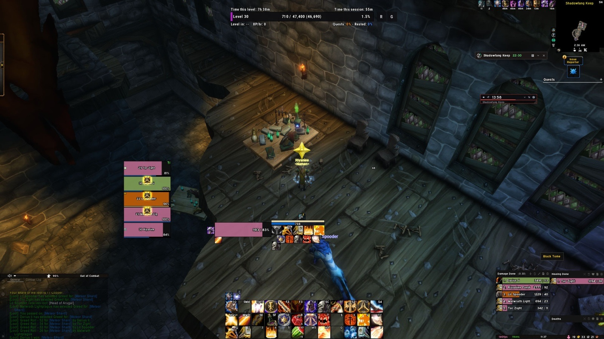

El <a class="wf-wh wf-q2" href="https://www.wowhead.com/forever/item=275989">Tome of Dalaran</a> no se gasta al invocar a <a class="wf-wh wf-plain" href="https://www.wowhead.com/forever/npc=247032">Lyn the Ignored</a>. El libro se queda en tus bolsas y vuelve a funcionar a los 3 minutos. Un grupo que cae ante el jefe oculto de City of Dalaran en la beta de WoW Forever puede llamarlo de nuevo casi al instante.

Cómo conseguir el libro y dónde usarlo se descubrió hace dos días. Está en el [artículo sobre el Tome of Dalaran](/es/news/the-tome-of-dalaran-summons-lyn-the-ignored/). En resumen, son tres pasos.

## Tres pasos

1. **Shadowfang Keep.** Derrota a <a class="wf-wh wf-plain" href="https://www.wowhead.com/forever/npc=4275">Archmage Arugal</a>, el último jefe de [Shadowfang Keep](/es/guides/dungeons/shadowfang-keep/). El <a class="wf-wh wf-q1" href="https://www.wowhead.com/forever/item=276561">Black Tome</a> está sobre la mesa de su sala.
2. **Ambermill.** Usa el Black Tome en el Ambermill Leyline Focus, el cristal azul del ayuntamiento de Ambermill en Silverpine Forest, en /way 63.4 64.3. Se convierte en el Tome of Dalaran.
3. **City of Dalaran.** Derrota a <a class="wf-wh wf-plain" href="https://www.wowhead.com/forever/npc=247126">Atrexis the Grave Knight</a> y sigue la alcantarilla. Donde la rampa de la derecha sube y sale de la alcantarilla, sigue recto por el túnel. Usa el libro sobre el círculo morado del suelo.

## Un guiño a Ragnaros

Lyn the Ignored no llega en silencio. Tras una breve escena, el jefe pregunta: "Why am I being summoned now... this feels too soon." Es un guiño a <a class="wf-wh wf-plain" href="https://www.wowhead.com/forever/npc=11502">Ragnaros</a> en Molten Core, que le grita a Majordomo Executus que lo han despertado demasiado pronto.

Qué suelta Lyn the Ignored y cómo funciona el combate, aún no se sabe. La mazmorra es para los niveles 28 a 33, y la beta acaba en el nivel 30. Los demás jefes están en la [guía de City of Dalaran](/es/guides/dungeons/city-of-dalaran/).
