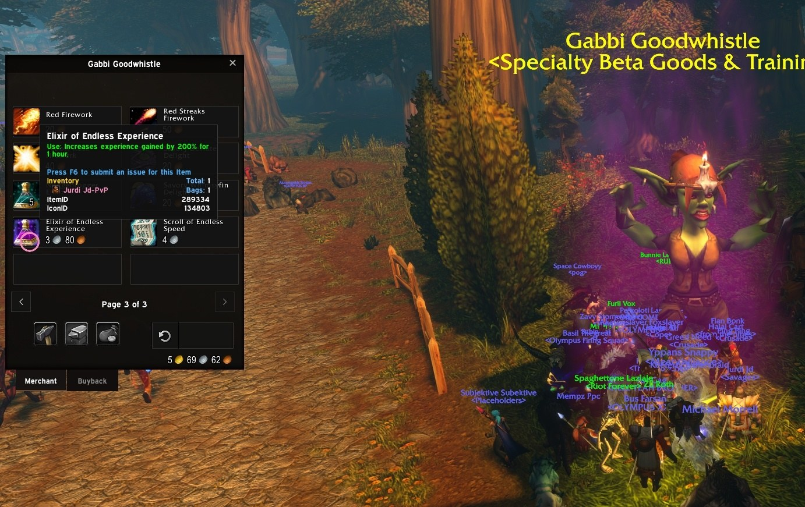
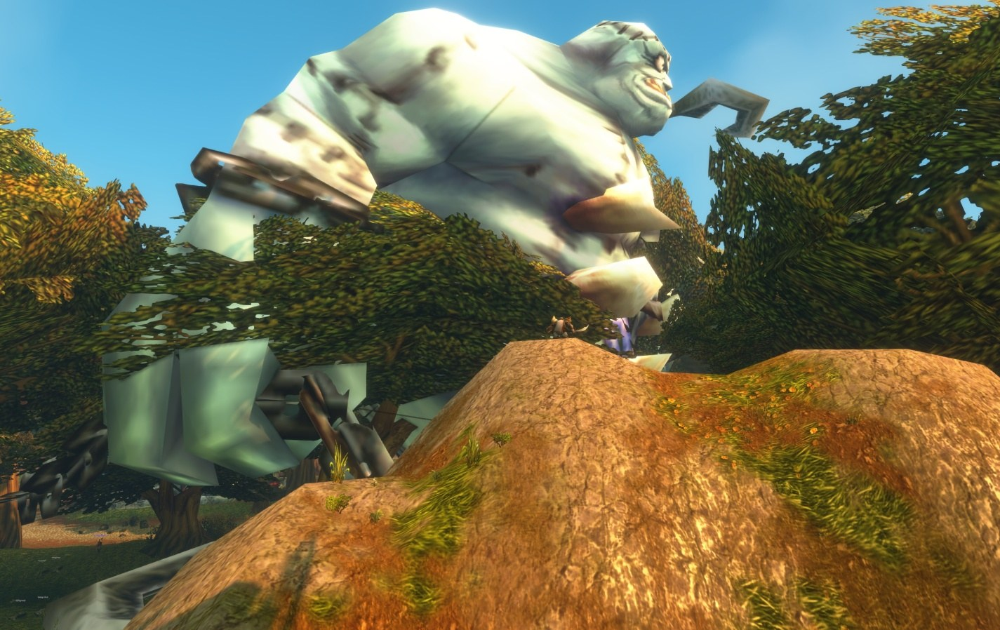
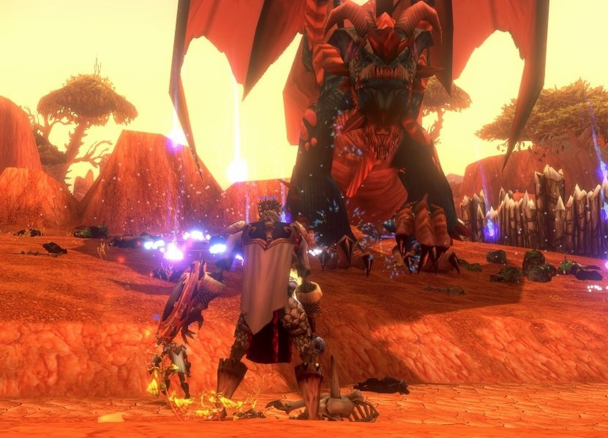
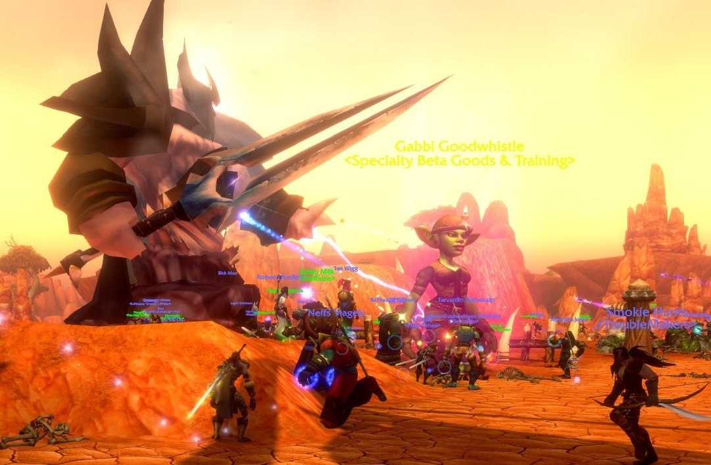

La beta de World of Warcraft: Forever terminó a lo grande. En sus últimas horas, world bosses recorrieron las zonas de inicio, cayeron Sulfuras y Thunderfury, mobs normales dieron Tier 1 y la plaga del Scourge de 2008 volvió a extenderse por Azeroth.

Blizzard había [anunciado 24 horas de caos](/es/news/epics-and-azuregos-as-the-beta-says-goodbye/) para el final de la beta. Se [cerró el 23 de octubre](/es/news/blizzard-closes-the-beta-and-thanks-the-testers/) a las 19:00, hora belga.

## Una goblin con artículos de beta

Primero apareció un PNJ nuevo frente a las capitales: Gabbi Goodwhistle, Specialty Beta Goods & Training. Vendía fuegos artificiales, un pergamino que te acelera a ti y a los jugadores cercanos, y un elixir que aumenta en un 200% la experiencia obtenida durante una hora.

## World bosses en las zonas de inicio

Después llegaron los world bosses: Azuregos, un "Super" Hogger, Voracious, Thunderaan y Lord Kazzak. Super Hogger, Bane of Elwynn, recorrió Elwynn Forest con un hacha en llamas.

## Legendarios y Tier 1

Los bosses soltaron legendarios conocidos, entre ellos Sulfuras, Hand of Ragnaros y Thunderfury, Blessed Blade of the Windseeker. Además, los mobs de cada zona de inicio soltaban los sets Tier 1 completos de Classic, con sus bonificaciones de conjunto, y armas de Molten Core. Blizzard avisó antes de que la fiesta casi seguro incluía objetos que no estarán en el juego tras el lanzamiento.

## La plaga de 2008

Por si fuera poco, Blizzard recuperó las cajas contaminadas de la invasión del Scourge de Wrath of the Lich King en 2008. La plaga volvió a extenderse por Azeroth. Un [clip del directo de Esfand](https://www.twitch.tv/esfandtv/clip/ObliqueBlightedJamDatSheffy-FTgyUYFWFn7KLcwD) lo muestra.

<figure class="wf-embed" data-wf-twitch="clip:ObliqueBlightedJamDatSheffy-FTgyUYFWFn7KLcwD">
  <button type="button" class="wf-embed__play">
    
    
      Clip de Twitch de Esfand
      Reproduce el clip. Esfand en Twitch.
    
  </button>
</figure>

## Lo que viene

[Early Name Reservation](/es/news/early-name-reservation-opens-on-27-october/) abre el martes 27 de octubre, y WoW Forever sale el 5 de noviembre a las 00:00, hora belga.
