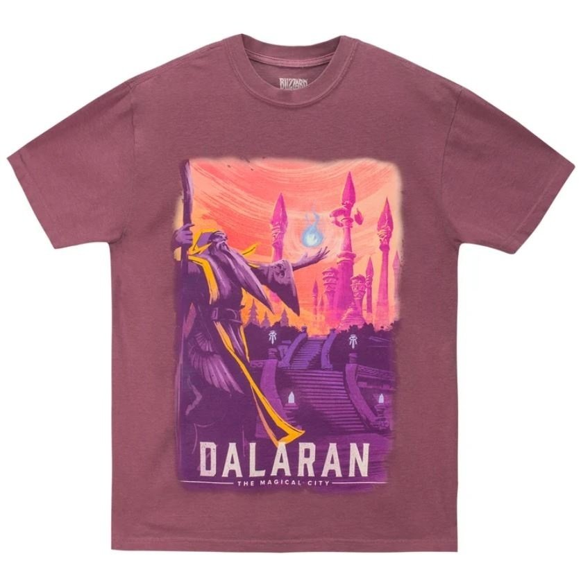
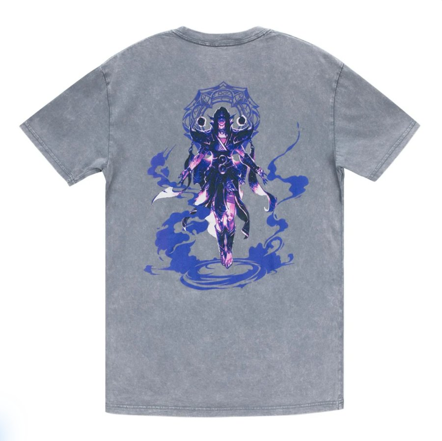

Le Blizzard Gear Store fait des soldes de Black Friday jusqu’à -60 %. Pour World of Warcraft: Forever, il y a deux t-shirts avec des affiches de voyage du lancement et un coffret de quatre de ces affiches. Jusqu’au 1er décembre, une commande de plus de 50 $ donne aussi trois codes en jeu.

## Forever dans les soldes

Le **Zephras Isle T-Shirt** et le **Dalaran T-Shirt** portent les affiches de voyage du lancement de Forever. Le **Travel Posters Gift Set** contient les affiches elles-mêmes : Zephras Isle, Dalaran, Mount Hyjal et Bandarion Keep à Tirisfal.

## Le reste des soldes

Les autres articles WoW en solde sont le What Sword Hoodie de l’annonce de la Worldsoul Saga, un Alliance Quarter-Zip, une veste à motifs d’armes, un Xal'atath T-Shirt, l’Arcantina Heat Changing Mug, une réplique de l’armure de Darion Mograine et une statuette d’Arthas.

## Trois codes au-dessus de 50 $

| | |
|---|---|
| Jusqu’au | 1er décembre |
| Condition | Une commande de plus de 50 $ d’articles éligibles |
| Diablo IV | Refined Mind Trophy |
| WoW Midnight | Deep Winter Toque, une apparence |
| Overwatch | Legendary Cyberhog Skin |

L’apparence est pour le WoW moderne, pas pour Forever. Tous les articles éligibles ne sont pas en solde pour le Black Friday. Le **Azeroth Forever Hoodie** compte pour les codes, mais n’a pas de remise. Combien de temps durent les prix du Black Friday, la boutique ne le dit pas. Les prix en euros et dans d’autres devises peuvent différer : regardez le [Gear Store](https://gear.blizzard.com/) de votre région.

