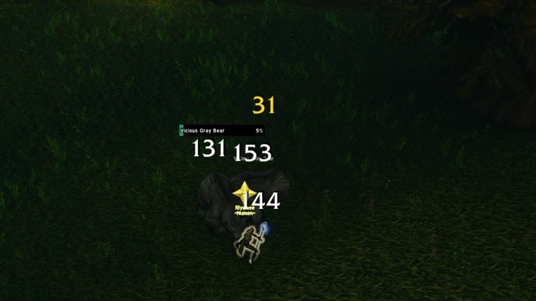
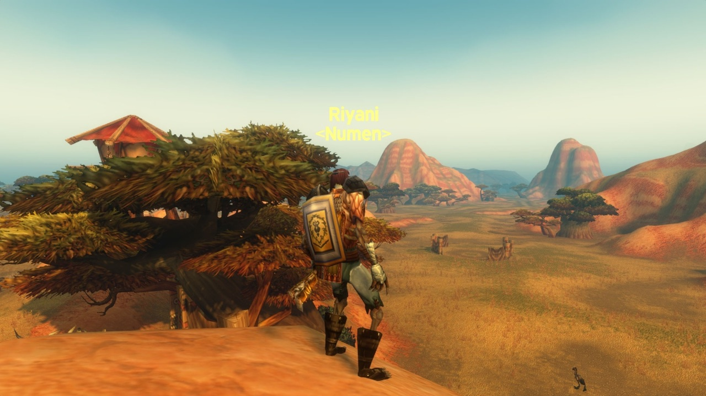

<a class="wf-wh wf-spell" href="https://www.wowhead.com/forever/spell=26573">Consecration</a> tire désormais 0,042 du spell power par tick, contre 0,095 auparavant. C’est le plus gros d’une série de changements pour le Paladin dans la beta de World of Warcraft: Forever. Righteous Fury génère à nouveau plus de menace, Salvation n’est plus une bénédiction et Reckoning stocke des charges.

## Ce qui change pour tous les Paladins

Blessing of Salvation et Greater Blessing of Salvation deviennent <a class="wf-wh wf-spell" href="https://www.wowhead.com/forever/spell=1038">Salvation</a> et Mass Salvation. Elles s’appliquent de la même façon, mais n’excluent plus <a class="wf-wh wf-spell" href="https://www.wowhead.com/forever/spell=20217">Blessing of Kings</a>, <a class="wf-wh wf-spell" href="https://www.wowhead.com/forever/spell=19742">Blessing of Wisdom</a> ni <a class="wf-wh wf-spell" href="https://www.wowhead.com/forever/spell=19740">Blessing of Might</a>. Avec Salvation, les Paladins apprennent aussi Revoke, qui retire Salvation à un membre du groupe ou du raid.

<a class="wf-wh wf-spell" href="https://www.wowhead.com/forever/spell=25780">Righteous Fury</a> porte la menace des dégâts Holy à 90 %, contre 60 % auparavant. Cette valeur avait baissé pendant la beta, quand Consecration et <a class="wf-wh wf-spell" href="https://www.wowhead.com/forever/spell=7294">Retribution Aura</a> étaient bien plus forts qu’aujourd’hui.

<a class="wf-wh wf-spell" href="https://www.wowhead.com/forever/spell=1311649">Seal of Fury</a> n’est plus écrasé par <a class="wf-wh wf-spell" href="https://www.wowhead.com/forever/spell=17">Power Word: Shield</a>, et son rang 3 s’apprend désormais au niveau 26 au lieu de 25. <a class="wf-wh wf-spell" href="https://www.wowhead.com/forever/spell=20293">Seal of Righteousness</a> profitait presque deux fois plus que prévu des dégâts des sorts ; c’est corrigé. <a class="wf-wh wf-spell" href="https://www.wowhead.com/forever/spell=20187">Judgement of Righteousness</a> et <a class="wf-wh wf-spell" href="https://www.wowhead.com/forever/spell=20414">Judgement of Fury</a> utilisent maintenant les coefficients d’un sort instantané.

## Talents

- **<a class="wf-wh wf-spell" href="https://www.wowhead.com/forever/spell=1310925">Shield Specialization</a>** rend 4 % de mana sur un blocage, contre 6 % auparavant, toujours avec un temps de recharge interne de 3 secondes.
- **<a class="wf-wh wf-spell" href="https://www.wowhead.com/forever/spell=20177">Reckoning</a>** donne désormais une charge à chaque déclenchement, jusqu’à 4. La prochaine attaque automatique utilise toutes les charges stockées comme attaques supplémentaires.
- **Champion of the Light**, dans l’arbre Retribution, ajoute 10, 20 ou 30 % de l’Intellect en dégâts des sorts, contre 20, 40 ou 60 % auparavant.
- **<a class="wf-wh wf-spell" href="https://www.wowhead.com/forever/spell=1311074">Sanctified Judgement</a>** ne génère plus de menace quand il rend du mana.

## Ce que cela change pour le tanking

Consecration était la raison d’emmener un Paladin Protection sur un pull avec beaucoup d’ennemis. Sa menace par tick était (base + 0,095 × spell power) × 1,6 et passe à (base + 0,042 × spell power) × 1,9, avec le nouveau Righteous Fury. Au rang 5, avec une base de 39 par tick, les deux donnent la même menace vers 162 de spell power. Avec moins de spell power, la nouvelle version génère plus de menace, avec plus, moins.

Salvation ne prend plus la place d’une bénédiction : un groupe n’a plus à choisir entre Salvation et Kings ou Wisdom. En raid, un troisième Paladin n’apporte plus que <a class="wf-wh wf-spell" href="https://www.wowhead.com/forever/spell=19979">Blessing of Light</a> et <a class="wf-wh wf-spell" href="https://www.wowhead.com/forever/spell=20346">Judgement of Light</a>.

Les charges de Reckoning peuvent être gardées pour le début d’un combat : jusqu’à 4 attaques supplémentaires en un seul coup. Changer d’arme coûte un temps de recharge global de 1,5 seconde, donc passer à une arme à deux mains pour ce coup puis revenir au bouclier a un prix.

Comment le Paladin Protection se situera face au Warrior Protection et au Druid Feral au niveau 60 n’est pas encore connu. La beta s’arrête au niveau 30, et Blizzard n’a pas dit si d’autres changements suivront pour le Paladin. Un build de talents de 1 à 60 se trouve dans le [guide de leveling du Paladin](/fr/guides/paladin-leveling/).
