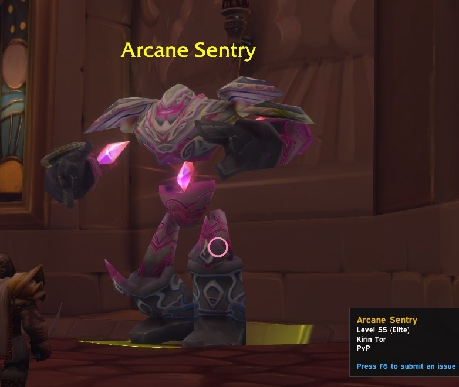
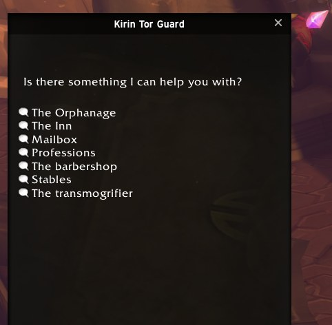
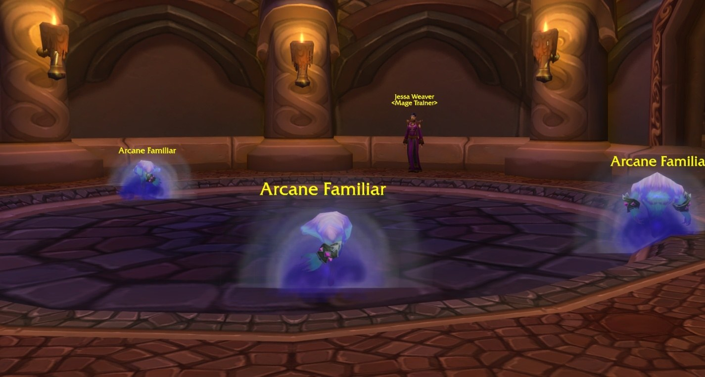
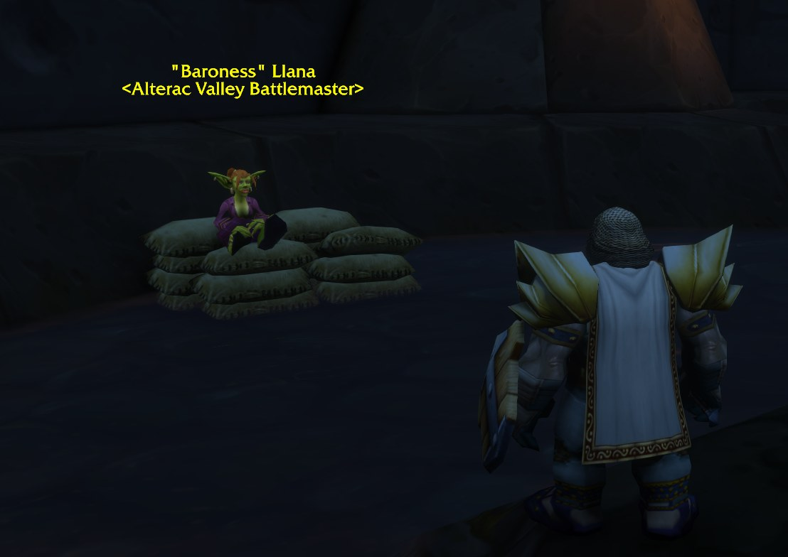
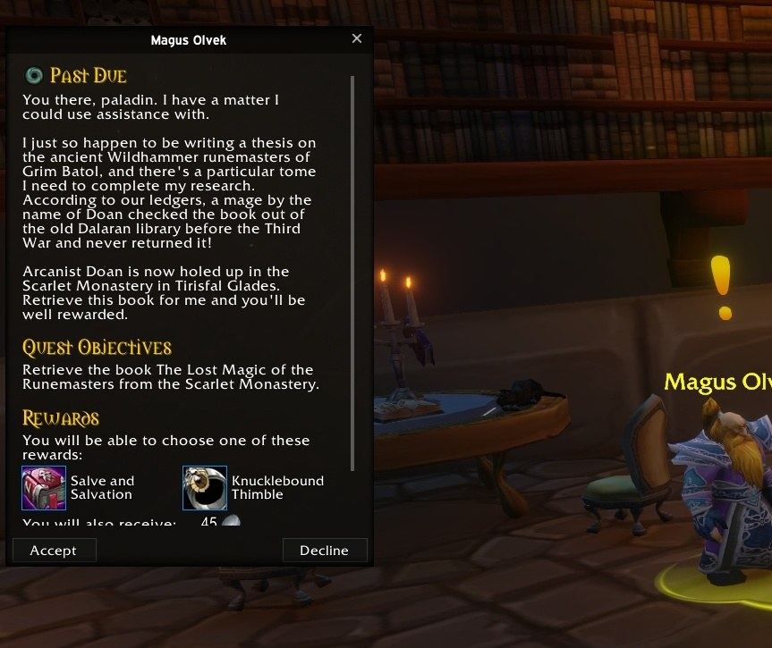
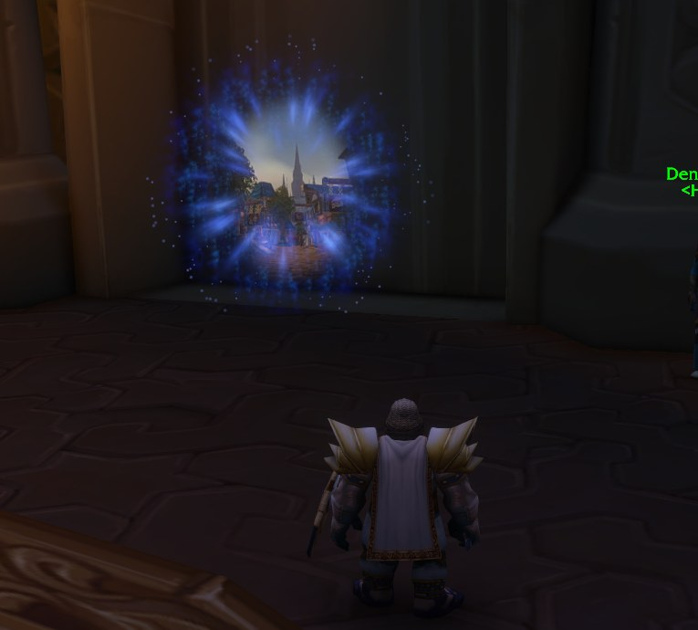
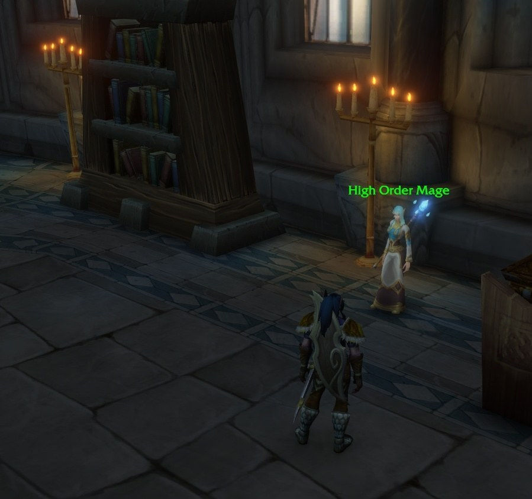
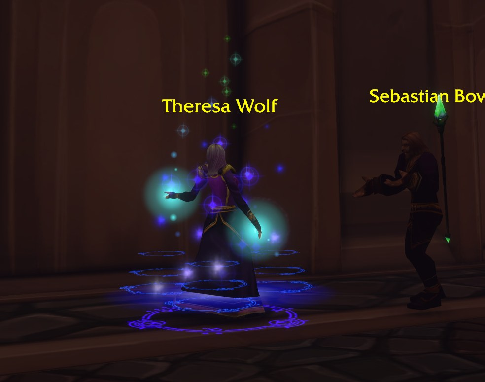

Le dernier build de la bêta de World of Warcraft: Forever a beaucoup changé Dalaran. Les Arcane Sentries sont maintenant des élites de niveau 55, des battlemasters se trouvent dans l'Underbelly et les joueurs de l'Alliance reçoivent une nouvelle quête. Le portail de Stormwind vers Dalaran semble avoir disparu.

Dalaran [a ouvert pour l'Alliance](/fr/news/dalaran-opens-on-the-beta-for-the-alliance-only/) plus tôt dans la bêta. Les changements sont arrivés dans le dernier build avant la fermeture de la bêta le 23 octobre.

## Gardes et maîtres

Les Arcane Sentries sont plus présentes dans la ville. Ce sont maintenant des élites de niveau 55.

Les Kirin Tor Guards indiquent maintenant le chemin. Ils montrent l'orphelinat, l'auberge, la boîte aux lettres, les maîtres de métiers, le barbier, les écuries et le transmogrificateur.

En plus des maîtres de métiers, Dalaran a aussi des maîtres de classe. Parmi eux, un maître Druid et un maître Mage.

## Des battlemasters dans l'Underbelly

L'Underbelly a maintenant des battlemasters pour chaque champ de bataille, aussi pour [le nouveau Darkspear Islands](/fr/news/darkspear-islands-pits-15-players-against-15/). <a class="wf-wh wf-plain" href="https://www.wowhead.com/forever/npc=29534">&quot;Baroness&quot; Llana</a>, l'Arena Organizer de Wrath of the Lich King, est l'Alterac Valley Battlemaster dans Forever.

## Une quête pour l'Alliance

Les joueurs de l'Alliance trouvent une nouvelle quête à Dalaran : <a href="https://www.wowhead.com/forever/quest=96800">Past Due</a> de <a class="wf-wh wf-plain" href="https://www.wowhead.com/forever/npc=264265">Magus Olvek</a>. Un mage nommé Doan a emprunté un livre à l'ancienne bibliothèque de Dalaran avant la Third War et ne l'a jamais rendu. Les joueurs récupèrent The Lost Magic of the Runemasters auprès d'<a class="wf-wh wf-plain" href="https://www.wowhead.com/forever/npc=6487">Arcanist Doan</a>, le dernier boss de la Scarlet Monastery Library.

En récompense, les joueurs choisissent entre Salve and Salvation et Knucklebound Thimble. Magus Olvek est connu du World of Warcraft Trading Card Game.

## Le portail vers Stormwind

Le portail de Dalaran vers Stormwind existe toujours. Le portail retour de Stormwind vers Dalaran semble avoir disparu.

Dans la Silver Enclave, où se trouvaient les portails de l'Alliance dans Wrath of the Lich King, Theresa Wolf lance un sort. Ce qu'elle invoque n'est pas connu.

Si Dalaran change encore avant le lancement du 4 novembre, on ne le sait pas.
