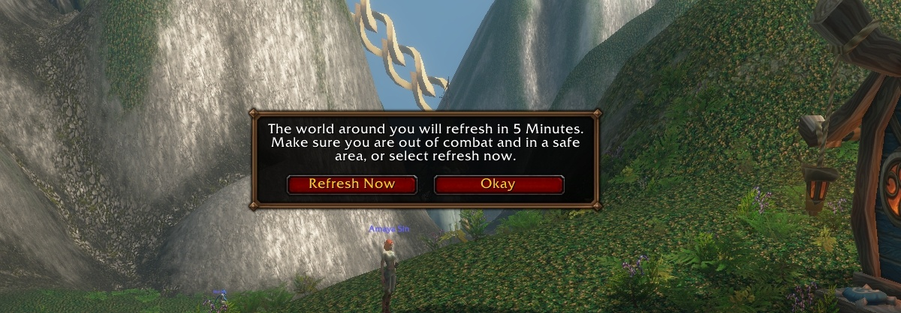

Le layering de World of Warcraft: Forever suscite des plaintes chez les joueurs de la bêta. Quitter un groupe envoie ce joueur sur un autre layer, et le chef de groupe aussi. Des zones voisines peuvent aussi avoir des layers différents. Blizzard parle de petites étapes.

## Ce qui a changé

Un layer est l'une des copies d'une zone, chacune tournant de son côté. Forever a déjà apporté une amélioration : le jeu [prévient cinq minutes avant un changement de layer forcé](/fr/news/phasing-warning-before-a-zone-refresh/), avec un bouton Refresh Now. Les joueurs, et surtout ceux du mode Hardcore, l'ont bien accueilli.

Les groupes fonctionnent autrement. Dans les versions précédentes de Classic, un joueur qui rejoignait un groupe passait sur le layer du chef et y restait après son départ. Dans Forever, quitter un groupe envoie ce joueur sur un autre layer, et le chef de groupe change aussi.

## Des groupes qui se dispersent

Un post Reddit du 11 octobre qualifie le nouveau système de l'un des plus gros problèmes de la bêta. Rejoindre un groupe peut vous amener chez les autres, ou attirer tout le groupe chez vous. Quand le groupe se dissout, chacun retourne sur son layer de départ.

<figure class="wf-embed wf-embed--reddit" data-wf-reddit="r/classicwow/comments/1x385ws/new_layering_system_is_one_of_the_biggest_issues">
  <button type="button" class="wf-embed__play">
    
    
      New layering system is one of the biggest issues with WoW Forever
      Charger le post du subreddit classicwow.
    
  </button>
</figure>

Le post donne des exemples. Celui qui court aider un ami attaqué dans Stranglethorn Vale peut tout aussi bien l'éloigner du combat. Le chat général est lui aussi réparti par layer, ce qui complique la recherche d'un groupe. Et selon un commentaire, une invitation de groupe refusée envoie souvent un joueur sur un autre layer, ce qui dans une grotte peut signifier une salle pleine de monstres fraîchement apparus.

## Chaque zone a ses propres layers

Les layers sont désormais [liés à une zone](/fr/news/grouping-slows-quests-so-players-level-alone/), donc franchir une frontière peut mener à un nouveau layer. Le créateur de contenu HelloJTello l'a filmé à la frontière entre Dalaran et Silverpine Forest, où d'autres joueurs apparaissent et disparaissent. HelloJTello s'attend à ce que Blizzard corrige cela avec le temps.

<figure class="wf-embed wf-embed--x" data-wf-x="2108707166341476510">
  <button type="button" class="wf-embed__play">
    
    
      HelloJTello sur le layering à la frontière d'une zone
      Charger le post de X.
    
  </button>
</figure>

La même chose se produit entre Tirisfal Glades et les Ruins of Lordaeron au-dessus de l'Undercity, comme le montre un [clip Twitch de JurdiJD](https://www.twitch.tv/jurdijd/clip/SmoothWittyFriseeDerp-iQ2kNoGTGfqeobqo).

<figure class="wf-embed" data-wf-twitch="clip:SmoothWittyFriseeDerp-iQ2kNoGTGfqeobqo">
  <button type="button" class="wf-embed__play">
    
    
      Clip Twitch de JurdiJD
      Lancez le clip. JurdiJD sur Twitch.
    
  </button>
</figure>

## Petit à petit

Dans [l'épisode 4 du podcast des développeurs](/fr/news/podcast-episode-4-cuts-honor-in-alterac-valley/), un invité a parlé de groupes de raid qui se retrouvent soudain sur un autre layer. « Nous avançons par petites étapes », a répondu le Lead Designer Tim Jones. Selon Jones, Blizzard a fait de gros progrès pour que le world PvP fonctionne à grande échelle.

L'équipe veut donner plus de contrôle aux joueurs : des groupes plus grands qu'un raid, ne plus être sorti d'un groupe au hasard, et du PvP à la frontière des zones. Jones espère en intégrer le plus possible au lancement du 4 novembre, et parle d'un travail continu ensuite.

Lesquels de ces changements seront prêts au lancement, Blizzard ne le dit pas. Dans [le premier épisode](/fr/news/a-first-developer-podcast-promises-fewer-blues/), Josh Greenfield qualifiait déjà de bugs deux autres problèmes de layers : un monstre rare qui disparaît quand deux joueurs se groupent, et un adversaire en world PvP qui s'efface dans un autre layer.
