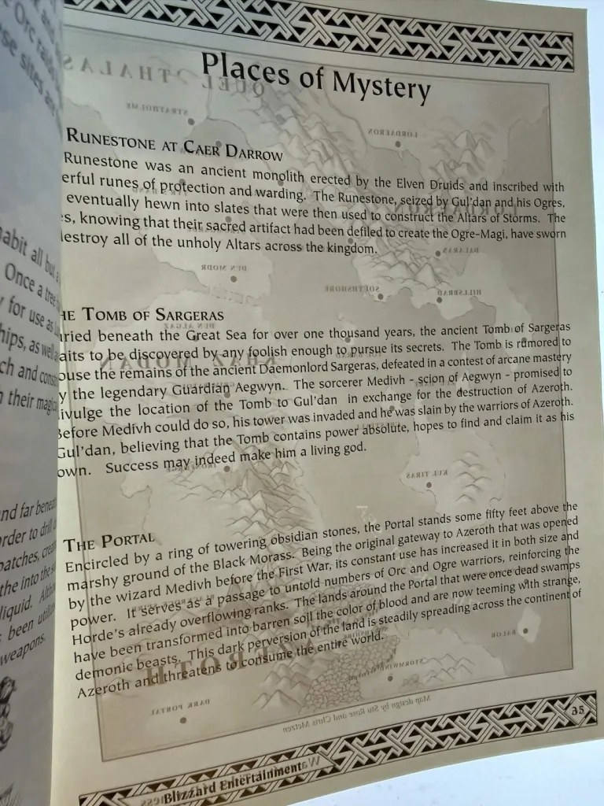
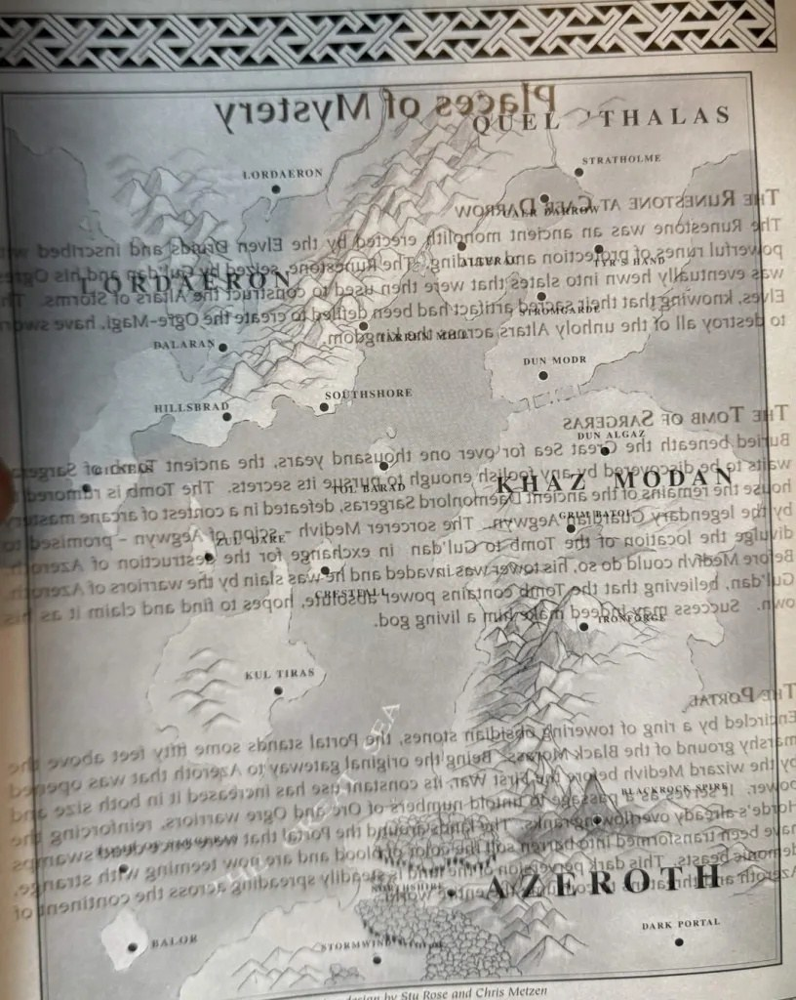

Des joueurs de la bêta de World of Warcraft: Forever ont trouvé une piste de pages, de clés et de caches cachées à travers Azeroth. Les indices semblent tirés des anciens manuels imprimés du jeu. On ne sait pas encore où mène la chasse, ni si une récompense attend au bout.

La recherche se déroule dans le WoW Secret Finding Discord, une communauté de joueurs qui traquent les secrets du jeu. Ils demandent à tous les joueurs de la bêta de signaler leurs trouvailles. Deux pages des anciens manuels montrent à quoi renvoient les indices : les Places of Mystery et la carte d’Azeroth.

## Ce qui a été trouvé jusqu’ici

Les objets ci-dessous forment une seule piste, dans cet ordre.

| Objet | Où | /way | Donne |
|---|---|---|---|
| **Burnt Page** | Arathi Highlands, dans un tonneau près du [Cozy Sleeping Bag](/fr/guides/cozy-sleeping-bag/) à Thoradin’s Wall. L’escalade commence à Hillsbrad Foothills, /way 87.6 47.9. | 22.7 24.2 | Un indice |
| **Torn Page** | Undercity, dans un tonneau à l’entrée arrière des égouts. Depuis la maintenance du 24 septembre, un couteau est posé à côté. | 22.9 36.2 | [Keystone Fragment](https://www.wowhead.com/forever/item=281350) |
| **Petit sac** | The Riverglades, derrière un Twilight Peon endormi. Sautez depuis /way 26.7 47.7. | 26.6 45.6 | Stone Key |
| **Burnt Page** | Blasted Lands, à Dreadmaul Hold. Il faut la Stone Key. | 45.2 16.5 | Un indice |
| **[Hidden Stash](https://www.wowhead.com/forever/object=674126)** | Un’Goro Crater, dans la grotte de Ringo, entrée à /way 52.5 51.1. Elle n’apparaît qu’avec la [Night Watchman’s Torch](/fr/guides/night-watchmans-torch/) allumée. | 52.2 49.6 | Pas encore connu |

La Stone Key se trouvait d’abord dans Blackrock Mountain. Blizzard l’a déplacée vers The Riverglades pendant la bêta, sous le même objet.

Trois autres trouvailles font peut-être partie de la chasse, ou sont un hasard. Une Hidden Stash à Stonetalon Mountains, /way 40.7 52.8, contient une Brittle Key. Un Traveler’s Cache à Stranglethorn Vale, /way 14.4 27.2, contient une Torn Page. À Stormwind, une note nouvelle dans Forever se trouve à /way 67.2 82.5.

## Ce que disent les pages

La page brûlée d’Arathi renvoie aux égouts d’Undercity. Une partie de son texte a été retirée du jeu le 8 octobre.

> Living death on this page you will see. Only will you find the key if you look beneath mindless undeath. Sewer's trail, a toxic tail.

La page déchirée d’Undercity renvoie à la page 155 de l’ancien manuel. Elle contient aussi trois images.

> The furrowed gaze of the orcish warrior lays upon the map, and reveals the key.

La page brûlée des Blasted Lands décrit trois lieux, qui semblent correspondre aux Places of Mystery du manuel. La page déchirée de Stranglethorn tient en une ligne : « The calm comes before the storm ».

> Behind three places of mystery is a map.
> The top of the key is within the first body. The key is under ogre protection and lies on the other side of the warding there.
> The tomb in the middle is where the next piece will be found. A shallow mark below the guardian: look behind, and you will find what you seek.
> Surging with pride and overflowing with heat.
> Shine light through this passage to see a peak.
> On the other side, a careful span, the last of your key.

## Deux fragments manquent encore

Les fichiers de la bêta contiennent deux autres Keystone Fragments que personne n’a encore trouvés en jeu. L’un [s’empile par deux](https://www.wowhead.com/forever/item=284092), l’autre [par trois](https://www.wowhead.com/forever/item=284093). Blizzard a modifié et déplacé ces objets pendant la bêta, ce qui laisse penser à un but final. S’il s’agit d’une attunement ou d’une récompense, on ne le sait pas.

Les chasseurs regardent maintenant du côté d’Uldaman. Un voyage difficile pour des personnages de niveau 30, le maximum de la bêta.
