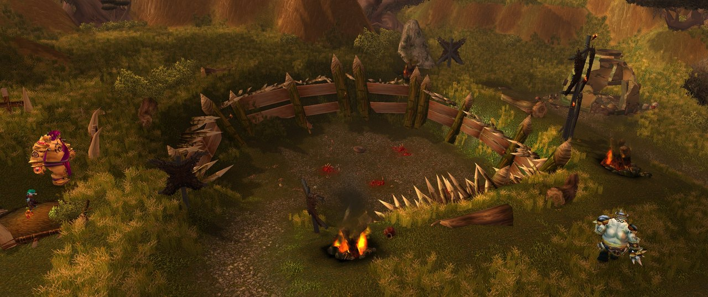
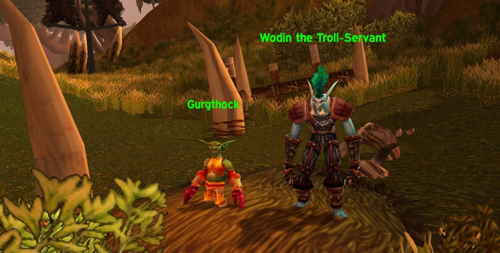

Les Riverglades ont leur propre version du Ring of Blood. Dans le Bloodmaster's Ring, au cœur du territoire ogre, les joueurs affrontent les meilleurs combattants du clan Bolder'ok. Blizzard a montré l'arène dans sa nouvelle vidéo sur la progression après le niveau 30.

<figure class="wf-embed" data-wf-video="hTCBfrFZ2qU">
  <button type="button" class="wf-embed__play">
    
    
      Your Leveling Journey Past 30, World of Warcraft: Forever
      Lancer la vidéo. World of Warcraft sur YouTube, 7 minutes. Le ring apparaît à 4:10.
    
  </button>
</figure>

Les Riverglades sont l'une des nouvelles zones de World of Warcraft: Forever. Les joueurs y arrivent vers le niveau 36, et la Horde comme l'Alliance y ont des camps de quêtes. Les Bolder'ok sont des ogres qui ont rompu avec le Twilight's Hammer après la Deuxième Guerre. Le reste de la zone est dans [l'article sur la vidéo](/fr/news/blizzard-shows-the-road-from-level-30-to-60/).

## Ce que montrent les fichiers de la bêta

Dans la vidéo, Blizzard consacre une seule phrase au ring. Les fichiers de la bêta en disent plus, même si Blizzard n'en a rien confirmé. Le ring a un maître des lieux : <a class="wf-wh wf-plain" href="https://www.wowhead.com/forever/npc=257059">Chub'chob</a>, Bloodmaster of Bolder'ok, un élite de niveau 45. Le vainqueur obtient <a class="wf-wh wf-spell" href="https://www.wowhead.com/forever/spell=1280857">Champion of the Bloodmaster's Ring</a>, avec la phrase « Earned the respect of the Bolder'ok. »

Il existe aussi un anneau rare du même nom, <a class="wf-wh wf-q3" href="https://www.wowhead.com/forever/item=275043">Bloodmaster's Ring</a>, niveau d'objet 45, avec de l'Endurance, de l'Intelligence et de la puissance des sorts. On ne sait pas encore comment l'obtenir.

## Le Ring of Blood dans The Burning Crusade

Le Ring of Blood était une suite de quêtes en Nagrand dans The Burning Crusade. Le gobelin Gurgthock et Wodin the Troll-Servant envoyaient les joueurs dans l'arène contre des adversaires toujours plus forts, jusqu'à ce que l'un d'eux devienne champion. L'idée est revenue dans presque chaque extension suivante, jusqu'à Dragonflight.

On ne sait pas si Gurgthock et Wodin reviennent dans Forever. Dans les fichiers de la bêta, le ring appartient à Chub'chob.
