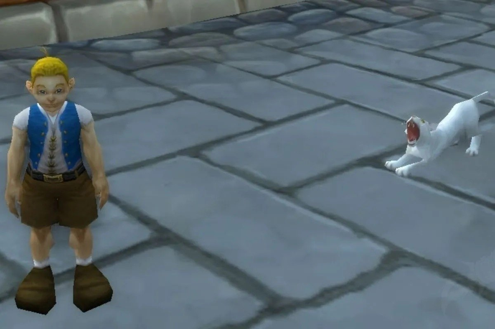

Deux marchands de la bêta de WoW Forever vendent un pet pour environ 60 pièces d'argent, mais ne restent jamais en place. Mayhoa Skyhoof marche dans Orgrimmar, Lil Timmy dans Stormwind. Chacun n'a qu'un pet en stock, pour un seul acheteur à la fois.

## Mayhoa Skyhoof à Orgrimmar

<a class="wf-wh wf-plain" href="https://www.wowhead.com/forever/npc=268745">Mayhoa Skyhoof</a> vend le <a class="wf-wh wf-q1" href="https://www.wowhead.com/forever/item=277508">Prairie Wolf Pup Carrier</a>, un nouveau pet dans Forever. Il coûte 63 pièces d'argent et 15 de cuivre sur la bêta. Ce prix peut encore changer avant la sortie. Le [Prairie Wolf Pup](/fr/guides/pets/prairie-wolf-pup/) a sa propre page dans le guide des pets.

Mayhoa est liée à Thunder Bluff, mais elle est listée à Orgrimmar. Elle n'attend pas à un étal et erre dans la ville. Des joueurs l'ont vue dans la Valley of Honor, près de l'étang des entraîneurs de pêche, et entre The Drag et la Valley of Wisdom.

Elle s'arrête en chemin et, selon des joueurs, fait parfois demi-tour ou reste immobile au milieu de son trajet. On ne sait pas où elle disparaît exactement.

<figure class="wf-embed wf-embed--reddit" data-wf-reddit="r/wowforever/comments/1wz8cqr/lets_get_this_girl_some_puppies_full_stop">
  <button type="button" class="wf-embed__play">
    
    
      Let's get this girl some puppies. Full stop.
      Charger le message du subreddit wowforever.
    
  </button>
</figure>

## Lil Timmy à Stormwind

Pour l'Alliance, <a class="wf-wh wf-plain" href="https://www.wowhead.com/forever/npc=8666">Lil Timmy</a> vend le <a class="wf-wh wf-q1" href="https://www.wowhead.com/forever/item=8489">Cat Carrier (White Kitten)</a> pour 60 pièces d'argent. Il se promène dans Stormwind. Commencez par Cathedral Square et les canaux voisins. Des joueurs l'ont vu traverser les ponts et passer par le Trade District, Old Town et le Dwarven District.

Il disparaît près de Cathedral Square et revient plus tard. Il n'a qu'un point d'apparition, donc attendre à Cathedral Square fonctionne s'il n'est pas là. La durée de sa réapparition n'est pas connue. Le [White Kitten](/fr/guides/pets/white-kitten/) figure aussi dans le guide des pets.

La vitesse de réapprovisionnement des deux marchands sur la bêta n'est pas connue non plus. Elle peut différer des versions précédentes de WoW. Tous les autres pets et où les obtenir sont dans le [guide des pets](/fr/guides/pets/).
