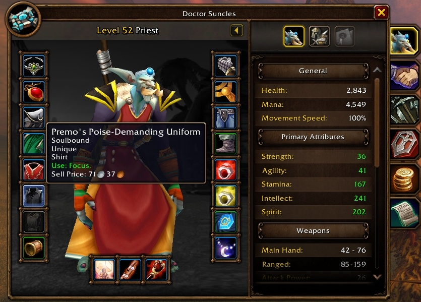

Una sporgenza nascosta a Blackrock Depths dà un nuovo giocattolo in World of Warcraft: Forever. In Season of Discovery lo stesso punto ospitava la missione del Rainbow Generator. Ora ci trovi <a class="wf-wh wf-q3" href="https://www.wowhead.com/forever/item=221315">Traveler's Symbols</a>, un cartello che gli altri giocatori possono leggere.

## Cosa ottieni

Traveler's Symbols si vincola alla raccolta. Piazza un cartello per 1 minuto. Scegli un messaggio e il cartello resta 1 ora, visibile a chiunque passi. Il tempo di ricarica è di 30 minuti.

Scegli da un elenco fisso: Vigilantes Active, Here!, Watchful Eyes, Good Camping, Bad Farm, Missed you, Do not follow, Unsafe area, I went this way, Follow, Need special item, Secret nearby e Death Trap.

La stessa sporgenza dà anche <a class="wf-wh wf-q1" href="https://www.wowhead.com/forever/item=221316">Premo's Poise-Demanding Uniform</a> e <a class="wf-wh wf-q2" href="https://www.wowhead.com/forever/item=216619">Student Fodder</a>. La camicia ti gira verso il bersaglio quando la usi. In Season of Discovery ebbe un ruolo chiave nel segreto di Seventeen and the Secret Agents, quindi i cacciatori di segreti si aspettano che conti anche in Forever.

## Come raggiungere la sporgenza

Serve un po' di parkour. Prenditi il tuo tempo con i salti, perché un salto sbagliato ti fa cadere molto in basso, nella lava.

1. Vai al ponte appena a est del Ring of Law. Porta a nord sopra la lava. Guarda in basso a sinistra: sulla base di un pilastro c'è un nano Dark Iron amichevole.
2. Elimina i Blazing Fireguards e il gruppo di nani Shadowforge sul ponte.
3. Spostati sul lato sinistro del ponte, vicino a un piccolo braciere. Sali sulla ringhiera, resta attaccato alla parete di roccia e salta sulla piattaforma vicino al muro.
4. Vai in fondo alla piattaforma, sempre contro il muro, e spingi forte nell'angolo di roccia.
5. Gira la spalla sinistra verso il muro e corri con cautela lungo di esso finché cadi nell'angolo aperto. Lasciati scendere sullo sperone di roccia sottostante. Quella è la sporgenza.

## Una scorciatoia per Lord Incendius

Sulla sporgenza c'è anche una porta. Ti porta su una sporgenza proprio sopra il cerchio di <a class="wf-wh wf-plain" href="https://www.wowhead.com/forever/npc=9017">Lord Incendius</a>. Non si torna indietro, quindi prendila solo se vuoi andare lì. Segui la sporgenza fino alla fine e salta con cautela sul ponte sottostante.

Il cacciatore di segreti SeventeenUncles ha trovato il punto. All'inizio della settimana i giocatori hanno trovato anche un [travestimento Defias in Alcaz Prison](/it/news/alcaz-prison-hides-a-defias-disguise-toy/). Il dungeon stesso è nella [guida di Blackrock Depths](/it/guides/dungeons/blackrock-depths/guide/).
