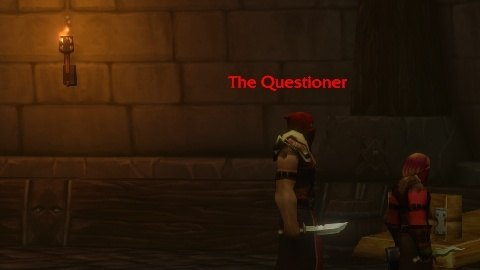
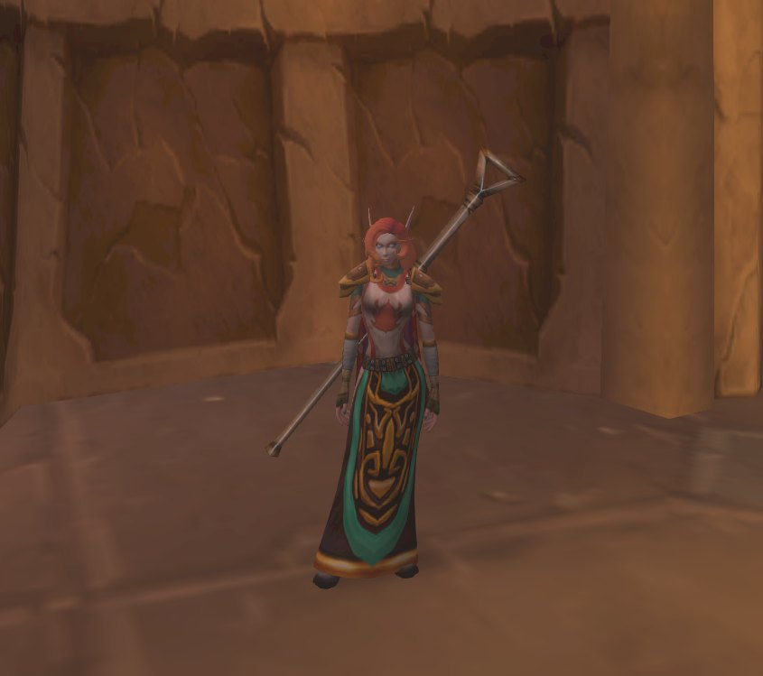
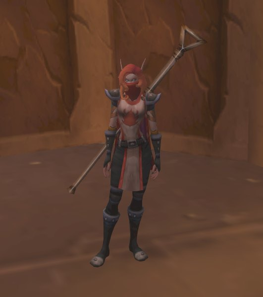

I giocatori hanno trovato un giocattolo segreto in World of Warcraft: Forever. L'<a class="wf-wh wf-q3" href="https://www.wowhead.com/forever/item=279471">Alcaz Operative Insignia</a> ti traveste da agente Defias di Alcaz Island per 10 minuti. La catena inizia nel nuovo dungeon Alcaz Prison, e il suo primo boss deve restare vivo.

## Come funziona la catena

Ripulisci Alcaz Prison, ma lascia in vita il primo boss, The Questioner. Alla fine del dungeon ricevi la missione <a href="https://www.wowhead.com/forever/quest=96335">The Man in the Iron Chains</a>. Ti chiede di recuperare l'Alcaz Shackle Key da The Questioner, quindi ti serve ancora.

Poi la pista porta a Moonbrook, nel Westfall. I giocatori dell'Alliance proseguono verso Stormwind, quelli dell'Horde verso Booty Bay. Lì ricevi una <a class="wf-wh wf-q2" href="https://www.wowhead.com/forever/item=279450">Fractured Insignia</a>, che richiede il livello 40. Sei di queste formano l'Alcaz Operative Insignia.

## Cosa fa il giocattolo

L'Alcaz Operative Insignia è un giocattolo che si vincola alla raccolta. Ti traveste da agente Defias di Alcaz Island per 10 minuti, con un tempo di ricarica di 30 minuti.

I giocatori del Discord WoW Secret Finding hanno trovato il segreto. Come raccogliere sei Fractured Insignia, e se servano sei run, non è ancora noto. Il dungeon stesso è nella [guida di Alcaz Prison](/it/guides/dungeons/alcaz-prison/guide/).
