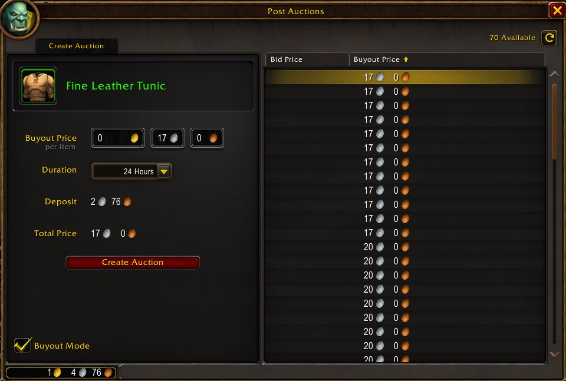
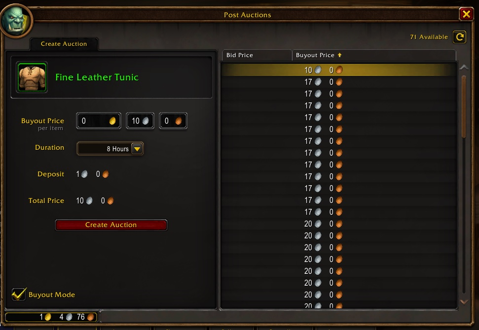

Ogni asta in World of Warcraft: Forever costa almeno 1 argento di deposito. Nel gioco originale il deposito seguiva il prezzo di vendita al mercante, spesso pochi rame. Se l'oggetto non si vende, quell'argento è perso.

## Come funziona il deposito

Paghi il deposito quando metti l'asta. Lo riprendi se l'oggetto si vende. Lo perdi se annulli l'asta o se scade.

Nel gioco originale il deposito è una parte del prezzo di vendita al mercante, e cresce con la durata:

| Durata | Deposito |
|---|---|
| **2 ore** | 5% del prezzo di vendita |
| **8 ore** | 20% del prezzo di vendita |
| **24 ore** | 60% del prezzo di vendita |

## Una regola in più in Forever

Forever mette un minimo: il deposito non scende mai sotto 1 argento. Una <a class="wf-wh wf-q2" href="https://www.wowhead.com/forever/item=4243">Fine Leather Tunic</a> si vende a un mercante per 4 argento e 61 rame. Per 24 ore il deposito è di 2 argento e 76 rame, esattamente il 60%. Per 8 ore dovrebbe essere di 92 rame, ma il gioco chiede 1 argento.

Ogni oggetto economico mostra lo stesso 1 argento. Nei primi livelli è molto denaro per un'asta che forse non si vende. Una pila più grande distribuisce l'argento su più oggetti. Un mercante paga una somma fissa, senza quel rischio.

## Un bug o una scelta

Nella beta il minimo è stato segnalato come bug, perché il deposito sullo schermo non corrispondeva a quanto il gioco tratteneva. Sui server live i due coincidono.

Blizzard non ha detto se vuole questo minimo. Forever gira sul client del gioco moderno, e quella versione ha un deposito minimo di 1 argento almeno dal 2018.
