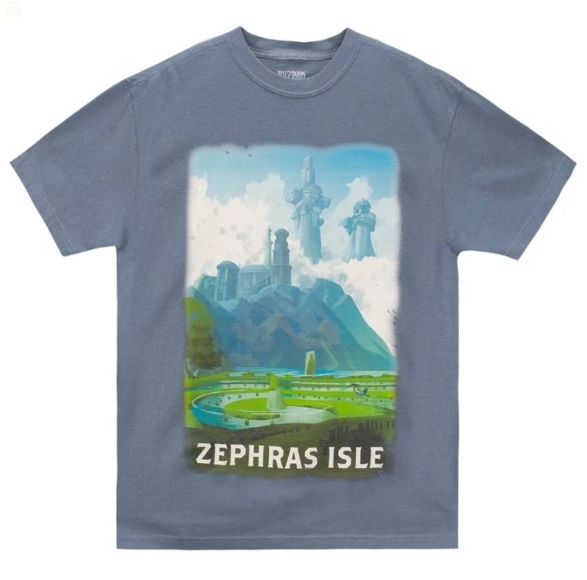
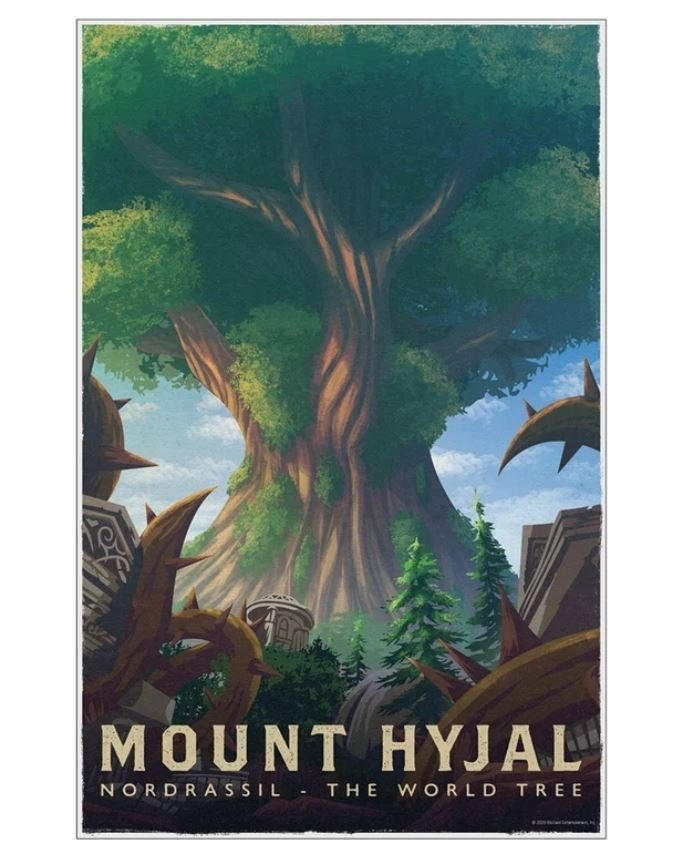
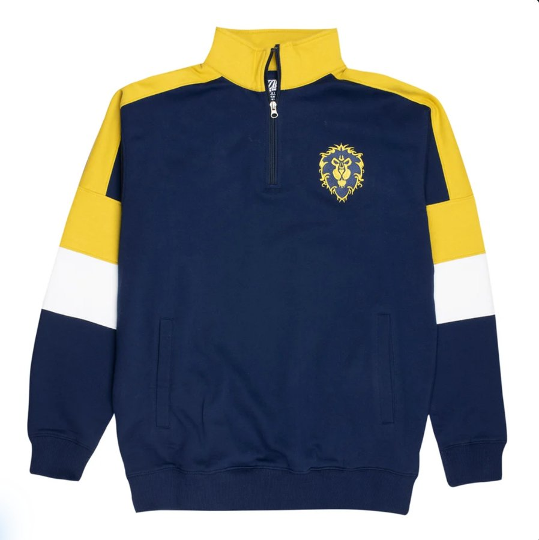

Il Blizzard Gear Store ha i saldi del Black Friday fino al 60%. Per World of Warcraft: Forever ci sono due magliette con i poster di viaggio del lancio e un set con quattro di quei poster. Fino al 1° dicembre un ordine sopra i 50 $ dà anche tre codici per il gioco.

## Forever nei saldi

La **Zephras Isle T-Shirt** e la **Dalaran T-Shirt** portano i poster di viaggio con cui è partito Forever. Il **Travel Posters Gift Set** contiene le stampe: Zephras Isle, Dalaran, Mount Hyjal e Bandarion Keep a Tirisfal.

## Il resto dei saldi

Altri articoli di WoW in saldo sono la What Sword Hoodie della presentazione della Worldsoul Saga, un Alliance Quarter-Zip, una giacca con armi, una Xal'atath T-Shirt, la Arcantina Heat Changing Mug, una replica dell’armatura di Darion Mograine e una statua di Arthas.

## Tre codici sopra i 50 $

| | |
|---|---|
| Fino al | 1° dicembre |
| Condizione | Un ordine sopra i 50 $ di articoli validi |
| Diablo IV | Refined Mind Trophy |
| WoW Midnight | Deep Winter Toque, una trasmogrificazione |
| Overwatch | Legendary Cyberhog Skin |

La trasmogrificazione è per il WoW moderno, non per Forever. Non tutti gli articoli validi sono in saldo per il Black Friday. La **Azeroth Forever Hoodie** conta per i codici, ma non è scontata. Quanto durano i prezzi del Black Friday, il negozio non lo dice. I prezzi in euro e in altre valute possono variare: guarda il [Gear Store](https://gear.blizzard.com/) della tua regione.

