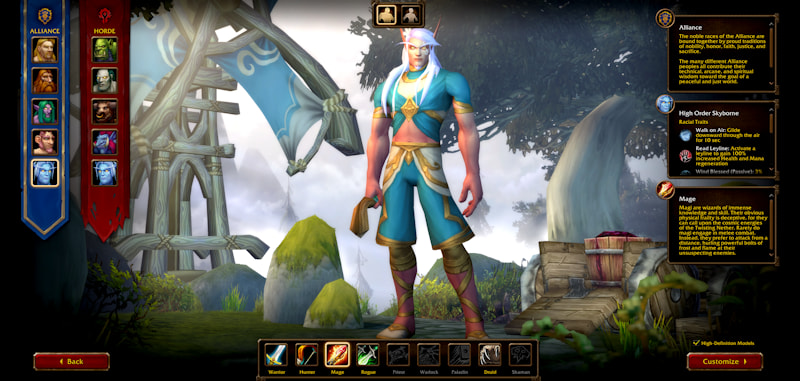

La beta di World of Warcraft: Forever ha chiuso il 23 ottobre, dopo cinque settimane di test. Blizzard ringrazia i giocatori sui forum. La creazione dei personaggi apre martedì 27 ottobre, e il gioco esce il 4 novembre.

La beta si è fermata alle 19:00, ora belga. Blizzard l'aveva prolungata di due giorni, come spiega [l'articolo sulla beta prolungata](/it/news/the-beta-stays-open-until-23-october/).

> The WoW Forever Beta is now closed, and we're incredibly grateful to everyone who joined us over the last five weeks of playtesting, data gathering, bug reporting, and feedback.
>
> We're now quickly moving into a period of a few short days where we will do some focused work on priority issues and the game service itself, so that it will be in good shape for launch day on November 4.

## Qualche giorno di lavoro mirato

Nei prossimi giorni Blizzard lavora sui problemi prioritari e sul servizio di gioco stesso, perché il gioco sia in buono stato il giorno del lancio. Di quali problemi si tratti, Blizzard non lo dice.

## Ruleset e nome prima del lancio

Il 27 ottobre apre la creazione dei personaggi. I giocatori scelgono allora un ruleset e un nome prima ancora che il gioco sia online, dice Blizzard. Chi può prenotare e da che ora è spiegato nell'[articolo sulla prenotazione anticipata dei nomi](/it/news/early-name-reservation-opens-on-27-october/); l'Europa apre alle 18:00, ora belga. Come funzionano i ruleset è spiegato nell'[articolo sui ruleset](/it/news/rulesets-replace-the-realm-list/).

## Il podcast continua

The WoW: Forever Podcast continua la prossima settimana, scrive Blizzard. Finora sono usciti cinque episodi, uno per ogni settimana di beta. Un cartello nell'episodio 5 lo diceva già, come spiega l'[articolo sul podcast](/it/news/the-podcast-continues-after-the-beta/). Di cosa parlerà il prossimo episodio non è noto.
