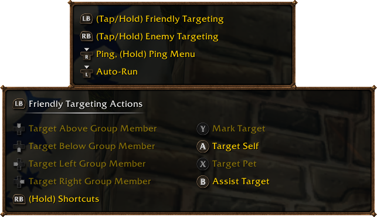
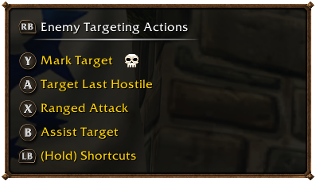
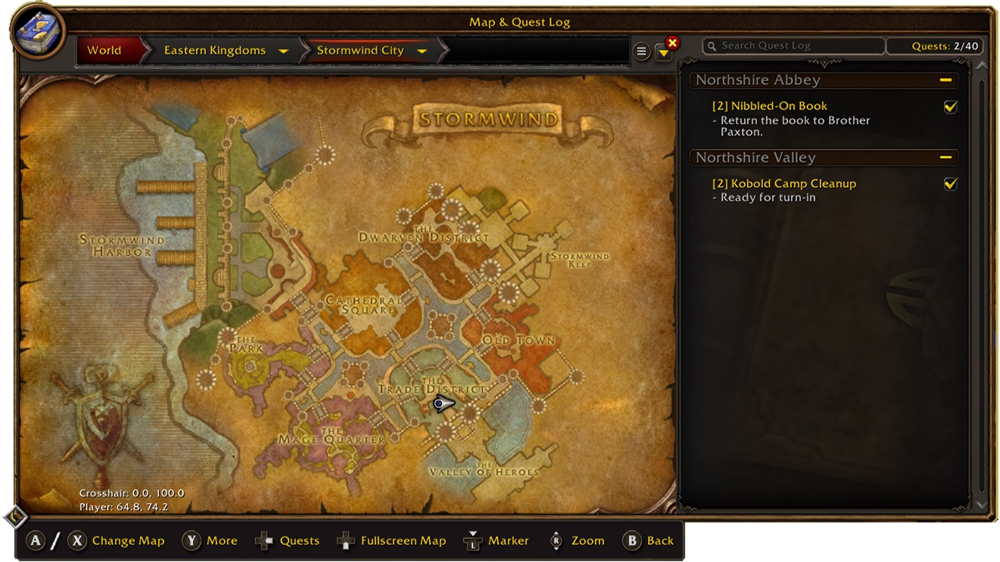
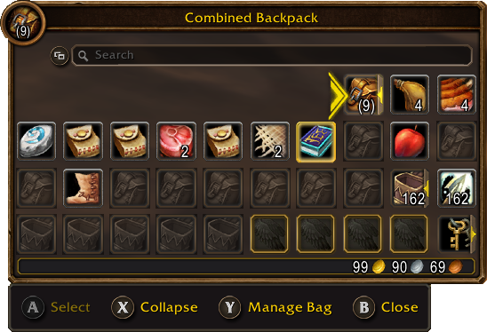

Blizzard ha pubblicato una guida completa per giocare a World of Warcraft: Forever con un controller. Funziona ogni controller XInput, con le icone di Xbox e PlayStation sullo schermo. Tre set di quattro barre delle azioni danno 84 slot. Il supporto è ancora una beta funzionante.

## Attivarlo

Premi Esc, apri Options e scegli Gamepad sotto Gameplay. Nelle impostazioni del controller regoli la telecamera, l'HUD Modifier, il Frame Focus Style, le barre delle azioni, la scelta del bersaglio e le opzioni di bersaglio in raid. Su un controller con luci, la luce diventa rossa per un personaggio dell'Orda e blu per uno dell'Alleanza.

## I tasti

Blizzard usa i nomi dei tasti Xbox:

| Tasto | Cosa fa |
|---|---|
| **Levetta sinistra** | Muoversi |
| **Levetta destra** | Telecamera |
| **LB** | Bersaglio amico |
| **RB** | Bersaglio nemico |
| **X** | Interagire |
| **A** | Saltare |
| **B** | Indietro |
| **Y** | Ispezionare |
| **LT, RT, LT + RT** | Altra barra delle azioni finché li tieni premuti |
| **Menu** | Menu principale |
| **View** | Change Focus Frame |

Anche i tasti azione possono contenere incantesimi. L'interfaccia sullo schermo segue la disposizione del controller, così ogni pannello sta dove sono i suoi tasti.

## Quattro barre, tre set

L'HUD mostra quattro barre delle azioni con la stessa disposizione dei tasti. Tieni premuto LT, RT o entrambi per cambiare, e rilascia per tornare alla prima barra. Un Mage può mettere quattro incantesimi su una sola direzione della croce direzionale:

| Tasti | Incantesimo |
|---|---|
| **Su** | Polymorph |
| **LT + su** | Fireball |
| **RT + su** | Frostbolt |
| **LT + RT + su** | <a class="wf-wh wf-spell" href="https://www.wowhead.com/forever/spell=10">Blizzard</a> |

È un esempio, non una disposizione fissa. In più ci sono tre set di barre delle azioni: tieni premuto LB + RB e premi sinistra o destra sulla croce. Un set ha quattro barre con 28 slot, 84 slot per i tre set insieme.

## Scorciatoie

Tieni premuti i due tasti dorsali e premi un terzo tasto:

| Scorciatoia | Apre |
|---|---|
| **LB + RB + B** | Zaino |
| **LB + RB + su** | Tracciamento missioni |
| **LB + RB + giù** | Chat |
| **LB + RB + Y** | Buff |

Le stesse schermate sono nel menu radiale. Scrivere in chat richiede ancora una tastiera. Una legenda in alto a sinistra mostra i comandi e si allarga quando un'azione ha più opzioni. La maggior parte delle schermate ha in basso una barra con i suoi tasti, ma non ancora tutte.

## Ancora in beta

Blizzard parla di una beta funzionante. Borse e menu riceveranno altre modifiche per essere più comodi con un controller. Giocare senza tastiera è l'obiettivo a lungo termine.

Forever non arriva su console: [Xbox ha confermato che il gioco resta su PC e Mac](/it/news/forever-stays-on-pc-and-mac-but-plays-with-a-controller/). Gli altri strumenti integrati nel gioco sono nella nostra [guida agli strumenti dell'interfaccia integrati](/it/guides/built-in-ui-tools/).
