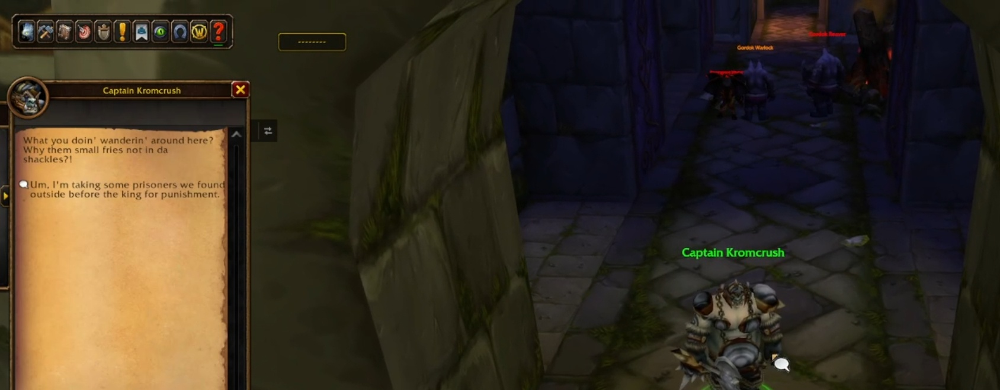

Il forziere Tribute di Dire Maul North non contiene più sempre tre oggetti blu in World of Warcraft: Forever. Ogni boss che resetta ne toglie uno, fino a un minimo di uno. Blizzard non ha confermato la modifica. I giocatori l'hanno scoperta con dei test.

## Come funziona una Tribute run

In una Tribute run uccidi solo <a class="wf-wh wf-plain" href="https://www.wowhead.com/forever/npc=11501">King Gordok</a> e lasci in vita cinque boss: <a class="wf-wh wf-plain" href="https://www.wowhead.com/forever/npc=14326">Guard Mol'dar</a>, <a class="wf-wh wf-plain" href="https://www.wowhead.com/forever/npc=14321">Guard Fengus</a>, <a class="wf-wh wf-plain" href="https://www.wowhead.com/forever/npc=14323">Guard Slip'kik</a>, <a class="wf-wh wf-plain" href="https://www.wowhead.com/forever/npc=14325">Captain Kromcrush</a> e <a class="wf-wh wf-plain" href="https://www.wowhead.com/forever/npc=14324">Cho'Rush the Observer</a>. Quando il re muore ricevi <a class="wf-wh wf-spell" href="https://www.wowhead.com/forever/spell=22799">King of the Gordok</a>, tutti gli ogre diventano amichevoli e compare <a class="wf-wh wf-plain" href="https://www.wowhead.com/forever/object=179564">Gordok Tribute</a>.

Quel forziere dà equipaggiamento pre-raid come <a class="wf-wh wf-q3" href="https://www.wowhead.com/forever/item=18531">Unyielding Maul</a>, un'arma forte per i tank Feral, e una buona somma d'oro. Gli Hunter fanno la run da soli. Il percorso completo è nella nostra [guida a Dire Maul North](/it/guides/dungeons/dire-maul-north/).

## Cosa costa un oggetto blu

Il forziere parte con tre oggetti blu. Ogni penalità ne toglie uno, ma mai l'ultimo.

| Azione | Effetto |
|---|---|
| **Una guardia resetta** | Un oggetto blu in meno |
| **Captain Kromcrush o King Gordok resetta** | Un oggetto blu in meno |
| **Kromcrush è ancora al suo posto** | Un oggetto blu in meno |
| **Nessuna trappola per Guard Slip'kik** | Nessun effetto |

Un giocatore che aggra una guardia e muore per salvare la run ora costa al gruppo un oggetto. Pesa soprattutto con Captain Kromcrush, che sta in mezzo all'ultimo corridoio. Lasciarlo resettare e passare oltre non dà più il bottino completo.

Il bottino completo arriva ancora con <a class="wf-wh wf-q2" href="https://www.wowhead.com/forever/item=18258">Gordok Ogre Suit</a>, una invisibility potion o una stealth potion. La trappola di <a href="https://www.wowhead.com/forever/quest=1193">A Broken Trap</a> non cambia nulla per il forziere, ma evita di aggrare una guardia per sbaglio.

Kromcrush lascia il suo posto quando gli parli. Funziona anche dopo la morte del re, finché il forziere non è ancora comparso. Non si sa se Blizzard lo voglia così.

## Le run di prova

| Run | Oggetti blu |
|---|---|
| **Senza trappola, Kromcrush resettato, ancora al suo posto** | 1 |
| **Senza trappola, oltre Kromcrush in stealth, ancora al suo posto** | 2 |
| **Trappola, oltre Kromcrush in stealth, ancora al suo posto** | 2 |
| **Trappola, Gordok Ogre Suit davanti a Kromcrush** | 3 |
| **Trappola, oltre Kromcrush in stealth, mandato via dopo il re** | 3 |

I tre oggetti blu sono arrivati solo quando Kromcrush ha lasciato il suo posto, prima o dopo la morte del re.

La Tribute run aveva già perso un po' di forza il 23 novembre, quando gli hotfix hanno [dimezzato Fengus' Ferocity](/it/news/world-buffs-survive-loading-screens-again/).
