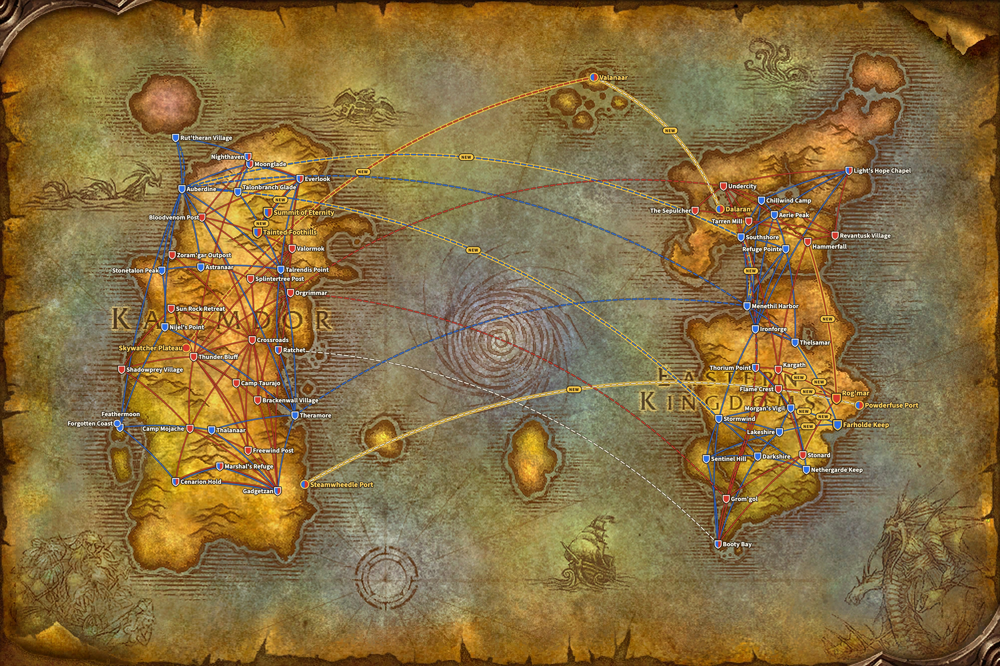
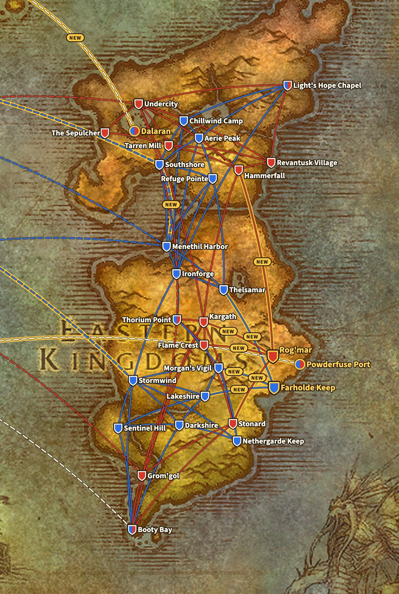
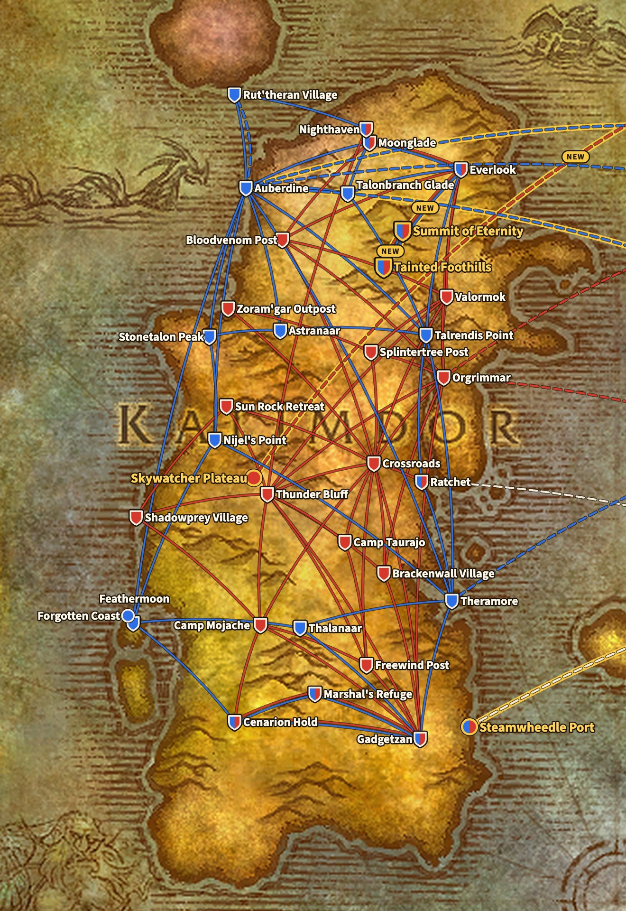
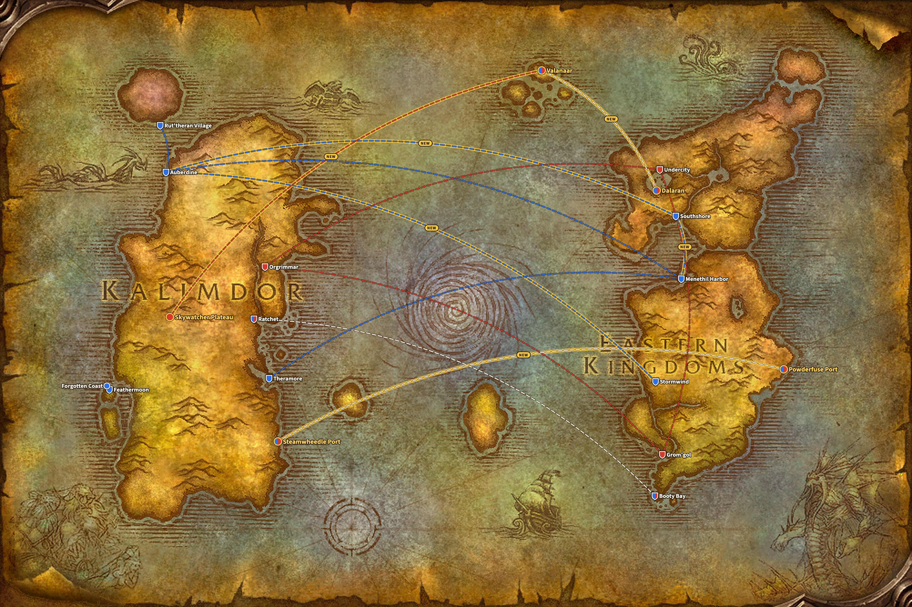

WoW Forever aggiunge quattro punti di volo: Farholde Keep e Rog'mar in The Riverglades, e Tainted Foothills e Summit of Eternity su Mount Hyjal. Insieme portano dieci rotte nuove. Nessuna rotta esistente scompare, mostrano i file del gioco live.

*Aggiornato il 9 novembre: nella beta Powderfuse Port, in The Riverglades, era un quinto nuovo punto di volo, con una rotta verso Farholde Keep. Nel gioco live quella rotta non c'è più, quindi questo articolo ora conta quattro punti di volo e dieci rotte.*

## Da dove vengono le rotte

Blizzard non ha pubblicato un elenco delle rotte di volo di Forever. Le rotte di questa pagina vengono dai file del gioco live, build 1.60.1.70862. Sono messe a confronto con gli stessi file di Classic Era, build 1.15.9.69722.

La mappa disegna ogni rotta come una linea tra due luoghi, non come scorre davvero il volo nel gioco. Così resta leggibile. La base è la mappa del mondo del client di Forever, che mostra già The Riverglades a est di Redridge Mountains. Navi e zeppelin vengono dalla stessa mappa del mondo.

Una linea blu è una rotta della Alliance, una linea rossa una rotta della Horde. Una linea tratteggiata è una nave o uno zeppelin, e una linea bianca tratteggiata è aperta a entrambe le fazioni. Una linea con il bordo dorato e la parola NEW è nuova in Forever. Uno scudo è un maestro di volo, un segno rotondo un porto o una torre degli zeppelin senza maestro di volo. Uno scudo blu e rosso serve entrambe le fazioni, e un bordo dorato indica un luogo nuovo.

## I quattro nuovi punti di volo

| Punto di volo | Zona | Per | Maestro di volo | Vola verso |
|---|---|---|---|---|
| Farholde Keep | The Riverglades | Alliance | [Gretchen Mayberry](https://www.wowhead.com/forever/npc=257087) | Lakeshire, Thelsamar, Morgan's Vigil |
| Rog'mar | The Riverglades | Horde | [Grakna](https://www.wowhead.com/forever/npc=255993) | Stonard, Hammerfall, Kargath, Flame Crest |
| Tainted Foothills | Mount Hyjal | entrambe le fazioni | [Bluebell](https://www.wowhead.com/forever/npc=260626) | Everlook, Summit of Eternity |
| Summit of Eternity | Mount Hyjal | entrambe le fazioni | [Fayran Elthas](https://www.wowhead.com/forever/npc=41861) | Tainted Foothills |

[The Riverglades](/it/forever/) è la nuova zona per i livelli dal 30 al 45. Ogni fazione riceve lì un punto di volo che la collega alle zone vicine: la Alliance vola verso Redridge Mountains, Loch Modan e Burning Steppes, la Horde verso Swamp of Sorrows, Arathi Highlands, Badlands e Burning Steppes.

Mount Hyjal è il finale del livellamento, con un accampamento dove Horde e Alliance convivono. Le rotte lo rispecchiano. Entrambi i punti di volo della montagna servono entrambe le fazioni, e Tainted Foothills collega ciascuna parte a Everlook, in Winterspring.

## Alliance

La Alliance guadagna tre punti di volo e cinque rotte. Negli Eastern Kingdoms, Farholde Keep si collega a Lakeshire, Thelsamar e Morgan's Vigil. In Kalimdor, Everlook porta a Tainted Foothills e da lì a Summit of Eternity.

**Eastern Kingdoms, 17 punti di volo.** Esistenti: Aerie Peak, Booty Bay, Chillwind Camp, Darkshire, Ironforge, Lakeshire, Light's Hope Chapel, Menethil Harbor, Morgan's Vigil, Nethergarde Keep, Refuge Pointe, Sentinel Hill, Southshore, Stormwind, Thelsamar e Thorium Point. Nuovo: Farholde Keep.

**Kalimdor, 19 punti di volo.** Esistenti: Astranaar, Auberdine, Cenarion Hold, Everlook, Feathermoon, Gadgetzan, Marshal's Refuge, Moonglade, Nighthaven (per i Druid, da Rut'theran Village), Nijel's Point, Ratchet, Rut'theran Village, Stonetalon Peak, Talonbranch Glade, Talrendis Point, Thalanaar e Theramore. Nuovi: Tainted Foothills e Summit of Eternity.

## Horde

La Horde guadagna tre punti di volo e sei rotte. Rog'mar, in The Riverglades, ha quattro rotte, verso Stonard, Hammerfall, Kargath e Flame Crest, tante quante Farholde Keep. In Kalimdor la Horde riceve gli stessi due punti su Mount Hyjal della Alliance.

**Eastern Kingdoms, 13 punti di volo.** Esistenti: Booty Bay, Flame Crest, Grom'gol, Hammerfall, Kargath, Light's Hope Chapel, Revantusk Village, Stonard, Tarren Mill, The Sepulcher, Thorium Point e Undercity. Nuovo: Rog'mar.

**Kalimdor, 22 punti di volo.** Esistenti: Bloodvenom Post, Brackenwall Village, Camp Mojache, Camp Taurajo, Cenarion Hold, Crossroads, Everlook, Freewind Post, Gadgetzan, Marshal's Refuge, Moonglade, Nighthaven (per i Druid, da Thunder Bluff), Orgrimmar, Ratchet, Shadowprey Village, Splintertree Post, Sun Rock Retreat, Thunder Bluff, Valormok e Zoram'gar Outpost. Nuovi: Tainted Foothills e Summit of Eternity.

## Classic Era e Forever a confronto

Una rotta qui è un volo diretto tra due punti di volo. Una città con un maestro di volo per ogni fazione, come Everlook, conta una volta per fazione.

| | Classic Era | WoW Forever |
|---|---|---|
| Alliance, Eastern Kingdoms | 16 punti, 35 rotte | 17 punti, 38 rotte |
| Alliance, Kalimdor | 17 punti, 31 rotte | 19 punti, 33 rotte |
| Horde, Eastern Kingdoms | 12 punti, 22 rotte | 13 punti, 26 rotte |
| Horde, Kalimdor | 20 punti, 47 rotte | 22 punti, 49 rotte |

Ogni rotta di Classic Era c'è ancora, con la stessa partenza e lo stesso arrivo. Forever aggiunge soltanto. Accanto alle rotte di volo arrivano [tre nuove rotte navali](/it/news/wow-forever-three-new-ship-routes/), tra cui una nave da The Riverglades a Steamwheedle Port, in Tanaris. Con il perk Legacy Frequent Flier un volo costa la metà ed è più veloce del 20%, come indica [la pagina di Forever](/it/forever/).

Ogni punto di volo con il suo maestro di volo, le coordinate e le rotte è nella [guida alle rotte di volo](/it/guides/flight-paths/).

## Cosa non è certo

- **Powderfuse Port non ha rotte di volo.** Nella beta volava verso Farholde Keep, ma nel gioco live quella rotta non c'è più. Il porto ha però la nave per Steamwheedle Port, in Tanaris.
- **Un altro punto di volo aspetta**: Tidegear Coast, in Dun Morogh, è nei file, senza nemmeno una rotta. A cosa serva non è noto.
- **Le rotte possono ancora cambiare** con un hotfix o una patch.
- **Zephras Isle non ha un posto fisso** sulla mappa del mondo nei file. La mappa mette Valanaar, dove arrivano i nuovi zeppelin da Dalaran e Skywatcher Plateau, sul gruppo di isole a nord del Maelstrom.
- **Quanto dura un volo** non è in questi file. La mappa mostra quindi dove passa una rotta, non quanto dura.
