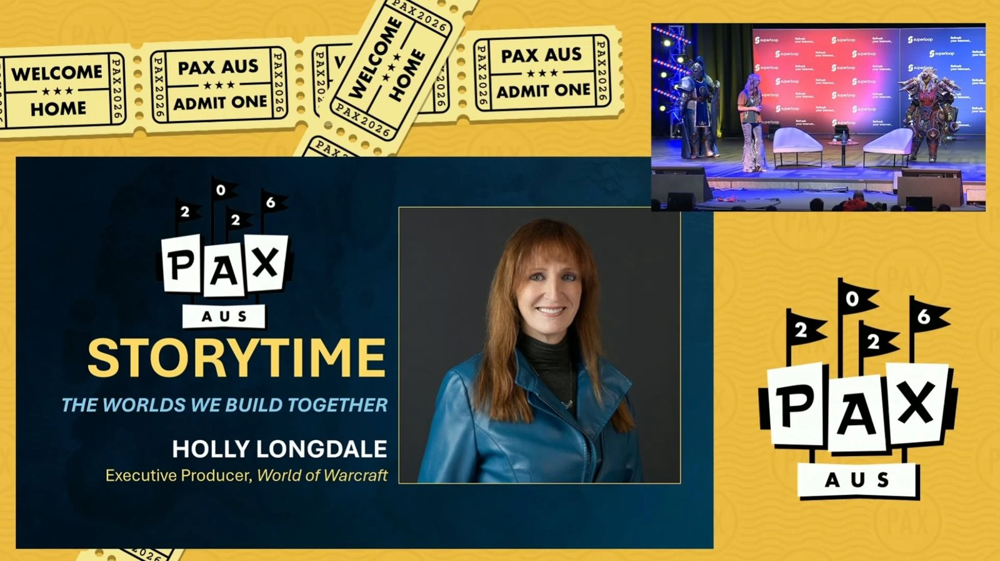
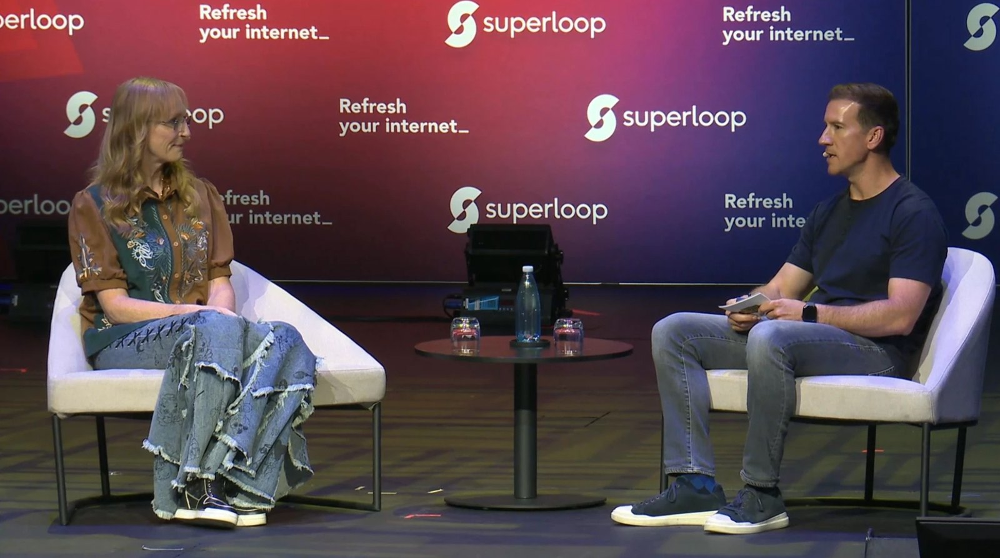

Holly Longdale vuole combo di incantesimi tra le classi di World of Warcraft. Lo ha detto la produttrice esecutiva al PAX Australia, in una Q&A con Clay Stone. Secondo lei, WoW Forever era la cosa giusta fin dal primo pitch.

Longdale è stata quest'anno la relatrice di Storytime al PAX Aus, il 9 ottobre. Dopo il suo racconto, Clay Stone, Associate Production Director di WoW Classic, l'ha raggiunta sul palco. Il keynote completo è sul [canale Twitch del PAX](https://www.twitch.tv/videos/2895639607). Alcune risposte qui sotto sono state accorciate.

## Da EverQuest a Blizzard

Longdale è cresciuta con il fantasy, la fantascienza e le sale giochi, e ha studiato giornalismo. Verso i trent'anni ha iniziato a giocare a EverQuest. Un compagno di gilda si è rivelato uno sviluppatore del gioco e le ha consigliato di candidarsi. Ha ottenuto il posto.

La sua lezione più grande lì, ha detto, è che un gioco appartiene ai giocatori e non agli sviluppatori. Dopo una parentesi alla Disney è tornata a EverQuest 2 come Senior Producer, e il team ha iniziato a pubblicare versioni "vanilla" dei suoi giochi.

Poi ha chiamato Blizzard. Stava preparando WoW Classic e le ha chiesto cosa aspettarsi quando torna vecchio contenuto. Poco dopo è entrata nel team di Classic ed è diventata Lead Producer. Quando Ion Hazzikostas è diventato Game Director, lei ha preso il suo vecchio ruolo di produttrice esecutiva.

## WoW Forever fin dal primo pitch

Alla domanda su come appare un team che ha trovato qualcosa, Longdale ha parlato di "una vibe". Con WoW Forever c'era, ha detto. Ricorda il pitch e lo ha definito "al 1.000% la cosa giusta da fare".

Il team non era sicuro di avere abbastanza tempo o persone per Forever, ha detto più tardi. La sua risposta è stata che una soluzione l'avrebbero trovata. Ha chiuso quella risposta con questa frase.

> I'm not a suit, is what I'm saying I guess.

## Combo e ascolto dei giocatori

Clay Stone le ha chiesto quale meccanica prenderebbe da un altro gioco. Longdale vuole combo di incantesimi tra le classi, e il pubblico ha applaudito. Ha scherzato che bisognava mandare il video a Ion Hazzikostas. Se queste combo siano in programma, non l'ha detto.

Sul feedback, ha detto che il team non ascolta chi urla più forte in sala. Guarda i dati e le ricerche dietro una tendenza, e accetta che un gioco per milioni di persone non può accontentare tutti. Bisogna scegliere cos'è il gioco e per chi è.

Non ha una posizione da difendere a ogni costo, ha aggiunto. Se un'intera sala si arrabbiasse per una delle sue opinioni, la lascerebbe cadere. Ha concluso con l'augurio che ogni giocatore trovi una comunità che sembri casa.
