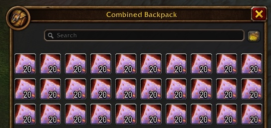

I giocatori Skyborne hanno ora il 10% di sconto sull'equitazione in World of Warcraft: Forever. Un hotfix del 19 novembre dà loro lo sconto a Honored, come a ogni altra razza. Journeyman Riding costa ora 900 oro invece di 1.000. Arrivare a Honored richiede comunque molta stoffa.

## Cosa cambia l'hotfix

Blizzard ha corretto lo sconto su Apprentice e Journeyman Riding da <a class="wf-wh wf-plain" href="https://www.wowhead.com/forever/npc=265756">Genn Fairweather</a> su Zephras Isle. Finora gli Skyborne pagavano il prezzo pieno a ogni livello di reputazione, vedi [il nostro articolo precedente](/it/news/skyborne-pay-full-price-for-riding-training/).

| Skill | Level | Prezzo pieno | Honored |
|---|---|---|---|
| <a class="wf-wh wf-spell" href="https://www.wowhead.com/forever/spell=33388">Apprentice Riding</a> | 40 | 100 oro | 90 oro |
| <a class="wf-wh wf-spell" href="https://www.wowhead.com/forever/spell=33391">Journeyman Riding</a> | 60 | 1.000 oro | 900 oro |

L'hotfix nomina le abilità di equitazione. Se anche le cavalcature Galestrider costino meno, Blizzard non lo dice.

## Honored richiede stoffa

Dopo Zephras Isle nessuna missione dà reputazione con High Order, la fazione Alliance degli Skyborne, né con i Windshapers dalla parte dell'Orda. Oltre Friendly restano solo le consegne di stoffa:

1. **Tre prime consegne** di Wool Cloth, Silk Cloth e Mageweave Cloth: 60 stoffe per 150 di reputazione ciascuna.
2. **<a href="https://www.wowhead.com/forever/quest=99199">A Donation of Runecloth</a>** da <a class="wf-wh wf-plain" href="https://www.wowhead.com/forever/npc=276171">Oura Stormspinner</a>: 60 Runecloth per 150 di reputazione.
3. **<a href="https://www.wowhead.com/forever/quest=99200">Additional Runecloth</a>**, ripetibile: 20 Runecloth per 50 di reputazione.

Quante consegne servono dipende da quanto sei avanti in Friendly. Un giocatore ha pagato circa 70 oro di Runecloth per arrivare a Honored, contro 100 oro risparmiati su Journeyman Riding.

Le cavalcature Skyborne sono nella [guida alle cavalcature](/it/guides/mounts/).
