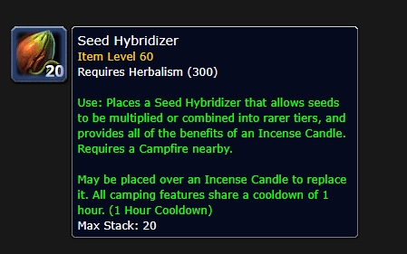

Il <a class="wf-wh wf-spell" href="https://www.wowhead.com/forever/spell=1263070">Seed Hybridizer</a> funziona di nuovo in World of Warcraft: Forever. Gli hotfix del 19 novembre riattivano l'oggetto da campo di Herbalism, con nuovi valori e un rischio di fallire quando combini i semi. Gli Scarce Herb Seeds non si possono più usare. Anche i Paladin Retribution e due dungeon ricevono correzioni.

## Seed Hybridizer

Il Seed Hybridizer richiede Herbalism 300 e un fuoco da campo vicino. Moltiplica i semi o li combina in varietà più rare. Blizzard non dice quali siano i nuovi valori né quanto sia alto il rischio di fallire. Tutti gli oggetti da campo sono nella [guida al campeggio](/it/guides/camping/).

## Retribution

Two-Handed Weapon Specialization ora aumenta tutti i danni Holy che infliggi con un'arma a due mani equipaggiata. Blizzard la chiama una correzione, quindi prima il talento perdeva parte di quei danni. I talenti sono nella [guida Retribution](/it/classes/paladin/retribution/).

## Dungeon

- **City of Dalaran:** la Shade of the Archmage non scompare più appena inizia il combattimento. Il boss è nella [guida di City of Dalaran](/it/guides/dungeons/city-of-dalaran/guide/).
- **The Shaper's Terrace:** Poison Shock di Vitrix infligge meno danni.

## Il resto degli hotfix

- **Skyborne:** 10% di sconto su Apprentice e Journeyman Riding a Honored, vedi [il nostro articolo](/it/news/skyborne-now-get-10-percent-off-riding-at-honored/).
- **Oggetti:** le Motes of Unstable Magic sono vincolate, vedi [il nostro articolo](/it/news/motes-of-unstable-magic-are-now-soulbound/). Squall-breaker's Potion ora si può distruggere.
- **Tauren:** Cultivation riesce più spesso sulle erbe per cui hai l'abilità di Herbalism, e funziona di nuovo con Purple Lotus.
- **Riverglades:** Mosh'gra ora può lasciar cadere il suo bottino raro, cosa che non faceva mai.
- **Shimmering Flats:** un Silithid Hive Drone bloccato sotto il mondo vicino al Rustmaul Dig Site è stato corretto.
- **Booty Bay:** Rix Xizzix non dà più accesso a uno strano tomo dopo la missione Rift Away.
- **Alterac Mountains:** durante Stormpike's Deciphering puoi avere un nuovo Ensorcelled Parchment se hai distrutto il vecchio.
- **Hunting for Ectoplasm:** la missione usa ora il tipo di creatura giusto per l'ectoplasma.
