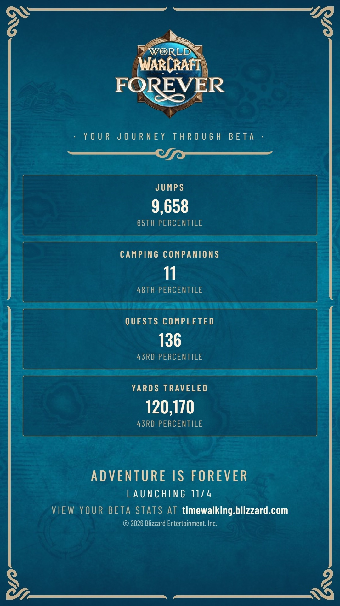
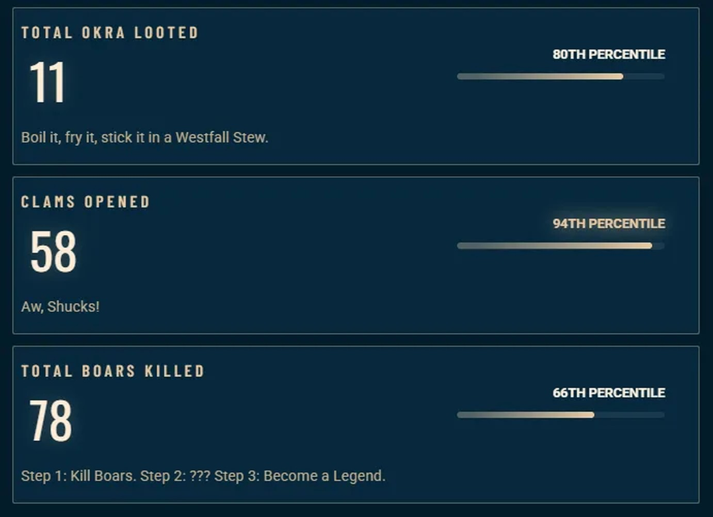
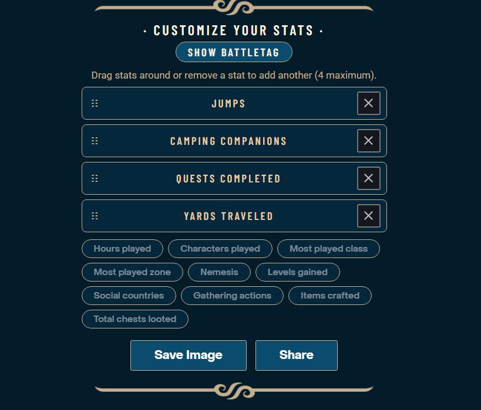

Blizzard heeft een pagina geopend met persoonlijke cijfers uit de beta van World of Warcraft: Forever. Testers zien hoe vaak ze sprongen, hoeveel quests ze voltooiden en welk monster hen het vaakst doodde. De pagina is [timewalking.blizzard.com](https://timewalking.blizzard.com/).

Elk cijfer krijgt een percentiel, dat toont hoe een tester zich verhoudt tot de anderen. De beta sloot op 23 oktober om 19.00 uur Belgische tijd; de pagina verscheen dezelfde dag.

## Veertien cijfers

De pagina telt sprongen, kampgenoten, voltooide quests en afgelegde yards. Ze toont ook de gespeelde uren, de gespeelde personages, de meest gespeelde class en zone, de aartsvijand, de gewonnen levels, de landen van medespelers, de verzamelacties, de gemaakte items en de geopende kisten.

## Okra, clams en boars

Niet elke kaart is ernstig. Sommige tellen de okra die je lootte, de clams die je opende of de boars die je doodde, elk met een grap: "Boil it, fry it, stick it in a Westfall Stew", "Aw, Shucks!" and "Step 1: Kill Boars. Step 2: ??? Step 3: Become a Legend." Bij de gespeelde uren staat "Your guild leader is proud. Probably."

## Een beeld om te delen

Onderaan de pagina maken testers hun eigen beeld. Ze kiezen tot vier cijfers, kiezen of hun BattleTag erop staat, en bewaren of delen het beeld. Op het beeld staat de regel "Adventure is Forever, launching 11/4".

Hoe lang de pagina online blijft, zegt Blizzard niet.
