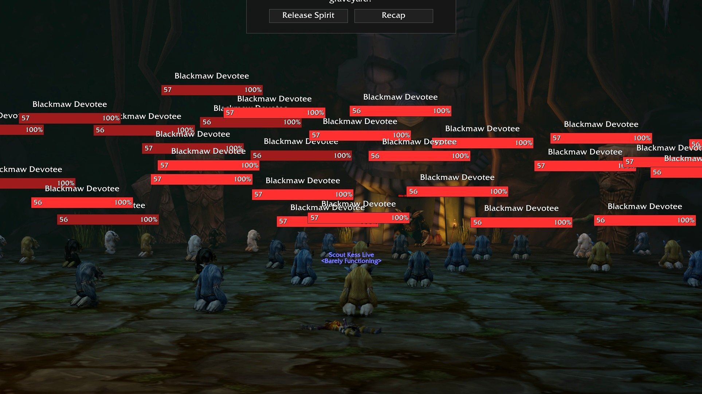

Een goudfarm in Blackmaw Hold werkt niet meer in World of Warcraft: Forever. Groepen ruimden een zaal met zo'n 30 <a class="wf-wh wf-plain" href="https://www.wowhead.com/forever/npc=277474">Blackmaw Devotees</a> op, resetten de dungeon en begonnen opnieuw, voor meer dan 100 goud per uur. Een hotfix nam alle buit van deze monsters weg.

## Hoe de farm werkte

De zaal ligt wat dieper in de dungeon. Groepen reden door het eerste deel en gebruikten een lange val om aggro kwijt te raken. Mages raakten er zelfs alleen, via plekken waar de monsters niet kunnen komen. De devotees zijn geen elites en doen alleen gewone aanvallen.

## Wat ze lieten vallen

Elke devotee gaf zo'n 25 tot 50 zilver, plus spullen voor de verkoper en groene items. Ze lieten ook <a class="wf-wh wf-q1" href="https://www.wowhead.com/forever/item=274964">Mote of Unstable Magic</a> vallen voor de quest <a href="https://www.wowhead.com/forever/quest=98477">Unstable Magic</a>, zo'n 13 zilver waard in het Auction House, en <a class="wf-wh wf-q1" href="https://www.wowhead.com/forever/item=273050">Blackmaw Pouch</a> voor <a href="https://www.wowhead.com/forever/quest=97327">Blackmaw Pouches</a>, ongeveer 1 goud per stuk. Sinds de hotfix laten de devotees niets meer vallen, dus de prijzen van beide items kunnen bewegen.

Sommige spelers zeggen dat ze duizenden goudstukken verdienden met de farm. Of Blizzard meer doet dan de farm sluiten, is niet bekend. In een interview met But Why Tho? zei Blizzard dat het de economie van dichtbij volgt en zelfs in het weekend zou ingrijpen tegen een oneerlijke goudfarm.

Blackmaw Hold is voor level 55 tot 60, zie de [gids over Blackmaw Hold](/nl/guides/dungeons/blackmaw-hold/). Goud op level 60 komt ook van de [wekelijkse quest in Booty Bay](/nl/news/a-weekly-quest-at-level-60-pays-up-to-100-gold/).
