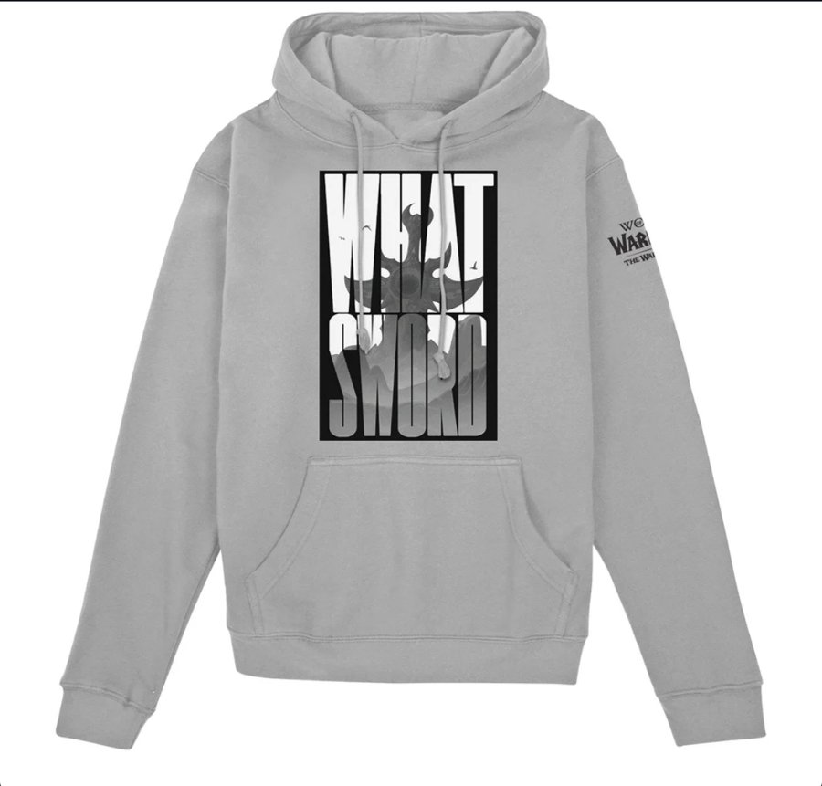

De Blizzard Gear Store houdt een Black Friday-uitverkoop met tot 60% korting. Voor World of Warcraft: Forever zijn er twee shirts met reisposters van de launch en een set met vier van die posters. Tot 1 december krijg je bij een bestelling boven $50 ook drie codes voor in de game.

## Forever in de uitverkoop

Het **Zephras Isle T-Shirt** en het **Dalaran T-Shirt** dragen de reisposters waarmee Forever van start ging. De **Travel Posters Gift Set** bevat de prints zelf: Zephras Isle, Dalaran, Mount Hyjal en Bandarion Keep in Tirisfal.

## De rest van de uitverkoop

Andere WoW-spullen in de uitverkoop zijn de What Sword Hoodie van de onthulling van de Worldsoul Saga, een Alliance Quarter-Zip, een jas met wapens, een Xal'atath T-Shirt, de Arcantina Heat Changing Mug, een replica van het harnas van Darion Mograine en een beeldje van Arthas.

## Drie codes boven $50

| | |
|---|---|
| Tot | 1 december |
| Voorwaarde | Een bestelling boven $50 aan geldige artikelen |
| Diablo IV | Refined Mind Trophy |
| WoW Midnight | Deep Winter Toque, een transmog |
| Overwatch | Legendary Cyberhog Skin |

De transmog is voor modern WoW, niet voor Forever. Niet elk geldig artikel zit in de Black Friday-uitverkoop. De **Azeroth Forever Hoodie** telt mee voor de codes, maar heeft geen korting. Hoe lang de Black Friday-prijzen gelden, zegt de winkel niet. Prijzen in euro en andere munten kunnen verschillen: kijk in de [Gear Store](https://gear.blizzard.com/) voor jouw regio.

