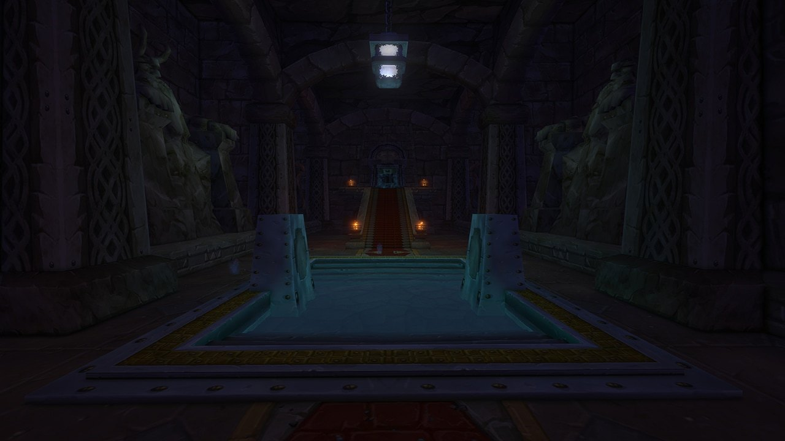
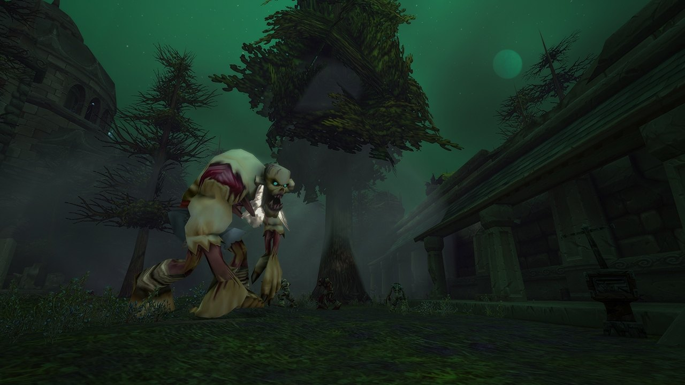
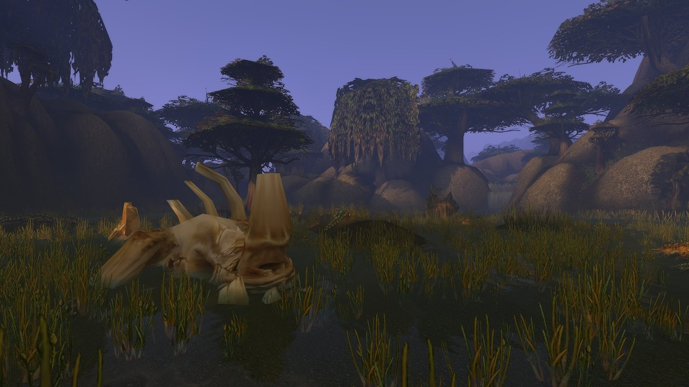
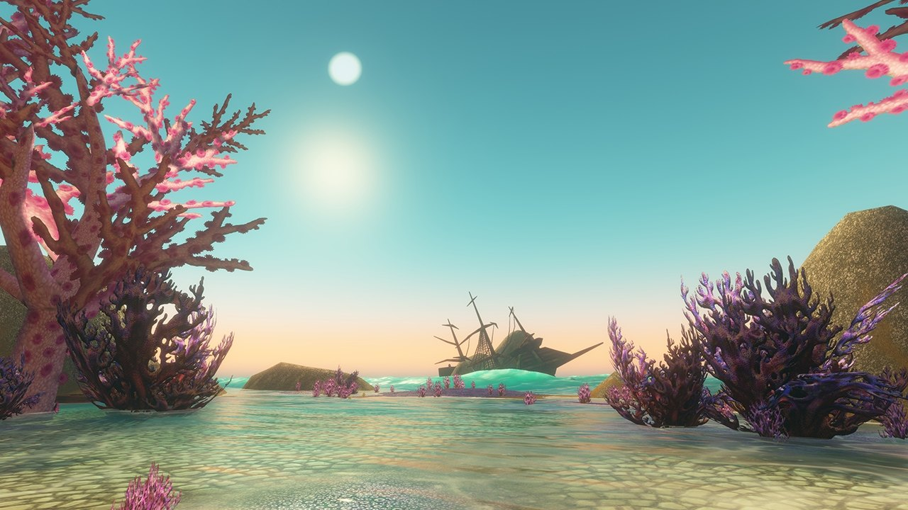
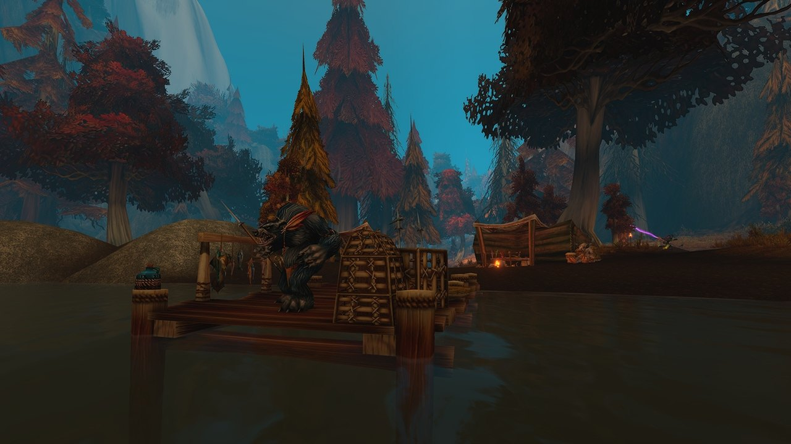

Blizzard heeft alle negen nieuwe dungeons van World of Warcraft: Forever beschreven, van level 13 tot 60. Zes liggen in de Eastern Kingdoms en drie in Kalimdor. Eén bereik veranderde: de Excavation Site is nu voor level 24 tot 29 in plaats van 26 tot 31.

| Dungeon | Levels | Waar |
|---|---|---|
| [The Hall of Thanes](/nl/guides/dungeons/hall-of-thanes/) | 13 tot 18 | Onder Ironforge, Dun Morogh |
| [Ruins of Lordaeron](/nl/guides/dungeons/ruins-of-lordaeron/) | 15 tot 20 | Boven de Undercity, Tirisfal Glades |
| [Excavation Site](/nl/guides/dungeons/excavation-site-wetlands/) | 24 tot 29 | Boven Whelgar's Excavation, Wetlands |
| [City of Dalaran](/nl/guides/dungeons/city-of-dalaran/) | 28 tot 33 | Alterac Mountains |
| The Drowned City | 35 tot 40 | Voor de kust van Stranglethorn Vale |
| Krol'dok Stronghold | 40 tot 45 | Riverglades |
| Alcaz Prison | 48 tot 53 | Alcaz Island, Dustwallow Marsh |
| Blackmaw Hold | 55 tot 60 | Azshara |
| Shaper's Terrace | 58 tot 60 | Un'Goro Crater |

De eerste vier staan al in de beta en hebben een eigen gids. De andere vijf openen boven het levelplafond van 30. Blizzard publiceerde de lijst op 20 oktober en verwijst naar [aflevering 3 van de podcast](/nl/news/dungeon-kills-give-20-percent-more-experience/) voor meer over levelen in dungeons.

## The Hall of Thanes

De grafhal van de dwergenkoningen onder Ironforge. Indringers, waarschijnlijk Dark Iron-dwergen, zijn binnengedrongen. De Alliance loopt er vanuit de eigen hoofdstad naartoe; de Horde moet diep Alliance-gebied in. Alle vier de bazen staan in [de walkthrough](/nl/news/the-hall-of-thanes-has-four-bosses-and-five-quests/).

## Ruins of Lordaeron

De Forsaken willen de verwoeste stad boven de Undercity terug, waar de Scourge nog rondwaart. Een necromancer verzamelt er macht. Voor de Horde ligt de ingang vlak bij de Undercity; de Alliance moet Horde-gebied in.

## Excavation Site

Bij Thelgen Rock en Dun Algaz drijft een vreemde mist uit de bergen boven Whelgar's Excavation. Achter de opgraving ligt een plek die in de tijd lijkt stilgezet, met titanconstructen en gevaarlijke dieren. Blizzard geeft nu 24 tot 29, twee levels lager dan eerst; de quests kon je al vanaf level 24 aannemen.

## City of Dalaran

De barrière rond Dalaran is gevallen en de stad zit vol arcane chaos: betoveringen keren zich tegen hun makers en constructen slaan op hol. Eerst heb je het vertrouwen van de Kirin Tor nodig. De Alliance begint met An Alarming Request van Emissary Jacques in Southshore, de Horde met Key to the City en Prison Break In van Magus Wordeen Voidglare in Tarren Mill. De groep gaat binnen via de riolen en kiest zelf een weg door de stad.

## The Drowned City

Oude trollenruïnes zijn ten westen van Grom'gol uit de zee opgerezen. Trollen en naga zwerven door de straten, en een piratenschip ernaast kwam slecht aan zijn einde. De ingang ligt onder water. De dungeon ligt onder de open hemel, en tijdens de run groeien mist en regen uit tot een storm voor het laatste gevecht.

## Krol'dok Stronghold

Ogre-verkenners ontvoeren reizigers en plunderen dorpen in de hele Riverglades. Hun spoor leidt naar Krol'dok Stronghold, een groot fort met werkplaatsen, kampen en bewaakte gangen binnenin. Na het donker klinkt er vreemd gezang uit het fort. Meer over het levelbereik staat in [deze post](/nl/news/wow-forever-kroldok-stronghold-level-range/).

## Alcaz Prison

Van de gevangenis op Alcaz Island in Dustwallow Marsh werd lang gezegd dat er belangrijke gevangenen zaten, onder wie koning Varian Wrynn, maar niemand kwam er binnen. Nu gaan de deuren open. Binnen vechten de Defias Brotherhood en naga tegen elkaar, en wachten nieuwe stukken van een bekend mysterie.

## Blackmaw Hold

Achter een poort in Azshara die lang dicht zat, ligt een grote furbolgstad. De Blackmaw-clan vecht tegen een verderf dat zich door zijn bossen en bergtunnels verspreidt. Blizzard noemt het een flinke dungeon op het hoogste level met meerdere routes en bazen, en het diepste deel leidt misschien nog verder onder Azeroth. De poort staat in [deze post](/nl/news/blackmaw-hold-sits-behind-the-old-gate-in-azshara/).

## Shaper's Terrace

Een oude titaninstallatie hoog in de noordelijke heuvels van Un'Goro Crater, met dinosaurussen, teerputten en kristallen. Neem de power crystals mee die je in Un'Goro verzamelt: ze werken op consoles in het terras, dus wat je buiten vindt, telt mee in de dungeon.

