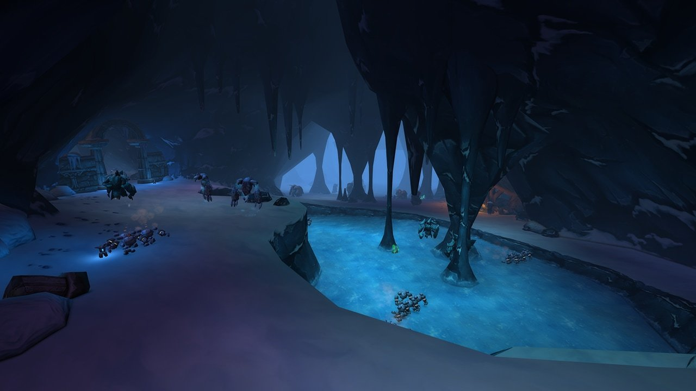
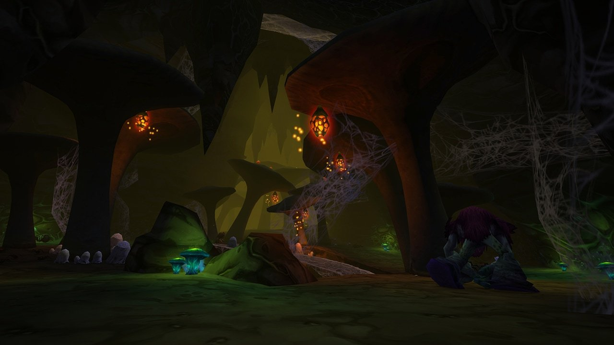
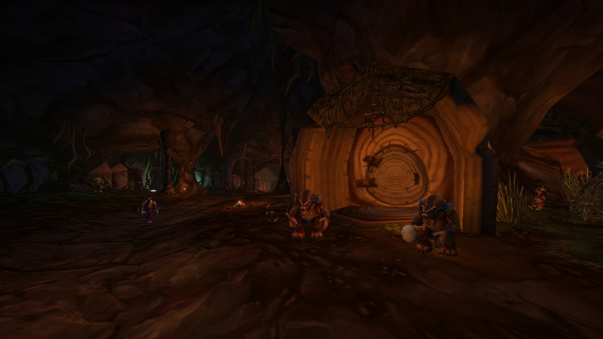
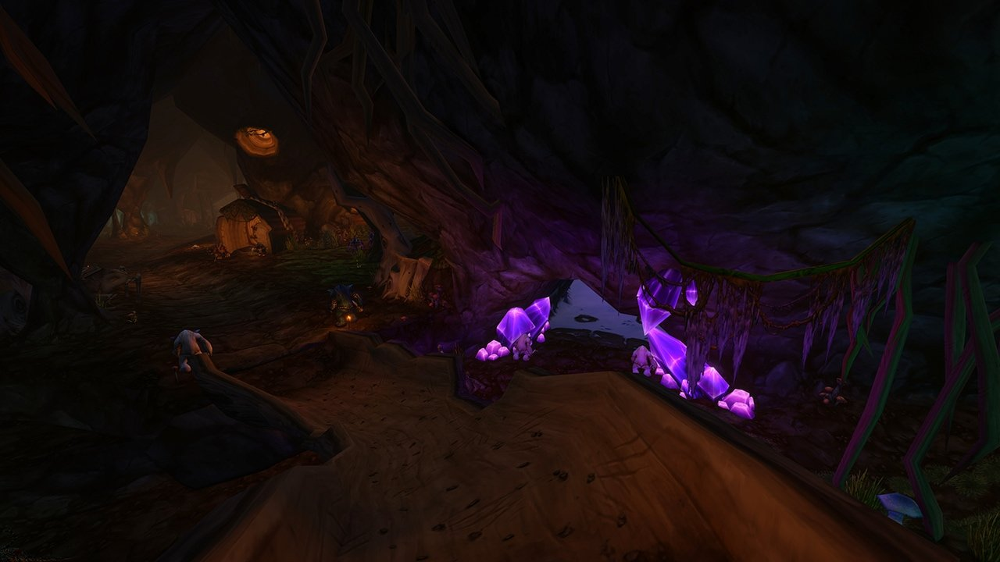
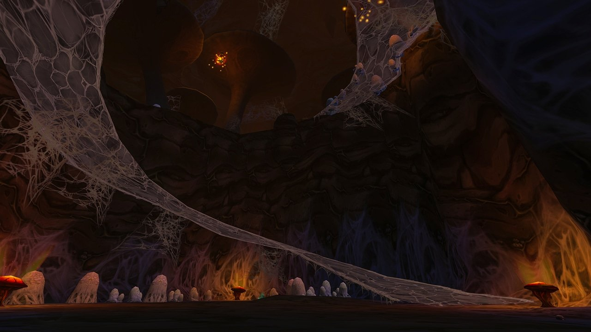
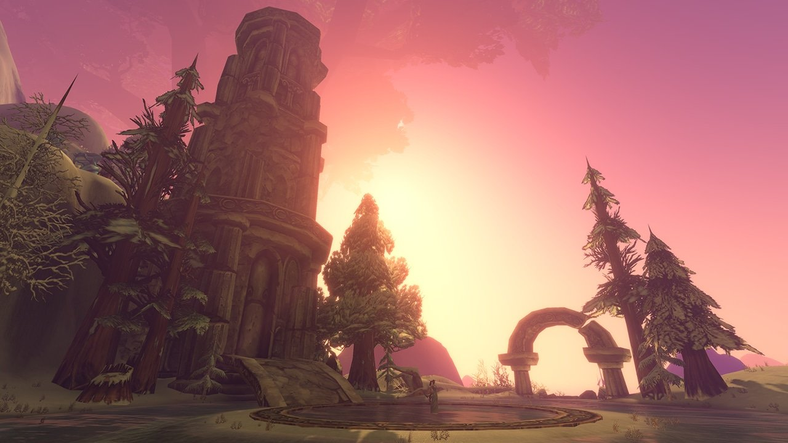
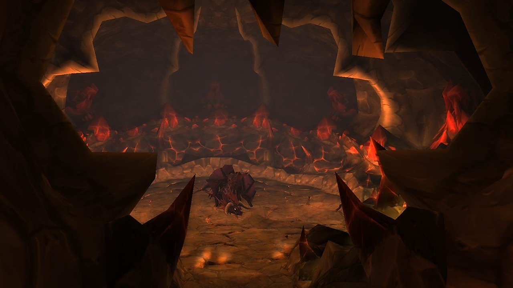

Blizzard heeft de drie raids beschreven die op 9 december opengaan in World of Warcraft: Forever. Barrow Deeps heeft acht bosses voor 10 spelers, Hyjal Summit 13 bosses voor 20 spelers, en Onyxia's Lair blijft een raid voor 40 met een attunement.

| Raid | Spelers | Bosses | Waar |
|---|---|---|---|
| Barrow Deeps | 10 | 8 | Onder Kalimdor, met ingangen op Mount Hyjal, in Winterspring en in Blackmaw Hold |
| Hyjal Summit | 20 | 13 | De top van Mount Hyjal, bij de World Tree Nordrassil |
| Onyxia's Lair | 40 | 1 | Dustwallow Marsh |

Alle drie zijn voor level 60. Blizzard plant nu een wekelijkse reset voor elke raid, zodat een groep een vaste raidavond kan houden.

## Barrow Deeps, de gevangenis van Illidan

In de Barrow Deeps zat Illidan Stormrage 10.000 jaar gevangen. De donkere gangen zijn nu open, en spelers dalen af om te ontdekken wat er geworden is van wie achterbleef en hoe de wardens het gevaar beneden willen indammen.

Drie ingangen leiden naar binnen: via Mount Hyjal, Winterspring en [Blackmaw Hold](/nl/news/blackmaw-hold-sits-behind-the-old-gate-in-azshara/), de dungeon in Azshara. Binnen wachten acht bosses op een groep van 10.

## Hyjal Summit, 13 bosses en meerdere wegen

Hyjal Summit ligt op de top van Mount Hyjal, bij Nordrassil. De raid begint met een gevecht tegen een oude bewaker. Daarna kiest de groep tussen meerdere wegen over de berg, door ruïnes boven en onder de grond, tot de weg naar de laatste gevechten opengaat.

## Onyxia's Lair, neem fire resistance mee

Onyxia, van de Black Dragonflight en het jongere zusje van Nefarian, bewaakt haar broed diep in Dustwallow Marsh. Haar gevecht heeft drie fases met zware vuuraanvallen. Blizzard raadt aan om vooraf fire resistance op te bouwen en klaar te staan om te verplaatsen als het gevecht kantelt.

Elk lid van de raid heeft de <a class="wf-wh wf-q3" href="https://www.wowhead.com/forever/item=16309">Drakefire Amulet</a> nodig om binnen te mogen. Die hoeft alleen in je tassen te zitten, niet aangetrokken. De ontwikkelaars zeiden in oktober al dat [de attunement blijft](/nl/news/onyxias-lair-keeps-its-attunement-quest-chain/); nu zet Blizzard elke stap op een rij.

## De attunement, stap voor stap

Elke factie heeft een eigen reeks. Blizzard raadt aan vroeg te beginnen, een paar vrienden mee te nemen voor de elite quests en te rekenen op meerdere tochten naar dungeons van hoog level.

### Alliance

1. <a href="https://www.wowhead.com/forever/quest=4182">Dragonkin Menace</a> bij Helendis Riverhorn in de Burning Steppes.
2. Zes quests met de naam <a href="https://www.wowhead.com/forever/quest=4183">The True Masters</a>, over de greep van de Black Dragonflight op de Blackrock-orcs. Ze eindigen bij Marshal Maxwell in Morgan's Vigil.
3. <a href="https://www.wowhead.com/forever/quest=4241">Marshal Windsor</a>: vind Marshal Windsor, of een bewijs van zijn dood, in Blackrock Depths. Hij stuurt je terug naar Maxwell met <a href="https://www.wowhead.com/forever/quest=4242">Abandoned Hope</a>.
4. <a class="wf-wh wf-q1" href="https://www.wowhead.com/forever/item=11446">A Crumpled Up Note</a> valt van vijanden in Blackrock Depths en start <a href="https://www.wowhead.com/forever/quest=4264">A Crumpled Up Note</a>. Breng het naar Windsor in zijn cel.
5. <a href="https://www.wowhead.com/forever/quest=4282">A Shred of Hope</a>: haal de verloren informatie van Windsor bij Golem Lord Argelmach en General Angerforge.
6. <a href="https://www.wowhead.com/forever/quest=4322">Jail Break!</a>: help Windsor ontsnappen uit Blackrock Depths en ga terug naar Maxwell.
7. <a href="https://www.wowhead.com/forever/quest=6402">Stormwind Rendezvous</a>: ontmoet Squire Rowe aan de poort van Stormwind en roep Windsor erbij.
8. <a href="https://www.wowhead.com/forever/quest=6403">The Great Masquerade</a>: verzamel bondgenoten voor de maskerade in Stormwind. Spreek Squire Rowe aan als Windsor er niet is.
9. <a href="https://www.wowhead.com/forever/quest=6501">The Dragon's Eye</a>: Highlord Bolvar Fordragon stuurt je door Azeroth op zoek naar iemand die kan helpen.
10. <a href="https://www.wowhead.com/forever/quest=6502">Drakefire Amulet</a>: neem het Blood of the Black Dragon Champion af van General Drakkisath in Upper Blackrock Spire en krijg de <a class="wf-wh wf-q3" href="https://www.wowhead.com/forever/item=16309">Drakefire Amulet</a>.

### Horde

1. Blood and Thunder bij Warlord Goretooth in Kargath, in de Badlands.
2. <a href="https://www.wowhead.com/forever/quest=4903">Warlord's Command</a> leidt je door Lower Blackrock Spire.
3. Goretooth stuurt je naar Eitrigg in Orgrimmar, en daarna naar Thrall.
4. <a href="https://www.wowhead.com/forever/quest=4974">For The Horde!</a>: breng Thrall het hoofd van Warchief Rend Blackhand uit Lower Blackrock Spire.
5. <a href="https://www.wowhead.com/forever/quest=6566">What the Wind Carries</a>, en zoek dan Rexxar op de wegen van Desolace voor <a href="https://www.wowhead.com/forever/quest=6567">The Champion of the Horde</a>.
6. <a href="https://www.wowhead.com/forever/quest=6568">The Testament of Rexxar</a>: breng zijn testament naar Myranda the Hag in de Western Plaguelands.
7. <a href="https://www.wowhead.com/forever/quest=6569">Oculus Illusions</a>: verzamel Black Dragonspawn Eyes.
8. <a href="https://www.wowhead.com/forever/quest=6570">Emberstrife</a>: zoek met de Amulet of Draconic Subversion de oude drake Emberstrife in Dustwallow Marsh.
9. Vier proeven: <a href="https://www.wowhead.com/forever/quest=6582">The Test of Skulls, Scryer</a>, <a href="https://www.wowhead.com/forever/quest=6583">The Test of Skulls, Somnus</a>, <a href="https://www.wowhead.com/forever/quest=6584">The Test of Skulls, Chronalis</a> en <a href="https://www.wowhead.com/forever/quest=6585">The Test of Skulls, Axtroz</a>, telkens voor de schedel van een draak met naam.
10. <a href="https://www.wowhead.com/forever/quest=6601">Ascension...</a> geeft de Dull Drakefire Amulet. Breng die naar Rexxar in Desolace.
11. <a href="https://www.wowhead.com/forever/quest=6602">Blood of the Black Dragon Champion</a>: haal het bloed bij General Drakkisath in Upper Blackrock Spire en ga terug naar Rexxar voor de <a class="wf-wh wf-q3" href="https://www.wowhead.com/forever/item=16309">Drakefire Amulet</a>.

## Klaar op 9 december

De raids gaan open vijf weken na de lancering van 4 november. Dat laat tijd om level 60 te halen en de attunement af te ronden. Onze [raidplanner](/nl/raid/) helpt een groep van 10, 20 of 40 te vullen, en elke datum staat op [de Forever-hub](/nl/forever/).
