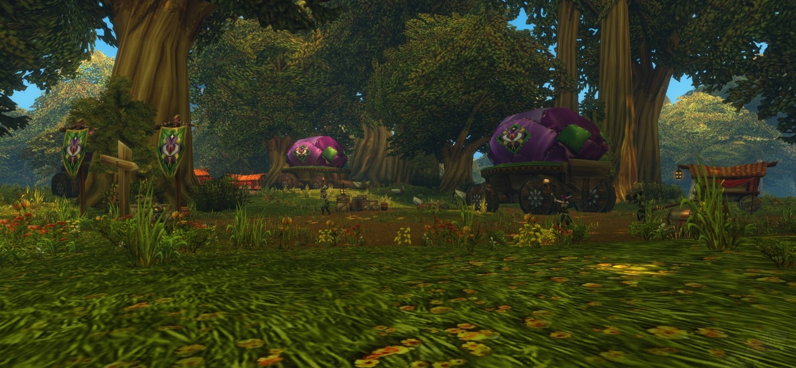
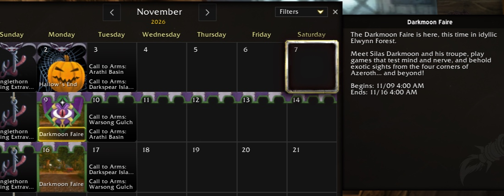

De eerste Darkmoon Faire van World of Warcraft: Forever strijkt neer in Elwynn Forest. De tenten en wagens worden al opgezet. Volgens de kalender in het spel opent de kermis op maandag 9 november en blijft hij een week.

## Een week in Elwynn

De kalender toont de Faire van maandag 9 tot maandag 16 november. "The Darkmoon Faire is here, this time in idyllic Elwynn Forest", staat in de tekst van het evenement. Spelers van de Alliance hebben hem dus eerst dicht bij huis. In Classic Era trekt de Faire afwisselend naar Elwynn Forest en Mulgore.

## Spelletjes, reputatie en een world buff

Op de Faire speel je minigames, verdien je reputatie bij de Darkmoon Faire en koop je zeldzame items. De bekendste reden om te gaan is <a class="wf-wh wf-spell" href="https://www.wowhead.com/forever/spell=23768">Sayge's Dark Fortune of Damage</a> van <a class="wf-wh wf-plain" href="https://www.wowhead.com/forever/npc=14822">Sayge</a>: 10% meer schade gedurende 2 uur.

Die buff is in Forever minder waard. World buffs werken daar niet in raids, alleen in de open wereld.

Of de Faire in Forever iets nieuws meebrengt, is nog niet bekend. Dat blijkt pas als hij maandag opent.
