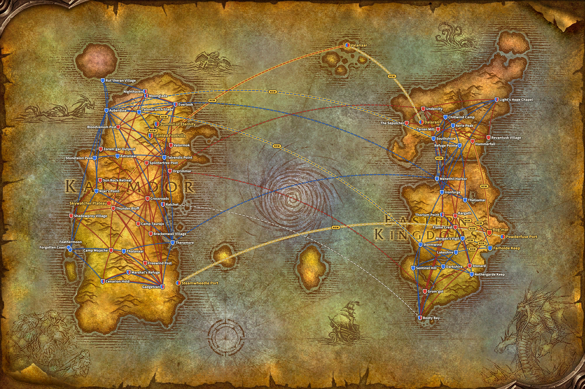
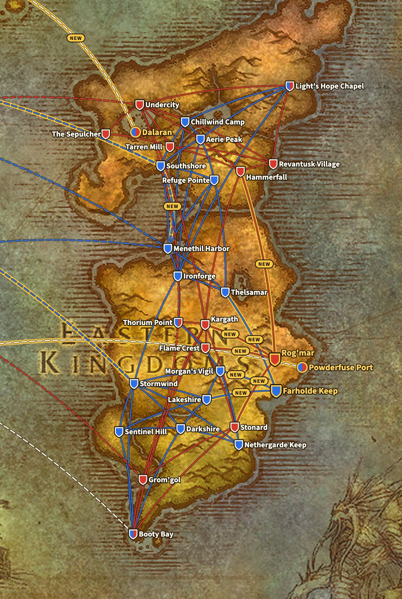
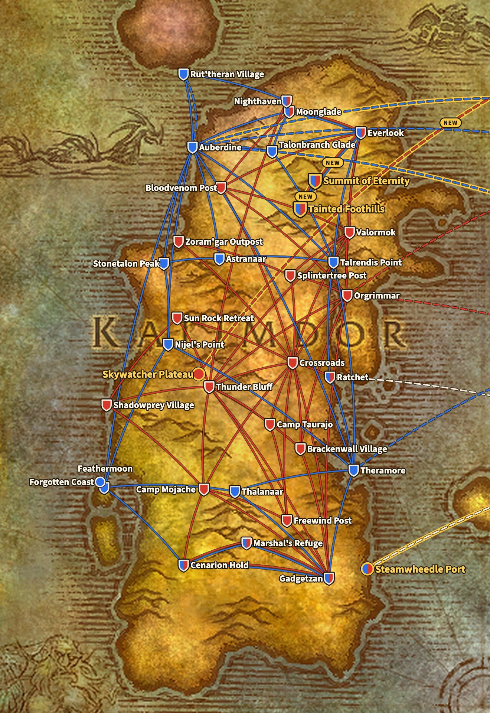
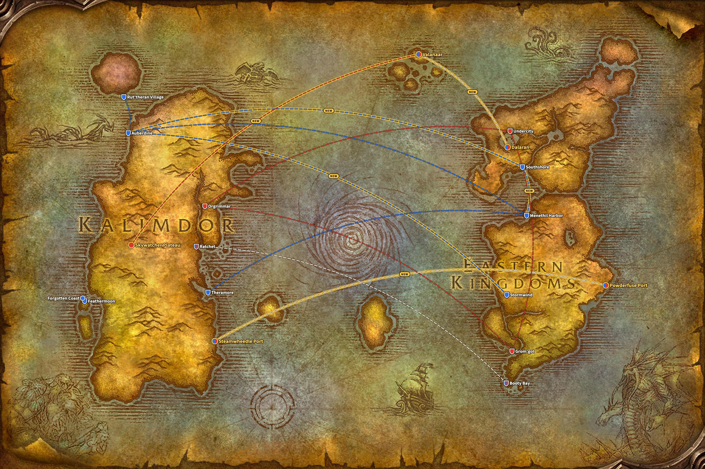

WoW Forever krijgt vier nieuwe vluchtpunten: Farholde Keep en Rog'mar in The Riverglades, en Tainted Foothills en Summit of Eternity op Mount Hyjal. Samen brengen ze tien nieuwe routes. Geen enkele bestaande route verdwijnt, blijkt uit de bestanden van het live spel.

*Bijgewerkt op 9 november: in de beta was Powderfuse Port in The Riverglades een vijfde nieuw vluchtpunt, met een route naar Farholde Keep. In het live spel is die route weg, dus telt deze post nu vier vluchtpunten en tien routes.*

## Waar de routes vandaan komen

Blizzard heeft geen lijst met vluchtroutes voor Forever gepubliceerd. De routes op deze pagina komen uit de bestanden van het live spel, build 1.60.1.70862. Ze staan naast dezelfde bestanden van Classic Era, build 1.15.9.69722.

De kaart tekent elke route als een lijn tussen twee plaatsen, niet zoals de vlucht in het spel echt loopt. Zo blijft ze leesbaar. De ondergrond is de wereldkaart uit de client van Forever, waarop The Riverglades al ten oosten van Redridge Mountains staat. De boten en zeppelins komen van dezelfde wereldkaart.

Een blauwe lijn is een route van de Alliance, een rode lijn een route van de Horde. Een stippellijn is een boot of een zeppelin, en een witte stippellijn staat open voor beide facties. Een lijn met een gouden rand en het woord NEW is nieuw in Forever. Een schild is een flight master, een rond teken een haven of zeppelintoren zonder flight master. Een schild in blauw en rood dient beide facties, en een gouden rand wijst op een nieuwe plek.

## De vier nieuwe vluchtpunten

| Vluchtpunt | Zone | Voor | Flight master | Vliegt naar |
|---|---|---|---|---|
| Farholde Keep | The Riverglades | Alliance | [Gretchen Mayberry](https://www.wowhead.com/forever/npc=257087) | Lakeshire, Thelsamar, Morgan's Vigil |
| Rog'mar | The Riverglades | Horde | [Grakna](https://www.wowhead.com/forever/npc=255993) | Stonard, Hammerfall, Kargath, Flame Crest |
| Tainted Foothills | Mount Hyjal | beide facties | [Bluebell](https://www.wowhead.com/forever/npc=260626) | Everlook, Summit of Eternity |
| Summit of Eternity | Mount Hyjal | beide facties | [Fayran Elthas](https://www.wowhead.com/forever/npc=41861) | Tainted Foothills |

[The Riverglades](/nl/forever/) is de nieuwe zone voor level 30 tot 45. Beide facties krijgen er een vluchtpunt dat de zone aan de omliggende zones knoopt: de Alliance vliegt naar Redridge Mountains, Loch Modan en Burning Steppes, de Horde naar Swamp of Sorrows, Arathi Highlands, Badlands en Burning Steppes.

Mount Hyjal is de finale van het levelen, met een kamp waar Horde en Alliance samen zitten. Dat blijkt ook uit de routes. Beide vluchtpunten op de berg dienen beide facties, en Tainted Foothills verbindt voor elke kant met Everlook in Winterspring.

## Alliance

De Alliance krijgt er drie vluchtpunten en vijf routes bij. In de Eastern Kingdoms verbindt Farholde Keep met Lakeshire, Thelsamar en Morgan's Vigil. In Kalimdor leidt Everlook naar Tainted Foothills en van daar naar Summit of Eternity.

**Eastern Kingdoms, 17 vluchtpunten.** Bestaand: Aerie Peak, Booty Bay, Chillwind Camp, Darkshire, Ironforge, Lakeshire, Light's Hope Chapel, Menethil Harbor, Morgan's Vigil, Nethergarde Keep, Refuge Pointe, Sentinel Hill, Southshore, Stormwind, Thelsamar en Thorium Point. Nieuw: Farholde Keep.

**Kalimdor, 19 vluchtpunten.** Bestaand: Astranaar, Auberdine, Cenarion Hold, Everlook, Feathermoon, Gadgetzan, Marshal's Refuge, Moonglade, Nighthaven (voor Druids, vanuit Rut'theran Village), Nijel's Point, Ratchet, Rut'theran Village, Stonetalon Peak, Talonbranch Glade, Talrendis Point, Thalanaar en Theramore. Nieuw: Tainted Foothills en Summit of Eternity.

## Horde

De Horde krijgt er drie vluchtpunten en zes routes bij. Rog'mar in The Riverglades heeft vier routes, naar Stonard, Hammerfall, Kargath en Flame Crest, evenveel als Farholde Keep. In Kalimdor krijgt de Horde dezelfde twee punten op Mount Hyjal als de Alliance.

**Eastern Kingdoms, 13 vluchtpunten.** Bestaand: Booty Bay, Flame Crest, Grom'gol, Hammerfall, Kargath, Light's Hope Chapel, Revantusk Village, Stonard, Tarren Mill, The Sepulcher, Thorium Point en Undercity. Nieuw: Rog'mar.

**Kalimdor, 22 vluchtpunten.** Bestaand: Bloodvenom Post, Brackenwall Village, Camp Mojache, Camp Taurajo, Cenarion Hold, Crossroads, Everlook, Freewind Post, Gadgetzan, Marshal's Refuge, Moonglade, Nighthaven (voor Druids, vanuit Thunder Bluff), Orgrimmar, Ratchet, Shadowprey Village, Splintertree Post, Sun Rock Retreat, Thunder Bluff, Valormok en Zoram'gar Outpost. Nieuw: Tainted Foothills en Summit of Eternity.

## Classic Era en Forever naast elkaar

Een route is hier een rechtstreekse vlucht tussen twee vluchtpunten. Een stad met een flight master voor elke factie, zoals Everlook, telt één keer per factie.

| | Classic Era | WoW Forever |
|---|---|---|
| Alliance, Eastern Kingdoms | 16 punten, 35 routes | 17 punten, 38 routes |
| Alliance, Kalimdor | 17 punten, 31 routes | 19 punten, 33 routes |
| Horde, Eastern Kingdoms | 12 punten, 22 routes | 13 punten, 26 routes |
| Horde, Kalimdor | 20 punten, 47 routes | 22 punten, 49 routes |

Elke route van Classic Era is er nog, met hetzelfde begin en einde. Forever voegt alleen toe. Naast de vluchtroutes komen er [drie nieuwe scheepsroutes](/nl/news/wow-forever-three-new-ship-routes/), waaronder een boot van The Riverglades naar Steamwheedle Port in Tanaris. Wie de Legacy-perk Frequent Flier heeft, betaalt de helft voor een vlucht en vliegt 20% sneller, zie [het overzicht van Forever](/nl/forever/).

Elk vluchtpunt met zijn flight master, coördinaten en routes staat in de [gids over de vluchtroutes](/nl/guides/flight-paths/).

## Wat niet zeker is

- **Powderfuse Port heeft geen vluchtroute.** In de beta vloog het naar Farholde Keep, maar in het live spel is die route weg. De haven heeft wel de boot naar Steamwheedle Port in Tanaris.
- **Nog een vluchtpunt wacht**: Tidegear Coast in Dun Morogh staat in de bestanden, zonder één route. Waarvoor het dient, is niet bekend.
- **De routes kunnen nog veranderen** met een hotfix of een patch.
- **Zephras Isle heeft geen vaste plek** op de wereldkaart in de bestanden. De kaart zet Valanaar, waar de nieuwe zeppelins uit Dalaran en Skywatcher Plateau landen, op de eilandengroep ten noorden van de Maelstrom.
- **Hoelang een vlucht duurt**, staat niet in deze bestanden. De kaart toont dus waar een route loopt, niet hoelang ze duurt.
