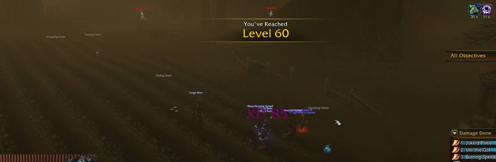

Vijf spelers haalden level 60 in World of Warcraft: Forever op precies hetzelfde moment, bijna 52 uur na de launch. Diezelfde nacht noemde Blizzard Forever de grootste launch in de geschiedenis van WoW.

## Vijf tegelijk

De launch was om 00.00 uur Belgische tijd op 5 november, dus de vijf haalden level 60 net voor 04.00 uur op 7 november. Het gaat om [Jokerd Prime](https://www.twitch.tv/jokerdtv), [Burning Speed](https://www.twitch.tv/b_urning), [Cloud Bells](https://www.twitch.tv/cloudbells), [Lmgd Mmr](https://www.twitch.tv/lmgd1) en [Vitochie Gofast](https://www.twitch.tv/vitochier1). Alle vijf streamden op Twitch.

Ze levelden als één groep. Een Paladin trok grote groepen monsters mee, en de Mages doodden ze in één keer met <a class="wf-wh wf-spell" href="https://www.wowhead.com/forever/spell=1449">Arcane Explosion</a>.

De groep hield de experience zo gelijk mogelijk. Eén experience point kon één speler achterlaten, legde Jokerd uit op zijn stream. De laatste 4 procent van level 59 was het moeilijkste stuk: de groep rekende uit welke monsters ze moesten doden, en wanneer, om samen te eindigen.

Hoe de groep zich voorbereidde, wil Jokerd de komende dagen op stream uitleggen, als alle vijf geslapen hebben.

## Grootste launch in de geschiedenis van WoW

Blizzard deelde twee records op X, om 03.30 uur op 7 november. Forever had de meeste spelers tegelijk online van alle launches in de geschiedenis van World of Warcraft. Het bracht ook meer terugkerende spelers terug dan elke launch ervoor.

> Congratulations everyone, you made HISTORY!
> WoW: Forever has achieved:
> 🔹The biggest launch in WoW history by peak concurrent players
> 🔹The highest number of returning players in WoW history

<figure class="wf-embed wf-embed--x" data-wf-x="2118893768984162668">
  <button type="button" class="wf-embed__play">
    
    
      Blizzard: de grootste launch in de geschiedenis van WoW
      Laad de post van X.
    
  </button>
</figure>

Hoeveel spelers dat zijn, zegt Blizzard niet. De raids openen op [9 december](/nl/news/wow-forever-is-live-and-the-raids-open-on-9-december/).
