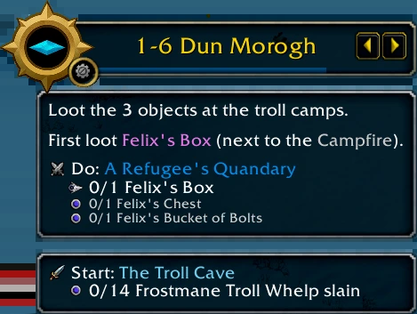
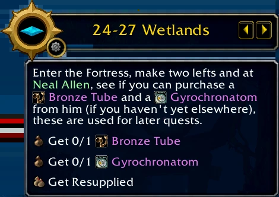
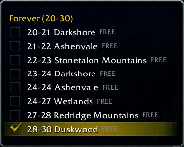
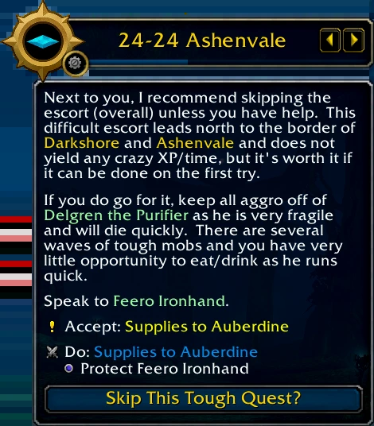
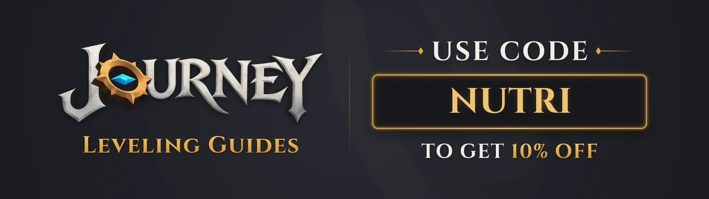

Journey is een nieuwe levelgids als addon voor World of Warcraft: Forever. Level 1 tot 30 is gratis voor iedereen, ook na de launch. De volledige route tot level 60 is een eenmalige aankoop en gaat open op 4 november, wanneer Forever opent.

## Wat de addon doet

Een paneel toont de volgende stap en een pijl wijst de weg. Journey herkent factie en class en laadt de juiste route; een bestaand personage krijgt een inhaalstap op zijn level. De addon zegt ook welk vluchtpunt je neemt, wat je bij een verkoper koopt en welke quest je laat vallen.

Journey werkt zonder TomTom en draait naast Questie en ElvUI. Moeilijke quests kan je overslaan, en de route past zich aan als een quest niet meer beschikbaar is. De stappen noemen de questbeloning voor je class.

## Wie de routes maakt

Journey bouwt op de oorspronkelijke routes van 1 tot 60 van Joana, een van de eerste speedrunners van Vanilla, met toestemming van de familie van Joana en van TomCat's Gaming, dat Joana's Guides bezit. De routes voor Forever zijn van Alenya, een speedrunner in Classic die al acht jaar gidsen van 1 tot 60 schrijft, met een team van speedrunners met records en classexperts.

Het gratis deel heeft al de nieuwe quests van Forever en de Skyborne-start op Zephras Isle voor beide facties. De nieuwe combinaties van ras en class, zoals de Undead Paladin, de Orc Mage en de Dwarf Shaman, hebben hun classquests in de route. Stappen voor Cooking en het nieuwe Camping-systeem gebruiken hun bonus op experience.

## Level 30 tot 60

Op 4 november start level 30 tot 60 op de klassieke route. Ongeveer een week na de launch komen de nieuwe quests en zones van Forever erbij, ongeveer vijf levels om de vier tot vijf dagen. Dungeonquests komen later als optie. Routes voor duo's en groepen staan gepland, net als Hardcore met een Self-Found-versie, die niet in deze aankoop zit.

## Prijs

Er is geen abonnement. Tot 4 december kosten beide facties 30 dollar en één factie 25 dollar, plus btw. Daarna wordt dat 45 en 30 dollar. Een aankoop geldt voor elk personage op één Battle.net-account, en terugbetaling kan binnen 14 dagen.

De addon zelf en level 1 tot 30 zijn gratis, zoals de addonregels van Blizzard vragen; het betaalde deel is extra gidsinhoud. De gratis versie staat op [CurseForge](https://www.curseforge.com/wow/addons/journey).

## Kortingscode voor Journey

De creatorcode NUTRI werkt als kortingscode en geeft 10% korting: 27 dollar voor beide facties, 22,50 voor één. <a href="https://getjourney.gg/?code=nutri" rel="noopener sponsored">Onze partnerlink</a> past de code toe bij het afrekenen; zelf intypen kan ook. De andere leveladdons voor Forever staan naast elkaar in [de vergelijking van leveladdons](/nl/compare/leveling-addons-forever/).
