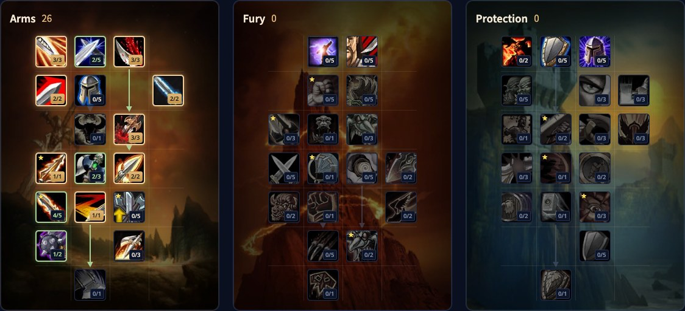

Der Arms Warrior in WoW Forever schwingt eine große, langsame Waffe. Rend blutet weiter, Overpower leuchtet immer wieder auf, und jeder Schlag nimmt dem Gegner ein sichtbares Stück ab. Viele seiner Talente neigen zum PvP, was Arms zur natürlichen Wahl für Schlachtfelder macht. Dieser Guide behandelt den Build für Level 30, die Rotation, Rend und Overpower, Rage, Werte, Waffen und Völker.

| | |
|---|---|
| Rolle | Nahkampfschaden mit einer Zweihandwaffe |
| Build auf Level 30 | 26 Punkte in Arms, mit den 5 zusätzlichen Punkten von Talented |
| Wichtige Talente | Improved Rend, Improved Overpower, Bloodthrill, Improved Slam, Impale, Two-Handed Weapon Specialization |
| Stärke | Große Treffer, starker Cleave mit Sweeping Strikes |
| Schwäche | Langsames Spiel, Fähigkeiten, die besser ins PvP passen |
| Leveln | [Leveling-Guide für den Warrior](/de/guides/warrior-leveling/), [Level-Build für den Warrior](/de/leveling/warrior/) |
| Andere Spezialisierungen | [Fury Warrior](/de/guides/fury-warrior/), [Protection Warrior](/de/guides/protection-warrior/) |

## Was sich für Arms ändert

- **Bloodthrill ist neu.** Angriffe mit der Waffenhand auf ein Ziel mit deinem Rend haben bei 5/5 eine Chance von 20 %, Overpower nutzbar zu machen.
- **Improved Rend** gibt Rend bei 3/3 35 % mehr Blutungsschaden.
- **Improved Slam kann viel mehr.** Kürzere Zauberzeit und globale Abklingzeit, kein unterbrochener Schlag und 3 Sekunden kürzere Abklingzeit.
- **Spearing Strike ist neu.** 40 % Waffenschaden, und 80 % zusätzlich gegen Riesen, Drachkin und berittene Ziele, die es vom Reittier holt.
- **Impale** erhöht den Bonus auf kritischen Schaden deiner Fähigkeiten jetzt bei 2/2 um 20 %.
- **Weaponmaster ist neu.** Ein Bonus pro Waffenart: kritische Trefferchance mit Äxten und Stangenwaffen, Rüstungsdurchschlag mit Streitkolben und Stäben, Extraangriffe mit Schwertern.

## Stärken und Schwächen

| Stärken | Schwächen |
|---|---|
| Schaden in großen Brocken, auch gegen mehrere Ziele | Rage kommt von langsamen Schlägen, alles fühlt sich langsam an |
| Sweeping Strikes, Cleave und Whirlwind für starken Cleave | Spearing Strike und Mortal Strike passen besser ins PvP als ins PvE |
| Die beste Warrior-Spezialisierung für Schlachtfelder | |

## Der Build für Level 30

Dieser Build nutzt 26 Punkte: die 21 Punkte von Level 30 plus 5 von Talented aus dem Legacy-System. Ohne Talented hörst du bei 21 Punkten auf; der [Level-Build für den Warrior](/de/leveling/warrior/) gibt die Reihenfolge pro Level. [Öffne den Build im Talentrechner](/de/talents/warrior/?t=323202031224101).

| Talent | Punkte |
|---|---|
| **Improved Heroic Strike** | 3/3 |
| **Deflection** | 2/5 |
| **Improved Rend** | 3/3 |
| **Improved Charge** | 2/2 |
| **Improved Overpower** | 2/2 |
| **Deep Wounds** | 3/3 |
| **Spearing Strike** | 1/1 |
| **Two-Handed Weapon Specialization** | 2/3 |
| **Impale** | 2/2 |
| **Bloodthrill** | 4/5 |
| **Sweeping Strikes** | 1/1 |
| **Improved Slam** | 1/2 |

Nach Level 30 kommen Weaponmaster und Mortal Strike unten im Baum.

## Was die wichtigsten Talente tun

| Talent | Was es in Forever tut |
|---|---|
| **Improved Rend** | 35 % mehr Blutungsschaden von Rend |
| **Improved Overpower** | 50 % mehr kritische Trefferchance für Overpower |
| **Bloodthrill** | Overpower-Procs durch Treffer der Waffenhand auf Ziele mit deinem Rend |
| **Improved Slam** | Macht Slam zu einem fast sofortigen Füller, der deinen Schlag nicht zurücksetzt |
| **Impale** | 20 % mehr Bonus auf kritischen Schaden für deine Fähigkeiten |
| **Two-Handed Weapon Specialization** | 3 % mehr Schaden mit Zweihandwaffen bei 3/3 |
| **Mortal Strike** | Einer deiner stärksten Angriffe in jeder Lage. Nach Level 30 |
| **Weaponmaster** | Ein Bonus pro Waffenart. Nach Level 30 |

## Rotation

1. Gib überschüssige Rage für Heroic Strike aus, oder Cleave gegen mehrere Gegner, damit sie nie verfällt.
2. Halte Battle Shout aufrecht.
3. Staple Sunder Armor.
4. Overpower, sobald es aufleuchtet.
5. Setze Rend auf das Ziel und halte es dort.
6. Mortal Strike, sobald du es hast.
7. Spearing Strike.
8. Slam.
9. Hamstring, wenn nichts anderes bereit ist und du Rage übrig hast.

## Abklingzeiten und Nutzen

- **Retaliation** und **Shield Wall**, wenn du das Ziel bist.
- **Berserker Rage**, um Furcht- und Handlungsunfähigkeitseffekte zu ignorieren.
- **Recklessness** ist die stärkste Schadens-Abklingzeit im Spiel.
- **Bloodrage** frei nutzen, für zusätzliche Rage.

## Mobilität

Bleib am Boss. Außerhalb des Kampfes eröffnest du immer mit Charge, für Rage und einen sofortigen Start. Im Kampf hast du Intercept, aber nur in Berserker Stance, der Wechsel kostet also die Rage, die du hattest.

## Rend, Overpower und Rage

**Rend** muss immer auf deinem Ziel laufen, vor allem für die Procs von Bloodthrill. Rend auf mehreren Zielen schadet nicht, gibt dir aber keine zusätzlichen Procs.

**Overpower** funktioniert nur, wenn es aufleuchtet, auch wenn die Abklingzeit vorbei ist. Achte darauf und drück es jedes Mal.

**Rage.** Plane voraus und halte genug für deine wichtigen Angriffe bereit. Lässt Heroic Strike oder Slam Mortal Strike oder Overpower eine oder zwei Sekunden warten, war das ein Fehler. Halte deine Rage in Bewegung: nie voll, nie leer.

## Werte und Ausrüstung

Die genaue Reihenfolge auf Level 60 folgt nach dem Start. Diese Werte helfen einem Arms Warrior:

- **Stärke und Angriffskraft.** Dein Hauptwert: 1 Stärke gibt 2 Angriffskraft, Stärke ist pro Punkt also mehr wert.
- **Trefferchance.** Ein Fehlschlag macht nichts und gibt keine Rage.
- **Kritische Trefferchance.** Mehr Schaden und mehr Rage. Beweglichkeit gibt auch etwas kritische Trefferchance.

**Rüstung.** Platte ist ideal, aber Kette oder Leder mit den richtigen Werten kann besser sein. Forever bestraft keine leichtere Rüstungsart, du hast nur weniger Rüstung. Schmiede stellen gute Leveling-Ausrüstung her, und Dungeons haben noch viel mehr.

**Waffen.** Such langsame, hart treffende Zweihandwaffen. Der Großteil deines Schadens kommt von Sofortangriffen wie Mortal Strike, Overpower und Slam, die mit dem Waffenschaden skalieren. Eine Fernkampfwaffe zählt nur für ihre Werte.

## Völker und Berufe

Jedes Volk kann Warrior spielen. Jede Wahl funktioniert, aber manche sind stärker.

| Fraktion | Volk | Warum |
|---|---|---|
| Allianz | Human | <a class="wf-wh wf-spell" href="https://www.wowhead.com/forever/spell=20597">Ruthless</a>: 1 % mehr kritische Trefferchance |
| Allianz | Dwarf | Artisan's Precision: 1 % Hit mit Zaubern und Angriffen |
| Allianz | Gnome | Eine Burst-Abklingzeit, die sehr stark sein kann |
| Allianz | Night Elf | Elune's Light, eine Krit-Abklingzeit für Rage und Schaden auf Abruf |
| Allianz | High Order Skyborne | <a class="wf-wh wf-spell" href="https://www.wowhead.com/forever/spell=1259710">Wind Blessed</a>: Tempo, selten und stark für dich |
| Horde | Orc | <a class="wf-wh wf-spell" href="https://www.wowhead.com/forever/spell=20572">Blood Fury</a> für Angriffskraft |
| Horde | Troll | Mehr Schaden gegen Wildtiere und Berserking für Angriffstempo auf Abruf |
| Horde | Undead | Touch of the Grave macht Schaden und heilt dich ein wenig |
| Horde | Tauren | War Stomp, 5 % mehr Gesundheit und Plainsrunning für Tempo, solange du dich bewegst |
| Horde | Windshaper Skyborne | Tempo und eine praktische Abklingzeit für Bewegungstempo |

**Berufe.** Blacksmithing stellt einen Teil der besten Ketten- und Plattenausrüstung her, vieles davon nur für Schmiede. Engineering hat nützliche Apparate für jede Spezialisierung.
