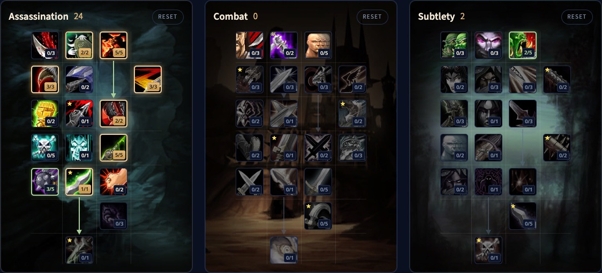

> **Update vom 4. November:** Builds und Talente unten folgen den neuen Bäumen aus den Entwicklungsnotizen vom 2. November, mehr in [unserem Beitrag](/de/news/rogues-get-shank-and-death-mark-in-a-big-rework/).

Der Assassination Rogue in WoW Forever ist der Giftmischer. Venom macht deine Gifte nach jedem Shank stärker, Mutilate gibt Dolchen ab Level 40 einen eigenen Combopunkt-Generator, und Gifte können jetzt kritisch treffen. Du brauchst weder Stealth-Tricks noch reine automatische Angriffe, um Schaden zu machen. Dieser Guide behandelt zwei Builds für Level 30, die Rotation, Energie, Gifte, Überleben, Werte und Völker.

| | |
|---|---|
| Rolle | Nahkampfschaden mit Dolchen und Giften |
| Build auf Level 30 | 21 Punkte in Assassination, Talented fügt Relentless Strikes und Opportunity hinzu |
| Wichtige Talente | Malice, Ruthlessness, Improved Slice and Dice, Improved Poisons, Venom, Mutilate |
| Stärke | Sehr hoher Schaden, der mit jedem Level wächst, viel Kontrolle |
| Schwäche | Eine anspruchsvolle Rotation, braucht Ausrüstung |
| Leveln | [Leveling-Guide für den Rogue](/de/guides/rogue-leveling/), [Level-Build für den Rogue](/de/leveling/rogue/) |

## Was sich für Assassination ändert

- **Mutilate ist neu.** Greift mit beiden Dolchen für 2 Combopunkte an, 20 % stärker gegen vergiftete Ziele. Seit dem 2. November steht es in der siebten Reihe, du bekommst es also auf Level 40.
- **Venom ist neu.** Ein passives Talent in der fünften Reihe: Jeder Shank gibt 6 Sekunden lang 30 % mehr Giftschaden und 20 % mehr Chance, Gifte aufzutragen. Shank selbst ist für jeden Rogue neu auf Level 24: ein günstiger Schlag mit der Nebenhand, der 15 Energie zurückgibt.
- **Gifte treffen kritisch** und werden mit der Angriffskraft stärker. Malice zählt jetzt auch für Gifte.
- **Improved Poisons kann mehr.** Bei 5/5 10 % mehr Chance, Gifte aufzutragen, und eine Chance von 50 %, die Ladung zu behalten.
- **Improved Expose Armor wurde überarbeitet.** 10 Energie weniger, und 2 Combopunkte zurück, wenn du Expose Armor mit 5 nutzt.
- **Remorseless Attacks** gibt deinem nächsten Mutilate oder Ambush nach einem Kill, der Erfahrung gibt, 40 % mehr kritische Trefferchance.
- **Energie kommt gleichmäßig zurück**, 10 pro Sekunde, statt in Schüben.

## Stärken und Schwächen

| Stärken | Schwächen |
|---|---|
| Sehr hoher Schaden, der mit jedem Level wächst | Eine anspruchsvolle Rotation mit mehreren Finishing Moves, die aktiv bleiben müssen |
| Gifte ignorieren Rüstung und treffen jetzt kritisch | Zufällige Combopunkte von Ruthlessness und Relentless Strikes können verwirren |
| Kick, Gouge, Sap, Cheap Shot, Kidney Shot und Blind | Braucht viel Angriffskraft, bevor er richtig loslegt |
| Gifte für jede Lage, und der einfachste Weg zu Improved Expose Armor | Kein Flächenschaden |

## Zwei Builds für Level 30

Beide Builds nutzen die 21 Punkte, die du auf Level 30 hast. Talented aus dem Legacy-System fügt jeweils 5 hinzu.

### Solo-Build

Auf möglichst viel Schaden gebaut: 5 % kritische Trefferchance durch Malice, zusätzliche Combopunkte durch Ruthlessness, mehr Gift-Procs durch Improved Poisons und Venom für stärkere Gifte nach jedem Shank. Mutilate folgt auf Level 40. [Öffne den Build im Talentrechner](/de/talents/rogue/?t=02530300200501).

| Talent | Punkte |
|---|---|
| **Remorseless Attacks** | 2/2 |
| **Malice** | 5/5 |
| **Ruthlessness** | 3/3 |
| **Improved Slice and Dice** | 3/3 |
| **Lethality** | 2/2 |
| **Improved Poisons** | 5/5 |
| **Venom** | 1/1 |

[Öffne die Talented-Version](/de/talents/rogue/?t=02530300200531--002) mit Relentless Strikes 3/5 und Opportunity 2/5 in Subtlety, für mehr Energie und härtere Ambushes.

### Build mit Improved Expose Armor

Fast derselbe, aber mit Improved Expose Armor, das Expose Armor in Dungeongruppen, bei Bossen und bei Trash viel leichter nutzbar macht. [Öffne den Build im Talentrechner](/de/talents/rogue/?t=02532300200301).

| Talent | Punkte |
|---|---|
| **Remorseless Attacks** | 2/2 |
| **Malice** | 5/5 |
| **Ruthlessness** | 3/3 |
| **Improved Expose Armor** | 2/2 |
| **Improved Slice and Dice** | 3/3 |
| **Lethality** | 2/2 |
| **Improved Poisons** | 3/5 |
| **Venom** | 1/1 |

[Öffne die Talented-Version](/de/talents/rogue/?t=02532300200531) mit Improved Poisons 5/5 und Relentless Strikes 3/5.

## Was die wichtigsten Talente tun

| Talent | Was es in Forever tut |
|---|---|
| **Malice** | 5 % mehr kritische Trefferchance für Angriffe und Gifte. Pflicht |
| **Remorseless Attacks** | 40 % mehr kritische Trefferchance für dein nächstes Mutilate oder Ambush nach einem Kill. Ideal zum Farmen und für Dungeongruppen |
| **Ruthlessness** | Eine Chance von 60 % auf einen Combopunkt nach einem Finishing Move |
| **Improved Slice and Dice** | Slice and Dice hält 45 % länger. Ohne funktioniert der Build nicht |
| **Relentless Strikes** | Auf 3/5: 12 % Chance pro Combopunkt, nach einem Finishing Move 25 Energie zurückzubekommen |
| **Improved Expose Armor** | Billigeres Expose Armor und 2 Combopunkte zurück bei 5 Punkten. Optional, aber deine Gruppe wird dir danken |
| **Lethality** | Bei 2/2 20 % mehr Bonus auf kritischen Schaden für Sinister Strike, Backstab und Mutilate, mit Remorseless Attacks noch besser |
| **Cold Blood** | 100 % kritische Trefferchance für dein nächstes Ambush oder Mutilate |
| **Improved Poisons** | Mehr Giftanwendungen und weniger verbrauchte Ladungen |
| **Venom** | Shank erhöht deinen Giftschaden um 30 % und deine Chance, Gifte aufzutragen, um 20 %, für 6 Sekunden |
| **Mutilate** | Dein Combopunkt-Generator mit zwei Dolchen ab Level 40, in der siebten Reihe. Trifft mit der richtigen Ausrüstung sehr hart |
| **Opportunity** | Auf 2/5: 8 % mehr Schaden für Backstab, Ambush, Garrote und Mutilate |

## Rotation

**Normale Gegner**
1. Eröffne aus Stealth mit Ambush.
2. Sinister Strike für Combopunkte, und Shank, sobald er bereit ist, für Energie und Venom. Ab Level 40 übernimmt Mutilate, mit Sinister Strike für den letzten Punkt bei 4 Combopunkten.
3. Slice and Dice, und erneuere es jedes Mal, wenn es ausläuft.
4. Eviscerate bei 5 Combopunkten, oder mit dem, was du hast, wenn das Ziel fast tot ist.
5. Kick auf jeden Zauber, Evasion, wenn du die Treffer abbekommst, Vanish, wenn du weg musst.

**Bosse**
1. Eröffne aus Stealth mit Ambush.
2. Sinister Strike, oder Mutilate ab Level 40, als Generator, und Shank, sobald er bereit ist.
3. Expose Armor so früh wie möglich.
4. Dann Slice and Dice so früh wie möglich.
5. Erneuere Expose Armor und Slice and Dice, bevor sie auslaufen. Expose Armor zuerst, weil es kürzer hält.
6. Übrige Combopunkte gehen in Eviscerate, oder in Kidney Shot, wenn der Boss betäubt werden kann.
7. Vanish und Ambush für Burst, Kick auf jeden Zauber, Feint, wenn deine Bedrohung zu hoch wird.

**Gruppen.** Der Rogue hat keine Flächenangriffe. Töte ein Ziel nach dem anderen und wechsle nie das Ziel, während du Combopunkte aufbaust: Sie bleiben auf dem alten Ziel.

Venom wirkt über Shank, also nutze Shank in jedem Kampf, sobald er bereit ist.

## Abklingzeiten und Nutzen

- **Cheap Shot** betäubt aus Stealth. Stark, um gefährliche Ziele festzusetzen.
- **Kidney Shot** betäubt mit mehr Combopunkten länger.
- **Sap** setzt ein Ziel aus Stealth lange außer Gefecht. Nutze es, um einen Gegner aus einer Gruppe zu holen.
- **Kick** unterbricht fast jeden Zauber im Spiel.
- **Expose Armor** senkt die Rüstung des Ziels für dich und deine Gruppe.
- **Cold Blood** für einen sicheren kritischen Treffer mit Ambush oder Mutilate.
- **Gouge** setzt außer Gefecht und stoppt deinen automatischen Angriff, um Zeit für Energie oder Abklingzeiten zu gewinnen.
- **Blind** später, um einen gefährlichen Gegner aus dem Kampf zu nehmen.
- **Crippling Poison** verlangsamt, **Mind-numbing Poison** verlängert Zauber und **Wound Poison** senkt Heilung.

## Stealth, Combopunkte und Finishing Moves

**Stealth** macht dich langsam, also reist du nicht damit, aber nutze es beim Questen gegen die meisten Gegner und in Dungeons so oft wie möglich. In Stealth bekommst du eine eigene Aktionsleiste mit Eröffnern: Ambush für schweren Schaden, Garrote für eine Blutung, Sap und Cheap Shot zum Ausschalten. Pick Pocket und Distract funktionieren ebenfalls nur in Stealth.

**Generatoren und Finishing Moves.** Du beginnst mit Sinister Strike und wechselst auf Level 40 zu Mutilate. Sinister Strike bleibt dann nur für den letzten Punkt bei 4 Combopunkten. Eviscerate ist dein erster Finishing Move; später nutzt du ihn vor allem, um Ziele zu erledigen. Slice and Dice ist dein stärkster Finishing Move und gehört in fast jeden Kampf. Gegen Bosse kommt Expose Armor dazu. Rupture ist für Assassination weder Energie noch Zeit wert.

## Energie

Jede Rogue-Fähigkeit kostet Energie. In Forever kommt sie gleichmäßig zurück: 1 alle 0,1 Sekunden, 10 pro Sekunde. Assassination kann das nicht beschleunigen, aber Vigor erhöht deine maximale Energie. <a class="wf-wh wf-q1" href="https://www.wowhead.com/forever/item=7676">Thistle Tea</a> gibt einen großen Schub Energie mit langer Abklingzeit. Shank, ab Level 24, kostet 5 Energie und gibt alle 10 Sekunden 15 zurück.

Gib also sorgfältig aus. Bei 5 Combopunkten nutzt du nie einen weiteren Generator. Bei 4 Combopunkten verschwendet Mutilate einen Punkt. Kick, Feint, Gouge und Blind kosten ebenfalls Energie, nutze sie also nur mit gutem Grund.

## Gifte

Ab Level 20 stellt ein Rogue nach einer Klassenquestreihe Gifte her; der [Leveling-Guide für den Rogue](/de/guides/rogue-leveling/) hat die Schritte. Instant Poison macht sofort Schaden, Deadly Poison stapelt Schaden über Zeit. Nutze diese beiden in den meisten Kämpfen: Instant Poison auf langsamen Waffen, Deadly Poison auf schnellen. Crippling, Mind-numbing und Wound Poison sind für Gegner, die verlangsamt werden, langsamer zaubern oder weniger geheilt werden sollen.

## Überleben

Der Rogue ist zerbrechlich, trifft aber hart, also entscheidet der Kampfbeginn, ob du überlebst. Leichte Gegner: Ambush, ein paar Sinister Strike oder Mutilate und Eviscerate. Gefährliche Gegner: Hol einen mit Sap aus der Gruppe, Zauberer zuerst, eröffne mit Cheap Shot, folge mit Kidney Shot, dann Gouge, um auf Energie zu warten, oder Blind, um auf Abklingzeiten zu warten. Danach deine normale Rotation mit Evasion, und Kick auf jeden Zauberer. Reicht selbst ein Heiltrank nicht, holt dich Vanish aus dem Kampf und zurück in Stealth.

## Werte und Ausrüstung

Die genaue Reihenfolge auf Level 60 folgt, sobald wir Level 60 im Live-Spiel testen können. Diese Werte helfen einem Assassination Rogue:

- **Beweglichkeit.** Dein Kernwert: 1 Angriffskraft pro Punkt, 1 % kritische Trefferchance pro 29 Punkte und 1 % Ausweichen pro 14,5 Punkte. Staple so viel wie möglich.
- **Angriffskraft.** Mehr Waffen- und Fähigkeitsschaden, und in Forever auch mehr Giftschaden.
- **Kritische Trefferchance.** Kritische Treffer machen 100 % mehr Schaden, und jetzt können auch Gifte kritisch treffen.
- **Stärke.** 1 Angriffskraft pro Punkt und sonst nichts.
- **Ausdauer.** Steckt auf den meisten Teilen. Nimm etwas mehr für Solospiel gegen gefährliche Gegner.
- **Willenskraft.** Gesundheitsregeneration außerhalb des Kampfes. Im Kampf nutzlos, aber manche Spieler bauen ein Willenskraft-Set, um zwischen Pulls weniger zu rasten.

**Rüstung.** Leder mit den Werten oben. Sets unterwegs wie das Defias Leather und das Embrace of the Viper helfen viel, und höhere Sets bringen stärkere Boni.

**Waffen.** Waffen wurden in Forever viel stärker. Du nutzt Dolche, und es gibt gute schon auf niedrigen Leveln: <a class="wf-wh wf-q3" href="https://www.wowhead.com/forever/item=6220">Meteor Shard</a>, <a class="wf-wh wf-q3" href="https://www.wowhead.com/forever/item=9453">Toxic Revenger</a>, <a class="wf-wh wf-q3" href="https://www.wowhead.com/forever/item=1935">Assassin's Blade</a> und <a class="wf-wh wf-q3" href="https://www.wowhead.com/forever/item=7682">Torturing Poker</a>.

## Völker und Berufe

| Fraktion | Volk | Warum |
|---|---|---|
| Allianz | Human | <a class="wf-wh wf-spell" href="https://www.wowhead.com/forever/spell=20597">Ruthless</a>: 1 % mehr kritische Trefferchance, die jetzt auch für Gifte zählt |
| Allianz | Night Elf | Elune's Light: 10 % mehr kritische Trefferchance für 15 Sekunden, dazu Quickness, Shadowmeld und besseres Stealth. Die zweitbeste |
| Allianz | Gnome | Eureka für Burst, Expansive Mind mit Vigor und Engineering Specialization für Ingenieure |
| Allianz | High Order Skyborne | <a class="wf-wh wf-spell" href="https://www.wowhead.com/forever/spell=1259710">Wind Blessed</a>: 2 % Tempo, das sich mit Slice and Dice überschneidet. Ordentlich, nicht die beste |
| Allianz | Dwarf | Stoneform ist eine gute defensive Abklingzeit, aber der Rest ist im PvE schwach |
| Horde | Orc | <a class="wf-wh wf-spell" href="https://www.wowhead.com/forever/spell=20572">Blood Fury</a>: 10 % mehr Angriffskraft, dazu 5 % weniger erlittener Magieschaden. Die beste Wahl |
| Horde | Troll | Berserking für 10 % Tempo und Rapid Regeneration als Heilung, die dir sonst fehlt. Die zweitbeste |
| Horde | Windshaper Skyborne | 2 % Tempo, und Skysight, um Mechaniken wie Feuer am Boden zu sehen |
| Horde | Undead | Touch of the Grave ist der einzige Schadens-Volksbonus, und Cannibalize verkürzt Pausen. Besser im PvP |

**Berufe.** Leatherworking stellt auf jedem Level wertvolle Lederausrüstung her, dazu das neue Lagerzelt und Rüstungssets. Skinning passt dazu und bringt auf hohen Leveln Gold. Engineering bringt Apparate und Sprengstoffe für mehr Schaden. Herbalism und Alchemy liefern Elixiere, Tränke und Fläschchen und können gutes Geld bringen.
